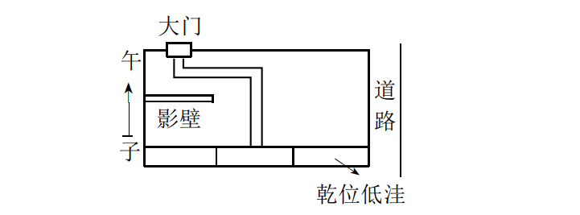
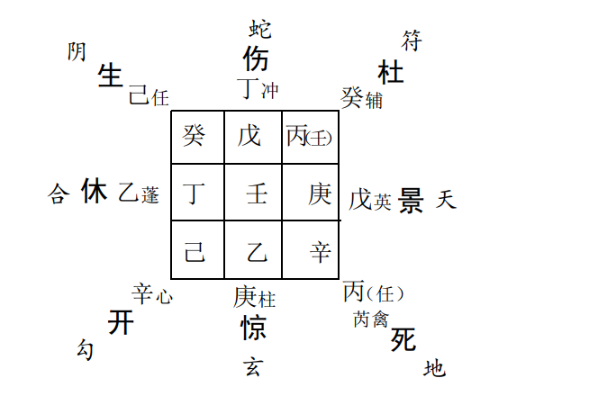
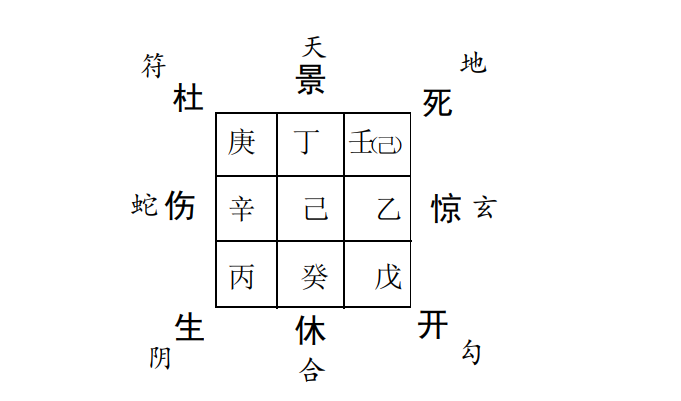
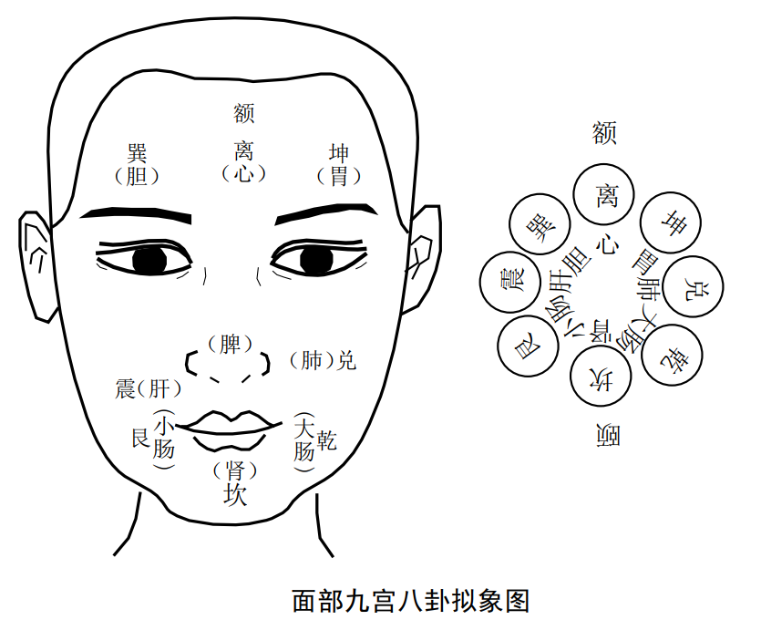
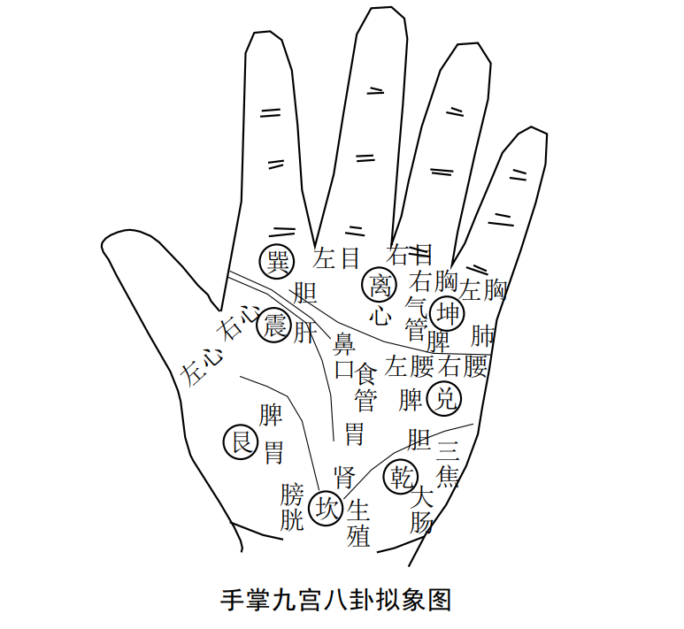
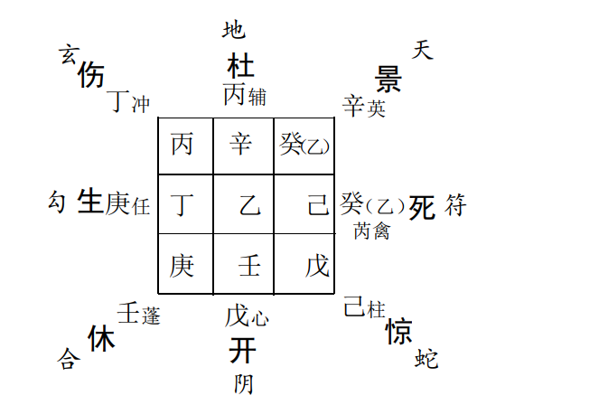
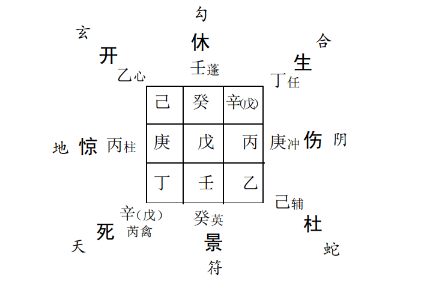
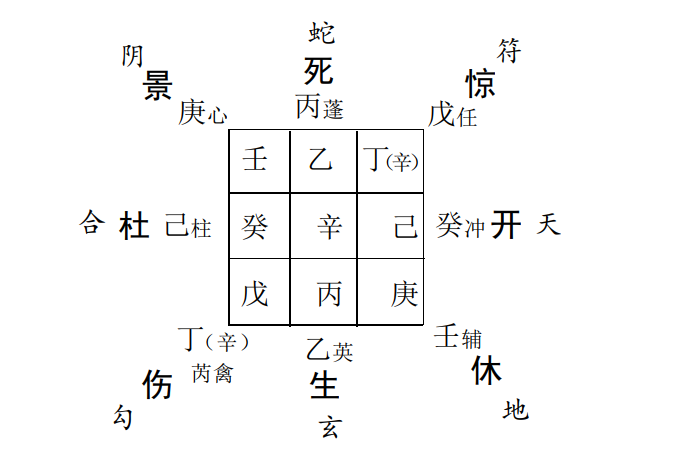
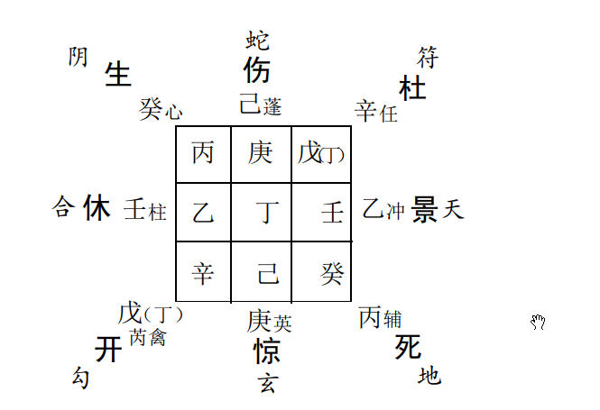

## 奇门九宫拟象预测的要略：   

以九宫八卦拟象人或事物， 如是预测疾病则可拟人体脏腑系统或身形部位， 如是预测家居环境风水则又可拟象家居环境的八个不同方位及其方位风水气场情况等等， 诸如此类， 终不越“ 戴九覆一”之法， 其所注重研究的是九宫八卦的空间分布信息， 其预测推理的主要依据是九星值符善恶， 八门吉凶分布和奇仪格局的变化， 其它因素可作辅助信息参考推理。
这种方法在实际生活中常用于家居环境风水预测， 人体病疾预测， 孕产子嗣预测， 猜物射覆类预测等方面内容，我们主要以家居环境风水预测和疾病预测为例  。

学习本节内容之前， 尚须注意以下两点  ：

一  、最好能够粗通并掌握一些基本地理和医理方面的常识。  

二、 奇门九宫拟象理法预测是以易学九宫八卦形法预测为基础的  

另外， 大家还须同时清楚以下几个问题：

（ 一）九宫八卦拟象预测形法、 理法的区别与联系

所谓九宫八卦拟象形法预测， 实际上就是根据《易经》“ 物物一太极”等原理， 以太极九宫八卦比拟人体和万物构造， 然后通
过对其外在形态和特性的直观观测， 以及长期的经验总结， 来归纳推理事物未来发展变化规律的一种易学思维方法。 如堪舆学
中的九宫八卦断法， 中医学中的手掌面部八卦诊法， 以及相学中的九州八卦观人法， 手相学中的九宫八卦预测法等等， 均可归属
于这个范畴。
所谓奇门九宫八卦拟象理法预测， 则是融入九宫八卦拟象形法预测的基本内容和原理， 同时应用奇门遁甲象数理模型， 以
五行、 八卦、 干支、 奇仪等易学数理为基础， 依照易学基本规律和模型本身的特殊规律， 来进一步模拟预测事物未来发展变化规
律和特点的方法  。

形法预测和理法预测， 虽然内容方法迥异， 一个侧重考察事物外在的、 直观的、 具体的规律研究， 一个强调研究事物内在的、
抽象的、 本质的规律把握， 但是， 它们之间的联系却是必然的， 它们是同一事物、 同一问题不可分割的表里两方面， 它们所要反映
的事物内在本质、 变化规律和最终结论， 以及所运用的易学普遍规律是相通或相同的  。

（ 二）学会形理兼顾， 表里俱察
只重理法， 忽视形法， 那么预测结论容易让人感到虚无飘渺而缺乏实相印证。 相反， 只顾形法， 不通理法， 那么， 我们的认识
就可能会仅限于表象， 难以触及事物变化的根本。 所以， 更科学严谨的预测方法应该是以形法做初步的判断结论， 以理法做进
一步的数理逻辑证明， 因此， 我们应该学会形理兼顾， 表里俱察。  

## 第一节 易学三大基本观点和预测应用  

### 一、 天人合一观  

广义的天人合一观应该说是本节所讲述的三大易学观点的统一。 此处指狭义的天人合一观。 主要包括两个方面的内容。
（ 一）宇宙是一个整体巨系统， 人是这个系统中的一员， 他与自然界的一切事物， 日月星辰， 草木山川， 飞禽走兽等等一起共
同组成了这个系统。 这个系统是生机浑然的整体， 其中任何成员之间都存在着这样或那样的联系， 他们相互影响， 相互制约，
无时无刻不在进行着广泛的物质、 信息和能量的交换。  

（ 二）在宇宙这个巨系统中， 天地万物之间存在着一种“ 神秘”的对应关系， 感应关系， 其中相互对应和彼此感应的事物两
者的信息是沟通的、 同步的或相似的。
天人合一观是易学思想中最基本的一个观点， 也是易学预测的基本原理之一。 大家学习九宫八卦拟象预测风水、 疾病等
内容， 其实有许多问题都是这一观点在不同领域， 处理不同问题的灵活运用和发挥而己。
比如堪舆学家居风水预测专题中， 以窗户阳台象征人的眼  睛和肺部， 厨房比拟人的脾胃系统和整个家庭的财政收支状况，
厕所、 浴室主排泄属水， 比拟人体的代谢系统和肾脏系统等等。假如是家庭成员中有人患肾脏功能疾病， 那么， 我们便常常会在
其家厕所的异常情况中得到表现和预知， 其它脏腑功能疾病， 皆可仿此对应关系堪察推断。  

有老姑家住太原， 在其迁居新家后不久， 家中便接二连三有人闹眼病， 姑夫患白内障， 手术摘除险些失明， 表弟工作时眼睛被碰伤， 表侄女患沙眼病。 经察， 其家窗户正对几座工厂的烟囱， 确系滚滚浓烟影射作崇， 这也就是我们所常说的“ 风水病”。 它是风水预测学中的一大“ 绝窍”， 也是易学天人观在人与外部环境感应、 对应、 合一关系的一种表现形式。  

其它， 再如星象预测学中以日、 月、 星、 辰的变化来考察人事的变异等等， 亦不外乎天人合一观的应用和再现。 比如在我国
著名的长篇讽刺小说《 儒林外史》首回楔子中， 就曾有过这样一段描述。 元朝末年， 出了个嵚崎磊落的人物， 名叫王冕， 此人天
性聪明， 天文、 地理、 经史上的大学问无不贯通， 蔑视富贵功名，隐居民间。 一日傍晚， 和秦老儿在打麦场上小饮。 须臾， 东方月
上， 照耀得如同万顷玻璃一般。 那些眠鸥宿鹭， 阒然无声。 王冕左手持杯， 右手指着天上的星， 向秦老道：“ 你看贯索犯文昌， 一
代文人有厄！ ”话犹未了， 忽然起一阵怪风， 刮的树木都飕飕的响， 水面上的禽鸟格格惊起了许多， 王冕同秦老吓得将衣袖蒙了
脸。 少顷， 风声略定， 睁眼看时， 只见天上纷纷有百十颗小星， 都坠向东南角上去了。 王冕道：“ 天可怜见， 降下这一伙星君去维
持文运……”。 这里说的贯索星位居南天天市垣中， 由九颗星组成， 主法律， 禁强暴， 是管辖下人的处所， 与国家制度法令的宽严  密切相关， 又名贱人之牢。 文昌则位居紫微垣中， 由上将、 次将、贵相、 司命、 司中、 司禄六星组成， 又称天之六府， 常主持文运， 即
代表着国家文化、 教育等天下事务。 所谓贯索犯文昌， 就是说贯索星群侵犯切近了文昌星， 据古代人天感应说寓义清朝八股科举制度、 封建文化专制主义对中国思想界、 文化界长期毒害与摧残的开始    

还有在人体小宇宙这个系统中， 中医学以手诊、 面诊预测疾病的方法， 如以拇指、 脸部中央、 鼻部对应于脾脏系统， 以食指、
左颊对应于肝脏系统， 中指、 额部对应于心脏系统， 无名指， 颏(ke)部对应于肾脏系统， 小指右颊对应于肺脏系统等等， 总之， 人体脏腑内在的病理变化， 均可以在其人体外部的对应器官和部位上得到显示和反映。 这其实也正是易学天人合一观在人体小宇宙系统中的表现和印证。
综上， 天人合一观不仅是易学思维的最基本观点， 也是我们
学习易学预测和掌握本节九宫拟象预测风水和疾病内容的关键.

### 二、 太极八卦泛存观  275

易经》说“ 物物皆有一太极， 其小无内， 其大无外。 ”又说“ 方以类聚， 物以群分， 吉凶生矣， 在天成象， 在地成形， 变化见矣”。 意思是： 太极八卦是宇宙万物最根本性的结构图， 它揭示了事物的内在本质， 并涵概了其运动变化的最基本的变化规律。 这就是太极八卦泛存观的基本思想。  

在易学预测方面， 可以说太极八卦泛存观又是一最基本的预测学原理， 其应用亦是极其广泛。 从大的方面讲， 中国古代天
文学、 历法学、 星象学中将天上的星宿划分成不同的区域， 形成二十八宿九州分野， 以对应地面中州大地之九州八郡； 还有堪舆
学中就某个局部地区或城市环境， 以九宫八卦拟形， 然后进行区域、 环境风水气场的堪测以及相关人事预测。 其它， 小的方面，
如中医学中的九宫八卦诊病， 包括身形八卦诊、 手相八卦诊， 面相八卦诊， 舌象八卦诊， 目象八卦诊， 脉象八卦诊等等， 均是以人
体或其某个局部拟象九宫八卦， 然后根据各局部九宫八卦的变化情况， 预测其所对应脏腑系统或整体病症、 病情的变化， 这些
都可以说是太极八卦泛存观这一思想的具体表现应用。  

### 三、 宇宙全息观  

易学宇宙全息观认为宇宙是一个相互联系的整体巨系统，它包括无数个子系统和分系统， 就其系统内部来讲， 每个成员的
信息变化都是相互沟通的， 他们之间的变化联系， 我们可以用“ 牵一发而动全身”做形象地譬喻说明。 这个观点应用于易学预
测最常见的表现形式就是从系统内部某一局部或某一成员的个体信息， 类比推论其他相关成员或整个系统的某些变化情况。
如中医学的局部诊断， 预测全身的健康状况， 堪舆学中考察  外部环境的个性变化， 推论其系统全局性变化的某种信息等等，
都是这一观点的具体应用和再现。 在风水学著名典籍《 阳宅十书》外形说一节中， 有许多案例和口诀， 就是这一观点被应用发
挥的精彩片断和经验总结。 如：

门前若有两种树， 断定二姓同居住。
大富之家招二妻， 孤翁寡母泪沾衣  

还有风水学中的其他许多口诀如：  

门对垂杨， 披发悬梁；
树木弯抱， 清闲福到；
门前桃杏， 贪花酒性；
独树当门， 寡母孤孙；
门对林中， 灾病多凶；
树下肿根， 聋盲病昏；
树弯驼背， 丁财俱退；
柘树当门， 火灾死人；
屋顶柘树， 必出寡妇；
树头向外， 必遭人害；
树头垂水， 必遭水灾；
两树夹屋， 骨肉受苦；
门前死树， 失财倒路；
门前有槐， 升官发财；
大树压人， 家无后人；  

空心树对门， 痨病断根；
屋在树下， 灾病孤寡；  

其他， 还如奇门综合预测中一局多测， 即从奇门一个局象的信息综合推论其家庭、 事业、 婚姻、 财运等多方面情况的变
化等等， 也都离不开易学宇宙全息观这一基本思想理论基础。  

## 第二节 家居环境风水预测  

### 一、 九宫八卦拟象形法预测  

九宫八卦拟象形法预测风水， 是堪舆学中风水堪测的基本方法， 也是奇门九宫拟象理法预测的基础。 它首先把某一区域
环境或家庭居室看成是一个整体太极系统， 然后， 按照文王后天九宫八卦图， 把这一系统划分成不同的九宫八卦方位， 最后详察
各部位的盈缺状况， 以及家居摆设或不同方位所存在事物的合理与否和善恶等情况， 再结合八卦类象拟人事活动进行综合推
断。 **兹举例说明如下：**  

1.某宅， 居室平面图西北角严重欠缺， 据后天八卦图， 西北为乾位， 乾卦万物类象可代表父亲、 家宅男主、 祖辈福荫、 又为头
首、 精神、 骨、 右足、 大肠等信息。 那么， 这种结构的住宅， 久居三五年后， 经常就会有如下一些情况发生。
（ 一）此宅不利男主， 丈夫或父亲易患病或早亡。
（ 二）本人与父亲或丈夫别居。
（ 三）家中有人因头部疾病或精神骨骼、 足部、 大肠部疾病而困扰受苦。  

2.某宅， 南方有大水池一个。 在后天八卦中， 南方为离属火； 六亲之中代表中女， 在身体为眼睛， 又可为血液循环系统。
今此宅南方设置水池， 离火被水所克， 是故， 此宅居住时间一久，则必会造成家庭成员中有人患眼部疾病或高血压， 脑溢血之类
疾病， 或中女身体欠佳等问题发生。  

据日本风水界人士研究， 日本前首相田中角荣死于脑溢血，就与其宅居南面之水池有很大的关系。 如果当时确能早一些时
候， 请高明的堪舆学家帮助调理一下风水气场， 那么， 或许就可避免悲剧的发生， 至少可以减免灾害的一些程度。 

### 二、 奇门九宫拟象理法预测  

以奇门地盘九宫八卦拟宅居九宫八方， 总的来讲天盘九宫得吉星值符、 三吉门、 三奇生助者为吉， 反此为凶。 值使可断八
宅门路， 值符、 九宫八卦的旺衰可推宅居兴衰和人丁兴旺状况。   

例： 某宅， 子山午向， 大门在巽， 西侧靠马路。 戊寅年辛酉月戊辰日丙辰时堪测。  

形法堪测结果： 院墙西侧紧靠一条大路， 且墙基西北角即乾位地势低洼， 是本宅外形最忌讳之毛病。 宅内形中， 西北角乾位
居室亦杂乱堆积， 气场感觉极差， 与宅外形信息馈示同步。 据此  我们便可以得出如下一些初步的结论， 此宅不利男主， 家中成员
易患头部、 血压高、 右脚部病疾， 但应验时间未敢贸然确定， 待起得奇门局象后， 看死门居乾， 于是， 才断然推论亥年冬月尤其不
利。 果然， 此宅男主那时患脑中风， 幸治疗及时， 未成大患。
奇门九宫拟象理法预测结果： 阴遁九局用事， 甲寅旬， 天辅星值符落坤二宫， 杜门值使亦落坤二宫， 日干戊在兑， 时干丙在乾  

天辅星值符， 为阴， 又为文曲， 故此宅女主当家， 且家中出文人秀士。 因开门落艮， 故推断丑寅年月， 家中必出人才， 果然， 其
子1985年以优异成绩考取全国名牌大学。 又天辅星喜修道， 是推论其家与佛道有缘。 果然， 宅主男女双方均笃信佛教。
死门落乾宫， 说明此宅之西北角气场极差， 且与形法预测结果完全吻合， 可进一步确认形法预测结果的正确无误。
另震宫得奇和吉门生合， 大利长子。 庚乙同宫生合， 可断家庭幸福和睦。 杜门值使可说明巽方门路。  

**例**： 某贸易公司总经理崔x预测宅居风水？  279

乙亥年丙戌月乙未日甲申时， 诹得阴遁六局用事， 甲申旬，天辅星值符， 杜门值使， 八门九星俱伏吟本宫不动。  

天辅星值符应崔某有一定的文化层次，60年代末清华毕业生， 皈依佛道等事宜。 杜门值使应其巽方门宅。
死门居坤伏吟， 于女主不利。 季月土旺水衰， 极易患肾脏系统疾病。 果然， 其妻因此类疾病未能生育。 另， 死门居坤又可说
明其宅之西南角气场不佳， 经察确系楼角冲射， 后依法做了些调整和化解不提。  

开门居乾旺相， 在社会上可有一些地位， 但大象格局伏吟，故难以青云直上。
庚丁、 乙丙相互生合， 可断其婚姻易出问题， 经询问得知确系离异再婚。 乙乘惊门、 玄武又奇应其前妻从事律师之职业， 丁
乘景门、 九天， 亦恰应其现在的爱人在热电厂工作等事宜。  

### 三、 变化的家居环境风水预测  

大家俗语中常说“ 风水轮流转”， 其实， 这就又是说家居环境的风水气场并不是一成不变的， 它常常随时间、 气运、 周围环境 事物的变化而变化。 据专门研究风水变化的理法派玄空风水学认为， 风水变化的节律周期一般是60年一大运、20年一小运，此外， 尚有流年运、 月运、 天运， 也就是每年、 每月、 每天的气场变化情况。 那么， 我们如何正确处理对待这些变化呢？ 大家总不能每天预测， 天天搬迁吧。 对此，有以下几个看法， 希望学者能够借鉴参考。   

1、当自己或家人身体、 事业等各方面情况表现良好时， 即表明家居或周围环境风水气场状况尚可， 那么， 在这种情况下就
无需经常性预测和布置搬迁。 只有当自己或家人的身体或事业等方面出现异常情况时， 那么， 此时就应该必须进行一下风水预
测、 堪察工作， 看是否确系风水作崇， 如若确系风水气场问题， 则必须尽快予以调整。 这一点应该说和邵康节《梅花易数》所强调
的“ 不动不占”是同一个道理。 

2、良好的风水气场一经堪测选定布置完毕之后， 最好是能够维持一段时期， 不要期望即刻见效， 因为风水气场的变化和作
用是缓慢和潜移默化的。 凭经验而论， 家居环境的风水变化周期一般是3—5年， 大型建筑和区域环境的气场变化周期可为
15—20年。 风水气场在经历过一个周期或近一个周期的变化之后， 则必须进行必要的重新堪测以及装修布置.

3、在具体堪测方法上， 笔者倡导形法理法兼顾并重。 就单纯的理法预测而言， 奇门预测和玄空风水预测亦要互相结合， 优
势互补， 因为两种方法单独使用任何一种， 玄空风水学稍嫌呆板、 机械， 而时家奇门预测却又是过于灵活。 所以， 很有必要将
二者溶合在一起， 这样就能够相互查漏补遗， 得出的结果也就会更加全面。  

### 四、 其它有关方面的预测  

只预测家居环境气场的吉凶或房屋修造吉凶等事， 而非详细堪测各部位气场情况者， 我们只需采用静态类预测方法处理即可。 一般而论， 日干为我， 为人， 时干为房为环境， 得奇门旺相者， 吉； 凶门衰死者， 为凶。 开门旺相生助， 则风水气场大利事业前途， 仕宦公务人员得之最吉； 生门旺相生助， 利财运拓张； 得休门者， 悠闲自在， 无忧无虑； 其他， 景门易惹官司、 口舌、 火光灾害； 死门常招死丧凶事， 惊门为惊恐、 忧疑、 鬼患等恶事。 具体案例参见《奇门综合预测案例详解》中的部分内容。  

## 第三节 疾病预测  

### 一、 中医学相关基础知识  

易学预测疾病是建立在中医系统学说基础之上的， 它有别于现代西方人体学和西方医学体系。 为了更好地掌握易学测病
这部分内容， 兹首先介绍如下一些中医学基本常识。  

#### (一）人体系统说

中医学认为人体是一个相互联系的有机整体系统， 有人曾以宇宙巨系统比拟人体， 故又称之为人体小宇宙。 它由脏腑、 经络、 皮毛、肌肉、 筋骨、 精髓、 气血、 津液等系统共同组成， 其中脏腑、 经络是人体系统的核心， 精、 气、 血和津液是人体脏腑、 经络等系统功能活动的物质基础。 此外， 中医学还强调人体的上述组成部分之间， 其结构上浑然一体， 不可分割， 功能上相互协调，相互为用。 就病理而言， 如若一个器官发生了病变， 那么， 就会牵连其他相关器官， 甚至率先在其器官或部位得到显示， 乃至影响到整个周身的健康， 而整个机体的盛衰也同样紧密关系影响着局部器官的病变。 以上这些观点和现代医学， 现代解剖学把人体器官及其功能割裂分置开来， 进而“ 头痛医头， 脚痛医脚”的某些机械做法， 均有一定的差别。  

####  (二）平衡观念

中医学经典《黄帝内经》说： “ 人生有形， 不离阴阳”， “ 阴平阳秘， 精神乃治”， “ 阴阳离诀， 精气乃绝”。 这就是说人体在正常的
情况下， 必须保持平衡， 否则， 一旦这种平衡关系被打破， 那么，人体就要发生病变。 换句话也可以说成是破坏人体相对平衡的  

稳定状态是引起人体疾病的根本原因。 由此， 我们亦不难得出结论， 中医治病从本质上看实际就是调整阴阳， 使人体重新恢复
到“ 阴平阳秘”的阴阳五行平衡状态。 其中， 中医学所着重强调的是脏腑功能的阴阳五行平衡和气血运化功能的协调平衡等几
个方面。  

#### (三）脏象学说概要

中医脏象学说是运用易学取象类比思维方式创立的， 所谓“ 象”指直观可察的形象， 客观事物的外在表现以及其行为和功能表现。 中医理论率先以阴阳之象类比、 类分人体的构造、 功能以及生理、 病理方面的升降变化， 而后又以五行之象类分五脏六腑功能及其相互之间的传变关系， 如此以来便构筑形成了脏象学说的基础框架.

1.五脏： 指心、 肝、 脾、 肺、 肾， 具有藏精气而不泻的特点。另外有心包络位于心之外廓， 包络于心， 有保护心脏的作用， 其病变与心脏相同， 故它附属于心。 以上合称五脏。
2.六腑： 指胆、 胃、 小肠、 大肠、 三焦、 膀胱， 是中空器官， 具有传化浊物， 泻而不藏的特点。
3.脏腑关系： 脏属阴， 属里； 腑属阳， 属表， 其间关系由经络来联系， 脏的经脉络于腑， 腑的经脉络于脏， 彼此经气相通， 相互作用。 二者在生理上既对立又统一， 在病理上相互影响， 相互传变。  

4.脏腑系统简介
**心系统**： 心是人体最重要的器官， 心主神志， 是人体生命活动的主宰， 在脏腑中居首要地位； 神志的含义包括精神状态、 意
识思维等， 即现代医学所谓中枢神经的部分功能。 心又主血脉,主管血液在脉管里的运行， 心开窍于舌， 在体为脉， 其华在面。
在脏腑， 心与小肠相表里， 小肠的主要功能是受盛胃中水谷， 主化物和分清沁浊。 在经络， 手少阴心经和手太阳小肠经相表里。
以上心与小肠、 血、 脉、 舌共同构成心系统。

**肝系统**： 肝主疏泄， 性喜舒畅条达。 肝的疏泄功能正常， 则脾胃健强， 能助脾胃生化气血。 肝藏血， 对人体动静时血量有调
节作用。 肝开窍于目， 在体为筋， 其华在爪（ 指、 趾甲）。 在脏腑，肝与胆相合， 胆的主要功能是贮藏和排泄胆汁， 助脾胃消化。 在经络， 足厥阴肝经和足少阴胆经相表里。   

以上， 肝与胆、 筋、 目、 爪、 甲共同构成肝系统  

**脾系统**： 脾气主升、 喜燥恶湿， 主运化水谷和津液， 即把水谷精微输送于其他脏腑和器官组织， 以供营养之用， 所以有“ 脾胃
为后天之本”的说法。 脾能统摄周身血液使之正常运行而不溢于脉管之外。 脾开窍于口， 主四肢、 肌肉， 其健运情况反应于唇。
在脏腑， 脾与胃相表里， 胃的主要功能是受纳水谷， 并将水谷进行初步消化后传送于小肠。 在经络， 足太阴脾经和足阳明胃经
相表里。
以上脾和胃、 肌肉、 四肢、 口唇等共同构成脾系统。   

**肺系统**： 肺主气， 司呼吸， 为气体交换的重要器官， 肺又主治节， 能辅助心脏进行血液循环， 能通调水道， 使水液下输膀胱。
肺开窍于鼻， 与气管、 喉、 鼻等连成呼吸道， 外合皮毛， 与声音的发生也有密切关系。 在脏腑， 肺与大肠相表里， 大肠的主要功能
是传送水谷经小肠消化后的糟粕。 在经络， 手太阴肺经和阳明大肠经相表里。
以上， 肺与大肠、 鼻、 气管、 皮毛等共同构成肺系统。  

**肾系统**： 肾属水， 是人体水液代谢的最重要器官。 肾主纳气， 是人体元气之根。 肾藏精， 主骨（ 齿为骨之余）生髓（ 脑为髓
之海）， 在上开窍于耳， 在下开窍于二阴， 肾气的情况可反应于头发。 在脏腑， 肾与膀胱相表里， 膀胱的主要功能是贮尿排尿。 在
经络， 足少阴肾经和足太阳膀胱经相表里。以上， 肾合膀胱、 骨、 齿、 髓、 脑、 耳、 前后二阴等共同组成肾系统。  

####   (四）九宫八卦拟象在中医学上的广泛应用

在中医学理论体系及其临床实践应用过程中， 易学思维方式和结构框架可谓无处不在深刻地发挥着作用。 其中， 九宫八
卦拟象的广泛应用， 可以说是医易同源、 易医汇通的又一重要表现形式， 具体说来常可见以下几方面内容。  

##### 1.形体功能拟象九宫八卦

乾为首， 坤为腹， 震为足， 巽为股， 坎为耳， 离为目， 艮为手，兑为口。

##### 2.身形部位拟象九宫八卦

太乙九宫图中， 头部、 首面、 喉头、 胸膺位九， 居于上天宫， 在卦为离； 腰、 臀、 下窍位一， 居于叶蛰宫， 在卦为坎； 左胁位三， 居于仓门宫， 在卦为震； 右胁位七， 居于仓果宫， 在卦为兑； 右手位二， 居于玄委宫， 在卦为坤； 左手位四， 居于阴洛宫， 在卦为巽； 左足位八， 居于天留宫， 在卦为艮； 右足位六， 居于新洛宫， 在卦为乾  

##### 3.脏腑拟象九宫八卦

《灵枢》脏腑与九宫八卦的配属关系为：
心配离卦， 居九宫； 肾配坎卦， 居一宫； 肝配震卦， 居三宫； 肺配兑卦， 居七宫； 脾配坤卦， 居二宫； 小肠配乾卦， 居六宫； 胃配巽卦， 居四宫。
元代王好古《此事难知》对此作了少许改动。 心、 肾、 肝、 肺的配属与《灵枢》相同。 大肠配乾卦， 小肠配艮卦， 胆配巽卦， 胃
配坤卦。  谁的才对？

##### 4.局部器官拟象九宫八卦

中医常将人体局部器官拟象九宫八卦， 从而进一步又创造了许多独具特色的中医八卦诊法。 常见有身形八卦拟象； 面部
九宫八卦拟象； 手相九宫八卦拟象； 舌象九宫八卦拟象； 目形九宫八卦拟象， 脉象八卦拟象等等   

### 二、 中医常见几种九宫八卦拟象形法测病方法  

#### 1.面部八卦诊法

面部九宫八卦的划分方法： 左颊为震， 象肝； 右颊为兑， 象肺； 额为离， 象心； 鼻为中宫， 象脾； 左额角为巽， 象胆； 右额角为
坤， 象胃； 左腮角为艮， 为小肠； 右腮角为乾， 象大肠， 颏部为坎，象肾。
具体观察步骤和方法：  

①观神
神即指人的精神、 意识、 思维运动等的总称， 是人体生命活动能力强弱的外部表现。 因为心主神志， 其华在面， 这就是说人
的精神状态， 在脸部可以得到较为集中的表现， 是故， 我们便可以通过观察人的面部情况变化， 包括色泽、 表情、 目光、 言语、 动  

作、 呼吸等， 即可综合判断人的精神状态之优劣， 从而进一步考察其人精气的盛衰， 身体的康健程度和疾病的综合变化情况及
预后。 当然在观察脸部情况的同时， 还必须参考病人的全身状况， 如动作的灵敏程度， 肌肉的色泽枯削等。 在具体观察过程
中， 如果病人目有光彩， 色泽清晰， 说话清楚， 那么， 这就表明其人身体健康状况良好， 或病情不甚严重， 反之， 其人精神萎靡不
振， 面色苍白， 语言迟钝无力， 眼睛没有光彩， 则表明体质情况较差， 抗病能力不足， 是患病或病情加重的表现。 若是烦躁不安，
甚至神昏谵语， 则必是病邪内传， 扰乱神志、 属危重病症 ， 急需救治。  

②望色：
1.望面部整体色泽
我国一般正常人的肤色是黄而明润的， 面色鲜明、 暗晦等均为病色。 一般而论， 面色明亮红润， 则表示气血旺盛， 色泽鲜明
则多属新病、 表病， 色泽暗晦， 则常为里病、 久病、 重病。
2.察九宫八卦部位颜色等变化， 初步确定病变的分属脏腑和经络。
《素问· 剌热论》说“ 肝病者， 左颊先赤， 心病者， 颜先赤， 脾热病者， 鼻先赤， 肺热病者， 右颊先赤， 肾病者， 颐先赤。
3.几种常见病色
红色
主热症。 红色为火， 为血的颜色， 由于热盛于内， 迫血充盈于面， 故面现红色。 常有虚、 实之别， 面色红赤、 发烧、 口渴汗多、
脉洪、 大便秘结多为实症， 常见于热性病和某些急性传染病； 午后低烧， 两颧发红， 则为阴虚火旺， 属虚热症， 每见于慢性消耗性  

疾病， 如肺结核等。
青色
常主风、 （ 寒）痛、 肝病。 如体内阳衰阴寒独盛， 气血凝滞， 阻格不通时， 常见面部口唇出现青色； 肝病患者， 亦可见青而晦滞
的颜色； 小儿急惊风， 面部多青紫色， 这又是青色主热的一个方面。
黄色
主热、 湿、 虚。 面黄、 目黄、 全身发黄， 多属黄疸； 黄赤明亮为阳黄， 湿热； 晦暗为阴黄， 多为寒湿； 面色淡黄、 枯萎， 多属脾虚、血虚  。

白色
主虚症。 白色为气血不足， 正气虚弱的表现。 急性失血、 气血虚弱者常见面部现白点。 白斑， 则常见于肠道寄生虫患者。
黑色
常主寒、 水、 痛。 每见于寒邪、 凝聚、 肾气虚衰所致， 多为腹中疼痛， 或久病肾虚痰饮、 水肿， 妇女带下症。  

#### 2.手象九宫八卦诊法  

手掌九宫八卦区域的划分方法是： 坎居正北， 位于掌根近腕部大小鱼际的联合处， 配肾水系统； 离居正南， 位中指、 无名指下
方， 配心系统； 震居正东， 位于手掌虎口处， 食指下方至鱼际上方， 配肝胆系统； 兑居正西， 位于掌后侧， 掌横纹（ 感情线）下至小鱼际上方， 主肺系统； 乾居西北， 兑下方， 主大肠， 头脑； 艮居东北， 主小肠， 因其属土， 能化育， 故有时也与脾胃有关； 巽居东南，食指下方， 主肝胆系统； 坤居西南， 小指无名指下方， 手掌中心为中宫， 又称明堂， 俱代表脾胃系统。  

手掌诊法主要是依据其八卦九宫之各部位的强弱程度， 隆起程度， 纹路色泽， 皮肤粗细等情况， 判断推理其所配脏腑功能的强弱。 如是部位隆起、 色泽新鲜， 纹理清晰不散乱， 则为强， 即可表明其归属之脏腑功能良好。 反之， 过于低陷， 筋浮骨露， 色泽暗淡， 纹理散乱不清， 则为弱， 表明其配属之脏腑功能较差， 多患病。 我们以乾宫情况的变化来具体说明如下    

如某人手掌乾宫隆起为强， 因乾宫配大肠、 头脑等， 且与肺系统相关联， 所以， 由此即可判断其人的精神心理状态一般来说
是健康正常的， 大肠和肺系统功能良好， 不易患病； 相反， 如果其人手掌乾宫过于衰弱， 那么， 这就表明其所配相关系统的功能较
差， 是故， 易患神经衰弱、 肺炎、 大肠功能紊乱、 便秘等类病疾。另外， 还须注意因强壮之极太过而易出现的一些疾病， 因为中医
学强调推崇的是协调平衡原则。 所以， 这种情况下又极易引发阳亢阴衰之类的疾患。 如果乾宫过于高耸、 色泽又过于鲜明， 那
么， 很可能易患心脑血管扩张， 精神亢奋类病疾等症。 其它宫位的诊断方法， 请读者结合前面讲述的内容， 依理推论  

#### 3.身形八卦诊法  

**乾卦形体之人**
体质壮实， 个子中等， 偏高， 头颅宽大， 脸宽而圆， 禀性常表现为自尊心强， 有领导气质和组织才能， 刚健、 自强多思。 此种
体质之人阳气较盛， 常易患燥热性疾病， 头部和肺部、 大肠部疾病。 如脑血管疾病、 慢性支气管炎、 肺气肿、 神经衰弱、 消渴、 便
秘等。
**坤卦形体之人**
个子中等偏下， 体态墩实， 面黄头大。 禀性常表现为温顺厚道， 宽容恭谦， 不善言表， 反应较慢。 此种体质之人阴气较盛， 常 易患寒湿症， 脾胃系统疾病， 如腹痛、 泄泻、 痰饮、 积聚、 水肿和消化功能减弱等疾病。
**艮卦形体之人**
个子中等矮壮， 面宽鼻大， 口大背宽， 腿壮实。 禀性常表现为沉静多疑， 犹疑不决， 内刚外软。 此种体质之人常易患脾胃
病、 下肢疾病、 手指疾病（ 如风湿、 关节炎等）痰饮、 积聚、 腹痛等疾病。
**震卦形体之人**
个子偏高， 面青体瘦， 禀性常表现为急躁好动， 思维活跃， 善于交际， 处事果断。 常易患肝经或足部病疾， 如肝风内动、 中风、
肝郁、 癔病、 神经宫能症、 气积寒冷伤胃、 四肢倦怠等病疾   

**坎卦形体之人**
中等体形， 体瘦而黑， 目深耳大、 性格深沉内向， 长于心计，阴冷诡秘。 易患心肾疾病、 血病、 耳病、 水肿等类病疾， 如腰痛、
厥证、 五更泻、 胃冷水泻、 气血不通、 经络不通、 宫寒不孕、 精神抑郁等病。
**兑卦形体之人**
体形优美且较瘦， 口快善言， 阴匿暗昧， 喜静， 脾气稍嫌乘戾。 易患肺肾疾病， 水湿、 口舌咽喉类疾患， 如气逆喘咳、 浮肿、
咽喉舌齿痛， 饮食不下等病。
**离卦形体之人**
体型较尖， 面赤目亮， 喜动， 有礼， 性格外向， 热情激动， 浮夸自大， 具有发明家的某些气质。 常易患心血管类疾病和眼睛小
肠的病变， 如冠心病、 动脉硬化、 目赤肿痛、 青光眼、 白内障、 中风、 脑溢血， 以及精神分裂、 失眠阴虚火旺、 小便短黄等病。  

**巽卦形体之人**(自己补上)

**巽卦形体之人（对应五行中的“木”或“风”）通常呈现出高挑、修长、体态轻盈、行动敏捷的特点**。巽为风、为木，其形体特征和性格特质就像风和树木一样，具有向上、舒展和多变的灵动感。容易患如急慢性肝炎、胆囊炎、胆石症、胆道感染，容易出现精神紧张、焦虑、头晕、头痛、失眠或神经衰弱。

#### 4.其他一些八卦诊法

中医八卦诊法除上述几种方法外， 一般还有目形八卦诊、 舌象八卦诊、 脉象八卦诊、 腹象八卦诊、 足相八卦诊等不同方法， 请
学者参阅有关中医诊断学内容学习， 在此不做进一步介绍。  

### 三、 奇门九宫八卦拟象理法预测疾病  

### 1.预测所患病症

预测所患病症般以天芮星为病神， 为用。 如是预测内五行之病疾， 则以九宫八卦拟象脏腑系统及其功能； 如是预测身体外
五行之病疾， 则以九宫八卦拟配人体之身形部位； 如是预测形体功能性疾病， 则以九宫八卦分别配应乾首、 坤腹类推论。 看天芮
星落入何宫， 即为何种病症。 可参照以下内容具体推论。天芮星落离宫， 在病为火， 在外为头、 目， 在内为心、 血等系统。
天芮星落坤宫， 在内为腹、 脾胃系统蛊胀类病疾， 在外为肌肤、 右手、 右肩、 右耳、 病为疮毒类病疾。
天芮星落兑宫， 兑为口、 咽喉， 在内为肺脏系统， 故常病患咳嗽、 喘急、 暗哑、 肺炎， 支气管炎类疾病； 在外为口齿、 右胁、 在病
常为痞积类病疾。  

天芮星落乾宫， 乾为首、 头， 在内配大肠、 络肺， 故在病常为肺病、 壅结、 便秘、 脑溢血、 脑梗塞、 神经精神类病疾； 在外应腿足
筋骨疼痛、 疮疡类病症。
天芮星落坎宫， 坎为耳， 为肾水系统， 故病症常应寒疾、 遗精、 泄泻淋漓、 腹腰痛肾虚、 疝气类疾病。
天芮星落震宫， 震为足， 在内为肝脏系统， 在身形为左胁(xié)， 故病患常为肝脏系统之病疾， 如中风不语、 偏瘫、 肝癌、 血虚、 外则应眼目、 左胁痛疾。天芮星落巽宫， 巽为股、 为胆， 在外为左耳、 左肩， 故病患常为胆囊炎、 胆结石， 伤感风热、 手足风麻等类病疾。
天芮星落艮宫， 艮为手， 左足， 在内配小肠、 脾胃， 故常病患小肠、 脾胃虚胀， 痞积、 手足风湿、 脚气等症    

**例：** 石家庄市合作银行张石林预测其父亲的一些情况， 以求验证奇门遁甲的准确程度。  

丁丑年壬寅月戊寅日己未时， 阳遁六局用事， 甲寅旬， 天芮星值符落兑七宫， 死门值使亦落兑宫， 日干戊在坎， 时干己在乾。  

时干己为事， 乘惊门， 冲克年干丁奇， 其父亲之用神， 应其父94年亥月去世之事。
丁奇乘伤门， 天冲星， 格局亦甚佳， 故推断其父生前或为文职军官， 级别可为正团， 果应。
预测病疾何症以天芮星落宫推断。 今天芮星落兑七宫， 故推论应与肺脏系统病疾有关。 应其父曾患严重肺病， 并终死于
鼻癌之事。 应鼻癌者， 肺开窍于鼻故也。其他， 震三宫庚加丁上， 乘勾陈， 又奇应其父左胁有枪击被伤之事。   

### 2.预测局部病变情况

如占眼病， 则以离宫象目， 得吉门、 吉格、 吉星， 愈速； 凶则愈迟； 吉凶参半， 缠绵悱恻。
**例**： 邻居张成测子病？ 其子被自行车车轮挂伤左脚， 感染而致连续几日高烧不退 .

丙子年乙未月癸亥日壬戌时， 阴遁五局用事， 甲寅旬， 天英星值符、 景门值使， 日干癸均落坎一宫， 时干壬在离九宫。  

测脚病， 可以艮宫象脚取用， 恰天芮星亦落艮八宫， 可见以此为用的确无误。 时值未月， 丑寅八宫无气， 可论病神无力， 虽
乘死门亦不为凶。 再者， 格局大象反吟， 近病逢冲即愈， 故最后的结论是四日之后， 自当痊愈无事， 果应验 .

### 3.预测疾病的综合治愈情况  

可结合奇门静态预测和九宫拟象测病两种方法综合使用。可以日干或病人年命为我， 为病者， 仍以天芮星为病神， 一般来
说， 病者得吉门、 吉星、 吉格， 可断病患易治， 生门落宫可断愈期，远应年月， 近应时日， 还可以天芮星废没休囚之期推论病情之轻
重缓急。 反之， 病者如遇凶门凶格， 则病患难治， 可以死门落宫及病神旺相之时推算病重日期或死亡日期。 此外， 我们尚可以
以奇门格局等信息推断病情的变化情况， 如近病逢冲即愈， 久病逢冲则死； 新病空亡入墓者生， 久病空亡入墓者凶等。  

**例：** 天津商学院马x测父亲病情？
丁丑年戊申月己丑日辛未时， 甲子旬， 天任星值符落坤二宫， 生门值使落坎一宫， 阴遁八局用事， 日干己落震三宫、 时干辛
在艮八宫。  

年干丁奇乘天芮星， 应其父亲患病之象， 落艮八宫， 可推断为肠胃系统之肿胀、 痞积类病患， 果然确系直肠癌晚期  .

年干丁奇入墓， 寿期恐怕不会太久。 确定死亡日期可以病神天芮星生旺之时， 亦或用神丁奇入墓逢冲之际。 是故， 当时推
论其父去逝时间最大可能是寅年未申月， 本年丑月亦不可忽视。后终于闯过丑年冬月， 去逝于寅年申月。  

### 4.预测医者医术如何  

预测医者医术如何或此医院、 医生能否治疗此病， 常以天心星或乙奇为用。 天心星常可代表医、 巫、 僧、 道类人物信息， 其较
突出的特点是注重技艺。 乙奇常为贵人， 帮助我克服排除困难者， 稍重行动或效果。 两者在具体选用中， 请学者结合实际情况
确定。
心、 乙落宫乘奇门吉格者， 是为良医； 落旺相之宫， 不逢奇门吉格者， 为时医， 即我们现代社会的一般职业医生， 只能按图索
骥诊治头痛脑热类小病。 不得旺相气和奇门吉格者， 是为庸医。
日干或病者年命或用神得心星、 乙奇之生者， 则大多医者与我诊治， 且有一定的疗效； 克我者， 则不愿与我治疗， 或治疗过程
中责任心较差， 医德不好或即治疗效亦不明显。
推论医者能否治愈疾病还须参看其与天芮星病神的生克关系， 不论良医、 庸医， 能克制天芮落宫者， 那么， 医治有功， 否则，
虽是良医， 亦不能治。
**例**： 邻居顾延理之老母年事， 患病卧床已有一段时日，近几天来病情突然加重， 不能进食。 于是， 想预测一下其母亲的病情， 以及当地医生的治疗情况。 另外， 顾从石家庄某医院买了一些特效药品， 也准备送回去， 看看有没有一些疗效？  

戊寅年庚申月丙申日戊戌时， 阴遁二局用事， 甲午旬， 天任星值符落坤二宫， 生门值使落巽四宫， 日干丙在乾， 时干戊在艮 八宫。  

   

日干丙乘死门， 又恰 为病人之年干， 落乾宫墓地， 生门落巽四宫， 空亡， 由此看来其母病情确系危险， 须防戌亥日月。 但从
顾x进门落坐后的表情和面相看， 近几天来没有死丧之气色， 故告知戌亥月当是其母病关。
预测当地医生的诊治情况。  

因其母家在山东， 故以巽四宫之天心星为用。 虽克艮八宫天芮星之落宫， 奈何落宫空亡， 又休囚无力， 是以说明当地医生
已无能为力， 不愿费心治疗。 实际情况果然是医生已对其母不再进行疾病治疗， 目前只是在家输液， 以维持生命而已。
顾x从石家庄购买的药品可以乙奇为用， 因乙奇上乘景门九天， 可象外地之贵人、 药品等。 今落兑七宫， 虽旺相， 怎奈不能
克制天芮星之落宫， 说明此药物虽贵重且对同类病症确有较特殊的疗效， 但是， 对其母之病情来说却是有无皆可。
最后应验情况是， 顾x去山东看望其母， 并陪住了几天， 带去的药品也没怎么吃， 后来病情又自动好转， 一直维持到戌月去 逝  。 

### 5.八神、 值使论病  

八神在疾病预测过程中， 常可表示病因或病症的某些特点。
如病神或用神乘值符， 则病多属阳症； 腾蛇则多是惊恐夜梦、 遗精； 太阴是肺痨、 骨虚、 相思成疾； 六合是风麻， 情欲过度； 白虎是伤亡道路， 翻胃呕吐； 朱雀是颠邪； 九地是阴症、 内症； 九天是落魄、 失魂等。
值使门常可用来说明疾病的某些性质。 休门为泻痢、 伤寒；生门痈毒、 伤目； 伤门拘挛、 风寒； 杜门壅塞、 喉齿、 胃风； 景门伤
食、 疽疔； 死门肿块、 癌症； 惊门痨瘵； 开门肺痛、 喉舌疾。  

## 第四节 九宫八卦拟象射覆和预测孕产  

 

  

