# 第十一章 奇门综合预测案例详解

## **【 案例一】**

 某日， 应香港国际糖尿病研究院院长， 石家庄市糖尿病医院院长王x的邀请， 来其研究院做客， 交谈中随机以时间起得奇门格局， 对其企业发展状况、 家庭情况以及身体健康状况、 祖居风水概况等进行了综合预测。

己卯年丁卯月丁巳日丙午时， 阳遁七局用事， 甲辰旬， 天芮星值符伏吟坤二宫， 死门值使落巽四宫， 日干丁与值使同宫， 时干丙在坤。 

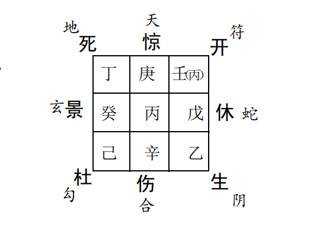   

事业流年运势情况：1988年至1989年为事业草创时期， 艰苦卓绝， 乃日干丁奇乘死门落巽四宫故也；1990年南方外地建
业，6月中下旬左右遇到一件麻烦事， 其年王院长果在广州做药品销售工作， 是因庚乘九天寄离九宫故也；1992年其公司手续  

正式被国家有关部门审批认可， 是乃开门落坤主用也； 其后几年企业逐年上台阶， 效益猛增， 尤其是1997年1998年两年， 企业
突破千万元效益大观， 社会效益也大大加强， 成为国内外治疗糖尿病声誉颇佳的知名企业， 是又为年干己作贵相助也。  

企业内部关系状况： 日、 月同宫， 说明企业中、 上层关系团结一致， 与值符宫相合， 表示其与主管部门如卫生局等的关系处理
得也比较和谐， 而且企业内部必曾安排了一些这些主管部门介绍的朋友或家属， 因时干丙与开门值符同宫也。 据调查， 实情确
在。 其它， 企业流动资金周转和效益情况可谓呈良性发展势态，因为甲子戊乘休门， 生门临乙奇故也。
身体状况： 木火系统较旺， 即说明心肝系统会出现一些问题。 王院长中医学院毕业， 精通医理， 当即表示叹服。 

家庭婚姻状况： 不甚和睦， 因乙庚落宫相冲克故也， 尤其是1998、1999两年， 婚姻状况危机。 其妻尚属心灵手巧， 性格贤
淑， 只嫌冷静稍过， 似乎缺乏一定的热情， 是皆为乙奇临天心星之故也。
祖居风水概况： 甚佳， 乾坤高耸， 人材辈出， 尤其医道方面，必有名医高道等层出于家族之中。 据王院长后来介绍， 其家祖
原是本地赫赫有名的地主， 祖坟亦是曾请民国高人堪舆过的， 世居龙头之位 .

## 【 案例二】  

1998年夏日， 客居武当山国际道教文化研究会， 湖北省物资集团某总裁慕名来访， 品茶论道之余， 乘兴拟局预测， 以易显道弘法。  

戊寅年己未月戊午日戊午时， 阴遁二局用事， 甲寅旬， 天心星值符落坤二宫， 开门值使与值符同宫， 日、 时干戊在巽。  

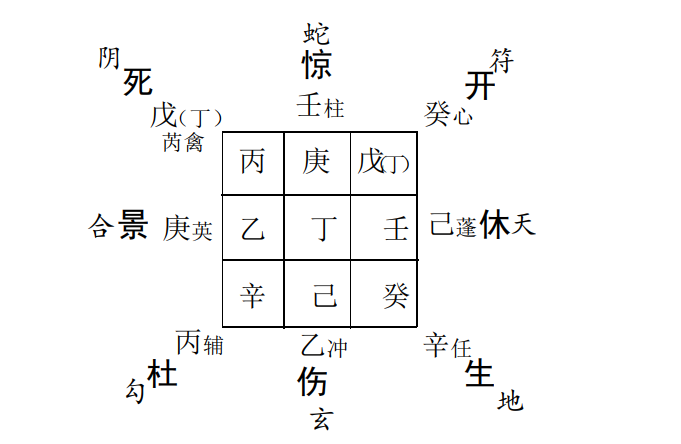

企业集团状况： 集团实力雄厚， 势力庞大， 但是若论经济效益而言， 近几年终不是很好。 因局象显示， 年、 日、 时三戊干同
宫， 地盘居坤二宫旺相之地， 天盘客居巽四宫乘死门， 实为有势无运之象。 另外， 天盘生门落乾六宫， 格局为“ 天牢华盖”日月失
明， 误入天网， 动辄乖张， 又冲克日干落宫， 因戊在预测企业效益时， 为资本、 流动资金， 而生门则为效益， 今生门克资本， 故可有以上之推理。  

公司1992年秋季更准确地说应在8月7日立秋以后， 正式被国家批准成立， 主营金属类物资， 如钢材、 汽车等。 这些情况从开门、 天心星落坤二宫的信息中可得到显示说明。  

本集团1996年度冬月曾完成较好的经济效益， 数目当应1、6金水之数， 即1千万元或600万元。 总裁先生即刻命在场之财务部部长回忆验证， 部长点头默许。 其他许多信息亦皆应验无爽。
婚姻家庭状况： 当众未做推论， 进餐时挨座一起详细交谈。乙奇落坎一宫空亡之地， 且入地盘奇仪己干之墓， 乘伤门天冲
星， 表明其前妻原配因车祸等事不死即离。 总论夫妻关系尚且恩爱， 甚憾非白发之缘。 现随行之女可断为后妻， 戊（ 丁）同宫故
也， 天禽星温顺秀美正可为其人之象也。
最后， 又谈论了一些企业未来的发展状况以及企业内部涉及商业秘密的某些问题在此不做细述。  

## 【 案例三】 

天津慧聪公司总经理许洪涛先生， 系多年故交，偶逢津门， 谈及奇门易道， 表示非常怀疑其科学性， 并指责我这是大搞迷信活动， 为了推翻他的论调， 显示一下这门古老准科学的魅力， 当众起局演示。  

丁丑年戊申月戊子日癸亥时， 阴遁五局用事， 甲寅旬， 天英星值符、 景门值使俱伏吟在离九宫， 时干癸亦与之同宫， 日干戊
在坤。  

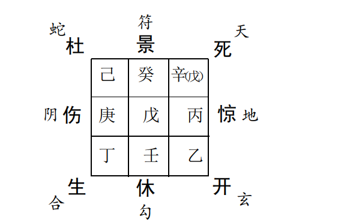

第一， 大象伏吟格局， 平稳之象， 说明最近一个时期各方面情况均没有什么较大的变化。 对此， 许洪涛只是默不做声， 做怀
疑性许可状。  

第二，8月7日至今天， 你公司在西南方向必有刑伤、 罚款等经济损失， 数目为2、5之数。 此言一出， 许洪涛蓦地从床上坐
起， 惊异万分， 连忙说道“ 工商局就是这几天罚了我2.5万元， 此事还没有几个人知道， 如此看来， 这奇门遁甲还真是有点邪。 ”以
上信息皆因日干戊乘死门居旺地故也。  

第三，6天以前， 你和爱人吵架了。 这件事还没等许洪涛回忆反映过来， 旁边另外老友孙佳新即刻起来指证。 “6天之前，
你过生日， 在你家喝酒， 咱们一共九个人， 可不正巧你与老婆子吵了一架”。 至此， 在场各位及许洪涛本人都已是心服口服。 此
项推理由时干癸乘景门落离九宫而得。 景门可为饮宴， 又代表吵闹、 争论等信息， 癸可看作酒水之应。  

## 【 案例四】 

一次大师在河北省五金交电公司办事， 总经理杨x也对奇门预测的准确性、 实证性有所怀疑， 当即出了道难题。 “ 我最近有两件较为重要的事情能否测出来？”  

丙子年壬辰月庚辰日辛巳时， 阳遁五局用事， 甲戌旬， 天心星值符落艮八宫， 开门值使与时干辛落巽四宫， 日干庚在坎。

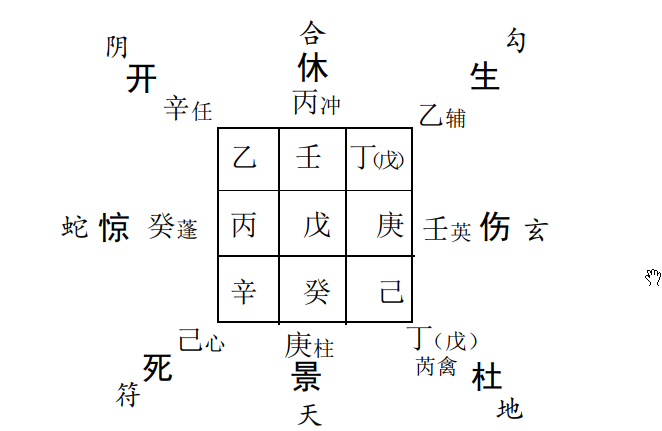  

杨总落坐坤宫问事， 乘生门再结合企业的一些具体情况， 可大至定格在生意和房产两个方面的内容。
第一件事可以日干庚为用， 落坎一宫， 乘景门、 九天， 可断事应北方， 当有关文书、 合约类事宜。 实际情况正是去年11月底与北京首钢签约1、6之数， 实应1566万元的钢材期货贸易合同， 实担心有关政策方面的影响。 因见格局庚加癸上， 呈凶格，故告诫注意合同中的某些条款， 要及时更改为好。 后依言果然避开了一些政策方面的影响， 为公司挽回了部分经济损失。

第二件事， 以时干辛之落宫为断。 应东南方向兴建办公楼、宿舍楼一事。 月干壬落兑七宫乘玄武相克， 表示同僚中有人不 怀好意。 再者， 丁（ 戊）落乾六宫冲克巽宫， 亦说明资金方面有一些问题， 但是， 巽四宫时正旺地， 上述几方面影响不成气候， 不足畏惧， 可按自己原计划行事。
以上两件事最后基本应验， 后来杨总经常谈及此事， 以宣传说明奇门遁甲的科学与神奇  

## 【 案例五】 

石家庄银舍食品有限公司总经理葛立恒先生说‘， 其企业目前面临一些困境， 全国电展集团有借机兼并之意’ ， 请预测一下能否被电展兼并， 假如被其兼并， 那么， 银舍公司的前途将会如何？     

戊寅年戊午月己丑日癸酉时， 阳遁九局用事， 甲子旬， 天英星值符落坤二宫， 景门值使伏吟九宫不动， 日干己在艮， 时干癸在兑。  

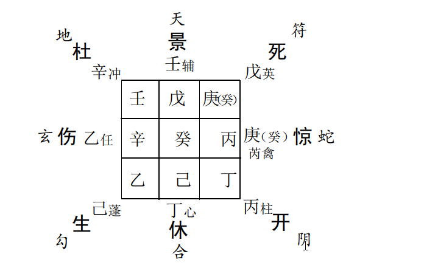

甲子戊乘死门； 地盘戊在离， 上乘景门， 时处旺季冲克开门，可说明此企业目前不仅是资金方面存有较严重的周转不灵问题， 而且还有较麻烦的贷款纠纷官司。 实际情况的确如此， 后来又听葛总介绍， 几家银行的贷款均已到期， 其中有家银行已上诉法院。
预测合资并股等事可以六合为用神， 今六合、 休门、 丁奇共居坎宫， 午月火盛水衰可谓用神衰死无气。 另外， 丁奇又代表文书、 合约等信息， 在此可表示双方的意向与合约。 今丁奇入坎，火入水乡， 格局“ 火入勾陈”断语是“ 奸仇冤事因女人”， 亦非佳象。再者， 值符与年、 月干之落座坤二宫， 亦克用神六合之落宫，可进一步说明此企业之上层主管部门或领导也不愿轻易被人兼并。
最后， 再看时干癸之落宫， 可看作是对方电展的信息表象，
乘惊门、 腾蛇落兑七宫， 不但衰弱无力， 亦被景门旺宫所克， 格局癸加丙， “ 华盖悖格”， 断语是“ 贵贱逢之皆不利”， 所以说亦终为
画饼充饥， 求谋不就之象。
另外， 我们还可以据大象伏吟， 开门落宫空亡的信息进一步确信上述推理的正确。  

综上， 于是得出最终结论并告知葛总， 不必担心眼前的困难， 此项兼并不会成功， 应该坚定信心， 努力工作， 冬月一到情况
均会有所好转。 后来情况基本与预测结果相符， 时至今日， 银舍公司的生意已是日渐红火。  

## 【 案例六】 

某私立公司专做股票债券等炒作、 投机生意， 其营业部主任李x一日从上海打来电话， 说几家公司已募集了大量资金， 准备操纵运作某项资金， 想预测一下其结果如何？  

戊寅年辛酉月己卯日壬申时， 甲子旬， 天柱星值符落震三宫， 惊门值使落艮八宫， 日干己在巽， 时干壬在兑。 阴遁七局用事。  

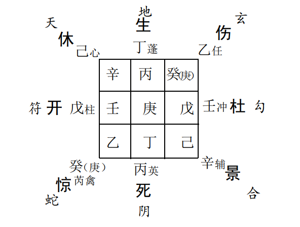

预测生意以甲子戊代表资金， 今地盘戊居兑七宫旺相之地，可说明资金量相当庞大， 且该应2、7之数， 天盘戊至震三宫， 正
应大量 资金东移或与日干己相合而作东南方向移动之象。 日干己在巽四宫， 阴遁一、 八、 三、 四宫为远， 乘九天、 休门， 可以说
明其时人已在东南方向之上海。
预测效益利润以生门为用。 现生门落离九宫， 下临丁奇、 格局“ 星随月转”， 甚佳， 可应此类股票、 证券、 文书类生意确是暴利可图。 怎奈眼下时运不佳， 尤其是年前这几个月， 根本不会有什么效益可言。 在一般情况下， 如是正常生意， 那么， 本该实言相告， 可是这类事情还是大道自然为好， 因为“ 祸福无门， 惟人自招”。
其他， 见乾宫乘景门且空亡， 可推此中可能透一玄机， 而且冲克日干己之落宫， 说明必然危及朋友本身利益或安全。 于是，只此问题直言劝谕， 须防戌亥月口舌是非类恶事。 可叹老李勿以为然， 还报怨大事不给测， 尽拿小事搪塞， 终至此事不幸言中。亥月老李又从上海打来电话， 说到现在为止生意不但没有做成，还因去发廊按摩被公安机罚款万元， 而且触怒得罪了一批地痞流氓， 急需解救办法， 无奈又预测并告知其几条避难方法和有利时空方位， 后终于避过风波。    

## 【 案例七】

 湖北省某市委领导张x预测能否通过本届人大选举？  

戊寅年癸亥月癸亥日丙辰时， 阴遁九局用事， 甲寅旬， 天辅星值符和杜门值使以及日干癸均落坤二宫， 时干丙在乾。  

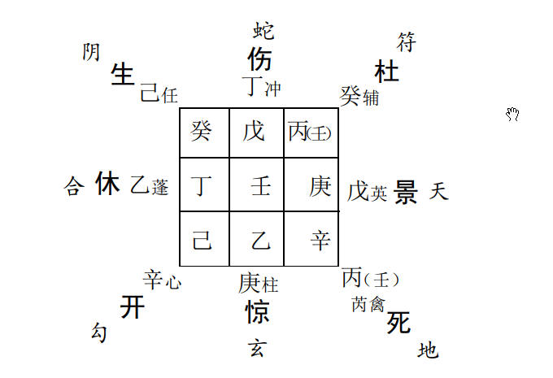

本局象之中有利于选举通过的几条信息是：
①日干癸乘值符且与年干相合。 值符常可表示官职、 领导等信息， 年干可为更高一层的支持者， 此条信息可说明其人有一些背景人物支持， 不会被罢官削职， 结果最差也可以搞个平级调动。
②丁奇可为选票信息， 落离九宫， 生合日干落宫， 虽衰弱， 但格局却很是不错， 这一点可说明选票上不会出现什么不很理想的事情。
③开门落艮八宫， 虽入墓但受落宫之生， 亦可说明官运尚有。
以上均为有利的几条信息， 此外尚存在几处不利的问题， 很  值得研究揣摸。
①日干癸入坤宫之墓， 乘杜门。
②时干丙乘死门且时干亦入乾宫墓地。
③开门落宫空亡。
为了解开上述疑窦并做出正确的判断、 结论， 于是便又信手占得《咸》之《革》卦， 参看了《焦氏易林》的占断结论， “ 朝鲜之地，箕子所保， 宜家宜人， 业处子孙”。 先了解一下这段典故， 是说箕子是殷商贵族、 王室宗亲， 和比干、 微子同是纣王的三位名臣， 后来由于纣王无道， 比干被杀， 微子被废， 而只有箕子起初虽亦被降为奴役， 但最终还是逃回了自己的领地朝鲜， 偏居一隅， 才算保存了性命， 延续了后代。 其大概意思可以说与张x为党外干部， 并受有关领导和政策内部保护的情况相符合一致， 于是大胆得出结论“ 选举肯定能够通过”。
没过多久， 南方果然传来佳讯， 张!顺利通过人大选举， 再次当选为市领导。    

事后上述几个疑点几经揣摸， 终于参悟了其中玄机。 日干乘杜门入坤宫之墓或在告诫韬光隐晦， 隐忍待机； 时干乘死门，为其意在察问有甚不利之恶事否， 或不能通过选举而被罢官的担心与厄运； 开门落宫空亡， 出空填实之际为应也。  

## 【 案例八】

 赵x被人举荐做某实业公司助手， 请预测一下这项工作能不能干？  

丁丑年癸卯月戊申日壬戌时， 阳遁四局用事， 甲寅旬， 天英星值符景门值使俱落艮八宫， 日干戊落坎一宫， 时干壬在兑。  

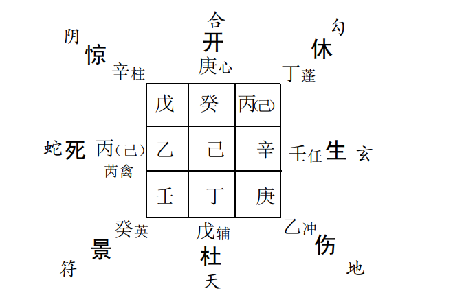

日干戊落宫空亡， 可说明此事赵某确实拿不定主意， 心中没有底数， 或亦可以说明此事终究将会落空。 乘杜门克开门落座
之离九宫， 可说明赵从心里讲对此工作亦不大感兴趣， 格局戊加丁“ 青龙耀明”可说明其目前各方面情况均系不错， 尚没有必要
去寄人篱下。
月干、 值符落宫亦空亡， 因月干为同事、 同僚， 值符为主事者， 故此项信息可表明此实业公司确处招兵买马之时， 尚没有几
人正式组织开展工作， 赵亦确定此情属实。所忌者， 值符、 月干落宫克日干落宫， 可说明其即便是出任就职， 但在具体的工作之中也很不容易处理好与领导和同僚之间的关系， 或终将不欢而散。 格局癸加壬“ 复加腾蛇”可象其内部关系很是复杂， 很难和睦共处， 团结一致。  

赵后来又说其公司许愿薪金很高， 但是， 我看生门落宫衰死无气， 乘玄武， 格局“腾蛇相缠”， 判语是“ 纵得奇门， 亦不能安， 若
有谋望， 被人欺瞒”。 所以， 当即告诉赵不必信以为实， 其中恐怕有假。
最后， 赵采纳了大师的建议， 终未前去就职。 半年过去了， 一次赵和大师又谈及此事， 说“ 幸亏听取了你的意见， 这个公司开业
至今一直经营不景气， 他所熟悉的另外一个朋友前去其财物部门工作， 已有三个月不发工资了， 如此看来其前途还真是不太光明。

## 【 案例九】 

邻居康x预测到战友那儿去工作如何？  

丙子年丙申月庚辰日乙酉时， 阴遁二局用事， 甲申旬， 天英星值符乘庚干、 日干落震三宫， 景门值使落艮八宫， 时干乙在坎。  

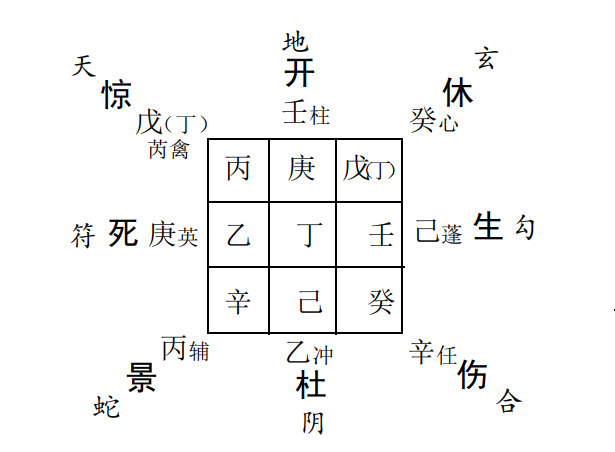

日干庚乘死门加临震三宫， 震为雷为动为车， 正应康x要去战友那儿开车之象， 乘死门可说明此事不一定能成， 再看格局庚
加乙为“ 太白逢星”， 判语是“ 谋为不利， 退吉进凶”， 结果也不算太好。
时干乙可为事， 乘杜门落坎一宫生合日干庚之落宫， 亦是告诫说明此事应该慎重考虑， 积极主动不得利益， 侍机而动反为上
策。
那么， 此份工作不能去的主要原因是什么呢？ 我觉得乙加己上， 己乘生门落兑七宫， 成“ 地网高涨”凶格， 冲克日干落宫， 问
题最后还是应该出在钱财工资等方面， 比如工资不高或拖欠不能按时发放等。 况且， 战友之间又没不开面子说什么不是， 所
以， 这事儿还是不太好干。  

最后， 察看用神开门落宫， 天盘落离九宫空亡之地， 受地盘 九宫所克， 格局亦不算佳， 可进一步说明此事不会成功， 无需再
费什么脑子了。
结果康x没有去， 几个月以后， 天赐良缘终被一家银行录用。  

## 【 案例十】 

某报社记者预测工作调动能成功否？  

丙子年乙未月甲戌日甲戌时， 阴遁四局用事， 甲戌旬， 天冲星值符， 伤门值使俱伏吟本宫不动， 戊干在巽。  

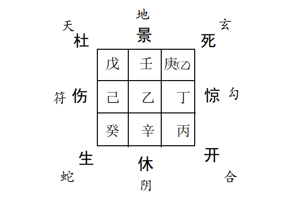

日干戊乘天辅星， 八神乘九天， 因天辅星常主文化、 艺术等方面， 九天常表示流动性较强， 可谓正应其报社记者忙碌跑动，社交活动频繁的工作性质和身份。 时间为事， 甲戌时常以己干而论， 今己乘伤门， 可知必为变动、 更改等方面事宜， 后见其落座乾宫， 乘开门便推知其意在询问工作调动方面的事情， 试问之，果然应验。
此外， 以开门之落宫尚可推论其工作意向之方位， 应在西北或北之方位。 以日干落巽四宫， 阴遁为内为近， 用神开门落乾六
宫阴遁为外为远， 可知其向往之工作必在异地。
最后， 再注意开门用神下临之奇仪为丙奇， 为年干， 因年干主贵， 主高层， 主上一级部门或领导， 故可断其意在想去北京总部工作。至此， 记者同志已是神情愕然。
预测其工作调动能否成功，主要考虑分析了以下几方面因素。 格局大象伏吟说明目前之事， 为时过早， 近期不会出现什么变化； 丙奇入墓， 又象征领导对此事没有真正放在心上，亦或是搪塞、 无能为力之象； 日干乘杜门说明阻力重重， 宜隐忍待机； 丁奇落宫空亡表明电话、 消息、 许愿等类事终不得实现。
最后综合上述信息， 可推论此事不会成功。 

## 【 案例十一】 

某大学外事办主任苏东先生问其学校二十余名学生， 现正在美国驻华大使馆办理出国留学签证手续， 请预测一下能签几个， 其弟也在其列， 看能否签成？     

丁丑年戊申月己丑日己巳时， 阴遁八局用事， 甲子旬， 天任星值符落兑七宫， 生门值使落震三宫， 日时干己在巽。  

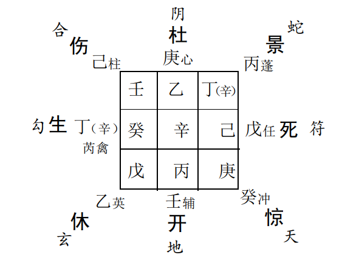

预测办理出国留学等手续合同类事， 以丁奇为用， 参看开门。 今局象中丁奇落震三宫， 时值秋月， 衰死休囚， 格局丁加癸“ 朱雀江”， 尤不利办理文书、 印信类事， 故此推断结果不会十分理想， 可应震三宫3、8木数， 以3数之可能性为最大。 果然，不一会， 北京便打来电话告知外事办“ 只有三人通过”。预测其弟能否通过， 当时随机以其年命为用， 甲寅年生人，年命天干甲乘死门， 格局甲加己“ 贵人入狱”， 判语是“ 公私皆不利”， 因此可知其弟亦肯定在未被录用通过之列。 但所幸身居旺宫， 且有月干， 值符生助， 故可推本次不行， 但如继续努力， 可有希望。  

果然， 申、 酉月又连续办理了三次手续， 第三次终于大功告成， 顺利通过。  

## 【 案例十二】 

陈x预测去日本留学事？  

戊寅年庚申月辛丑日戊戌时， 阴遁五局用事， 甲午旬， 天芮星值符落坤二宫， 死门值使落兑七宫， 日干辛时干戊均在坤宫伏
吟不动  。

陈x来时落坐坎位， 乘开门， 显然是想预测工作事业前途类事， 问之正是要预测去日本留学打工一事。 壬加壬格局可说明
其目前的一些工作状况， 实不太理想， 因此， 便考虑换换环境到国外去闯一闯。
那么， 陈x的愿望能否实现呢？ 

从局象反映的综合信息分析， 大象九星伏吟， 为没有变化， 谋事不成之象； 开门乘玄武， 又临天蓬星， 可说明对方学校或单位可能具有欺骗性或虚而不实，或非正式单位和机构； 甲子戊时干居坤宫旺地克开门落宫， 可表明留学费用很是可观， 不下5万元人民币， 果真是到了要陈x出此巨资之时， 恐怕她就得好好合计一下了。 所以， 最后从以上总的情况看， 陈x之计划纯属空谈。  

## 【 案例十三】

 某医疗器械厂女厂长助理测事？  

丙子年乙未月壬申日乙巳时， 阴遁一局用事， 甲辰旬， 天心星值符， 开门值使， 日干壬三者俱落坤二宫， 时干乙在巽。  

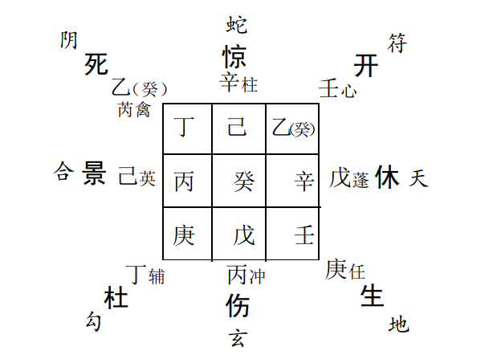

女助理首先要求预测一下其自身财运状况。 预测财运一般是以甲子戊和生门的落宫情况为用参看。今甲子戊落兑七宫， 生门落乾六宫， 时值未月， 虽属进气之地而非废没之宫， 但是奇仪格局“ 青龙折足”、 “ 小格”均不算十分之妙， 而且亦无三奇生助。 故此， 可推断其财运状况， 虽不错， 但也只能是工资较高而已， 其他额外收入恐怕不会太多。
本年度辰、 巳、 午三月， 因局象中巽四、 离九之死门、 惊门主事， 且冲克戊和生门落宫， 可代表是非、 不顺等恶事且因此而小损财利。 询问之， 果有此类事情发生。其所问的第二件事是其单位与某外商之合作事宜， 以六合为用， 天盘六合落震三宫衰死、 空亡之地， 乃真空实空之象， 乘景门为计划意向类事， 因之推断此事的最终结果恐怕是只听打雷不见下雨， 只有计划而没有行动。  

最后， 女助理再请预测一下其家庭婚姻情况。 因局象中乙、庚落宫反冲互克， 丁生庚而丙生乙， 是断其婚姻多属离异家庭，时间概应于戌亥年月， 果应于94年度。 此实为庚乘凶格遇流年旺气生助乾宫金气为虐， 冲克乙奇落座之宫。

## 【 案例十四】 

董x， 女， 某报社驻河北记者站副站长， 请预测一下她何时能够建立幸福家庭。  

乙亥年丙戌月壬午日己酉时， 阴遁五局用事， 甲辰旬， 天蓬星值符落巽四宫， 休门值使落坤二宫， 日干壬与值符同宫， 时干
己在兑七宫。  

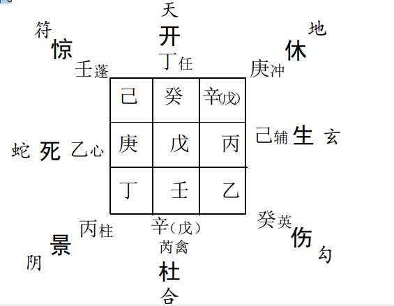

震三宫乙加庚上， 在预测婚姻时乙为女， 庚为男， 局象中落空亡之地， 可说明其女至今确是尚未成婚。 但其女预测时落坐
艮八宫， 天盘乘丙奇， 丙为第三者男人， 或非正式夫妻关系之男友， 可表明董女士肯定有意中之人， 且往来关系密切。 但是， 不
幸的是人虽落座其宫， 毕竟空亡之地， 某种关系可以保持， 合法婚约勿寄希望。
最后， 根据局象之中乙、 庚落宫的具体情况， 可推知其正式婚期应现于卯年或未申年。  

## 【 案例十五】 

罗x， 原市食品公司下属某贸易公司经理， 后因经营不善， 其公司倒闭破产， 在其过去的经营过程中， 与地区食品公司发生经济纠纷， 后以被告身份被起诉至鹿泉市人民法院。 接到法院传票后， 找我为其预测一下官司诉讼情况。  

乙亥年丙戌月己亥日乙亥时， 以其落座方位随机起一奇门局象， 得阴遁三局主用。 甲戌旬， 天芮星值符落巽四宫， 死门值
使落坎一宫， 日干己与值符同居巽宫， 时干乙在艮。  

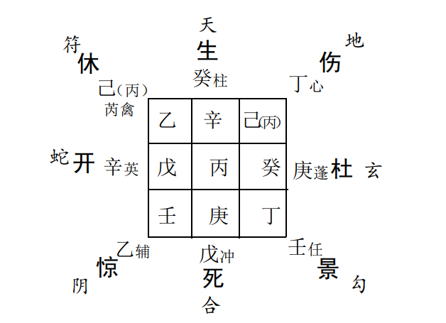

预测诉讼般以值符为原告， 乙奇为被告， 开门为问官， 惊门为讼神、 律师， 景门为整个诉讼事件。
在此局象之中， 值符即原告地区食品公司， 乙奇为被告罗x。 今值符乘休门加临地盘乙奇之上， 天盘乙奇落宫上乘惊门，常为官司， 口舌类信息， 这一点可明显说明原告要对被告罗x兴师问罪。 天盘值符克乙奇之落座艮八宫， 可谓其意不善。

但是， 进一步细审局象中所反映出的各种信息的关系，奇怪地发现景门落宫克值符原告落宫， 而与乙奇被告之落宫艮八宫却是相互生合， 这表明最后诉讼结果倾向于乙奇被告， 而于原告值符方却是不太有利。 这到底是怎么回事呢？ 难道说是法院在有意偏袒被告，亦还是原告纯属诬告？ 无奈只好根据局象信息如实告知罗x， 这事儿好象与你并没有多少关系， 当时罗!亦没有再说什么。 几个月过去了， 官司了结， 罗x如实反馈了信息， 亦终于解悟了其中之迷。
罗x在原告之起诉书中虽是被告身份， 但是， 其时其公司已经破产， 根据有关法律规定个人不能承担有关法律责任， 须追究其上级主管单位的责任。 而且， 罗!在宣告其公司破产之时， 亦得到了其主管上级市食品公司的审计通过。 因此， 法院根据这种情况， 在法庭之上根本不予承认罗x个人的被告资格。 最后，原告也就不得不放弃原被告对象而重新确认被告对象为市食品公司。

那么， 罗x的上级主管单位市食品公司以何为用神呢？ 这是一个很值得研究的问题， 花费了一番心思， 后来终以为以月干丙奇为用或许更加合适。 因为月干在人为兄弟、朋友、 同僚， 在企业而言， 就本例之实际情况来说， 罗!的贸易公司与其主管单位市食品公司， 在行政上虽有上下级之分， 可是在法律上却是两个平等独立的法人， 故而， 两者应该是同事、 比和关系； 再者， 丙奇与值符原告同宫， 可象地区食品公司与市食品公司原本一个单位， 后一分为二， 但又统归商业系统管辖， 受景门讼事所克， 可以说也正与最后的实际情况相符合一致。      

## 【 案例十六】 

珠海某房地产公司女老板严x， 预测与其配偶离婚后的财产纠纷诉讼案？  

丁丑年癸卯月辛酉日丁酉时， 阳遁四局用事， 甲午旬， 天柱星值符， 惊门值使俱落坎一宫， 乙奇落离九宫， 日干辛在坎， 时干
丁在震。  

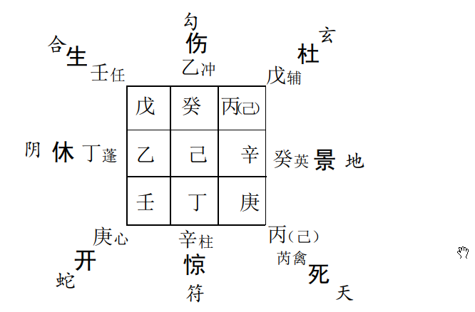

严x， 曾是珠海房地产界小有名气的人物， 其前夫是某空军执行大队的飞行员， 在一次飞行任务中， 遇难身亡。 其现在的丈夫原是其公司内部的一名职员， 因贪图爱恋她的财产， 便巧设圈套， 假意逢迎， 待骗得了严!的感情并与之真正结合后不久， 便原形毕露， 并断然提出了与严x离婚的要求， 企图平分其所有家业。
局象中值符和日干辛可视为原告严x， 乘惊门为诉讼类事；
加临地盘丁奇之上， 丁奇亦可代表文书诉状类信息； 格局辛加丁为“ 狱神得奇”， 亦有官讼方面的信息提示。
乙奇为被告， 即其现在名义上的丈夫， 乘伤门， 勾陈（ 白虎），可说明其人也在忙于加紧行动， 多方找寻借口搪塞应付此事。
格局乙加癸“ 华盖逢星”， 判语提示“ 隐匿藏形， 躲灾避难为吉”将其千方百计设法逃避法律裁决之心暴露无遗。
丁奇可看作是原告严x的诉状， 落震三宫， 旺地， 乘人遁吉格， 可推诉状写得很是不错， 可形容为淋漓尽致， 但所乘天蓬星，亦足见其中必有一些夸大和虚张声势即不实之词类也。原告值符、 日干辛乘惊门， 可说明其所聘律师确真心实意为其代理诉讼。 但不幸的是开门落艮八宫克原告之落座坎一宫，与乙奇被告落宫相互生合， 这一点足可说明法院有收受被告礼品、 财物、 人情乃至偏护被告之嫌。 严x当即确认此情属实。 庚加壬凶格， 判语“ 远走迷失道路， 男女音信嗟呀”可象法院对此案审理不十分积极的态度和较低的办案效率。
景门可表象整个诉讼事件， 落兑七宫生合原告值符日干落宫， 说明就此案的全面情况来看， 表面上应该说还是有利的， 至少是名誉上的一些影响。    

最终预测家业财产“ 鹿死谁手”， 尚须以生门和甲子戊落宫与双方的生克关系为断。
局象中原告生生门落宫， 但生门落宫空亡， 甲子戊落坤宫亦克原告落宫； 而对于落座离九宫之被告来说， 生门和甲子戊落宫皆与之相互生合， 此项信息可表明其夫对此应该说蓄谋已久， 并且早已掌握了一定的主动权和控制权， 看来家庭财产分割恐怕势在必行， 严x最后所能得到的恐亦仅限于名誉上的利益。
应验情况是， 本案拖延了很长一段时间， 并最终闹到省高院， 判决情况基本与预测结果一致。  

## 【 案例十七】 

一天， 大师来到石家庄四通公司， 总经理崔兆喜对大师说： “ 他的汽车被交警扣了， 刚好遇上电视台采访交警路风，司机小白不分青红皂白对着摄像机就给警察提了不少的意见”。因此， 老崔害怕电视台曝光后， 交警侍机报复。 请预测一下有没有什么不良后果  

丁丑年丁未月己卯日壬申时， 阴遁二局用事， 甲子旬， 天芮星值符落兑七宫， 死门值使落震三宫， 日干己在艮， 时干壬在乾。  

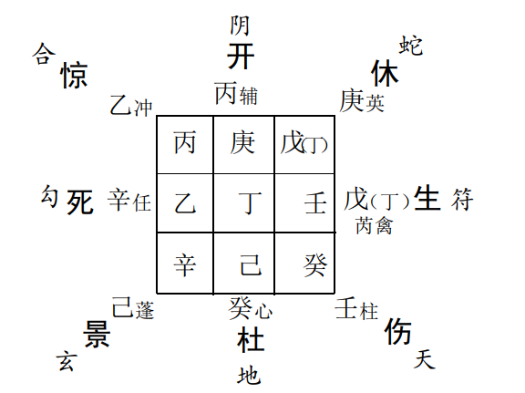

日干己可代表崔总， 乘景门玄武， 说明他对电视台采访曝光一事怀有一些非份不实之想， 所虑似乎太多， 根本没有这个必要。 再者， 日干己入艮宫墓地， 有灾害是非亦能避过。其他， 值符年月干丁奇落宫可象电视台， 勾陈（ 白虎）死门落宫可象交警， 因勾陈常主公安刑警、 道路等信息。 今电视台落兑七宫旺相之地克震三宫交警信息落宫， 故可以断言， 交警不会因此而滋生是非再施报复。 几年过去了， 当初的结论果然应验。  

## 【 案例十八】 

中医师胡x， 这天来大师家给家父治病， 诊治结束后， 准备回家， 一出门发现单车被盗， 随以时间起局预测。  

丁丑年癸卯月癸丑日癸亥时， 阳遁一局用事， 甲寅旬， 天心星值符， 开门值使， 日、 时干均伏吟乾六宫， 伏吟格局  

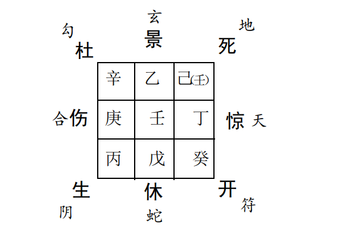

局象伏吟可说明两个方面的问题， 一是自行车没有被转移到多远的地方， 很有可能就被盗贼藏匿于附近； 二是盗贼多半是
小区内部人员所为。
再看具体信息， 伤门为单车， 玄武可代表盗贼， 日干落宫为我方、 为胡x， 勾陈或克玄武之坎一宫为公安人员。
今伤门落宫生玄武落宫， 且奇仪乙、 庚相合， 是为盗贼得手之象； 勾陈落宫亦生玄武落宫， 克玄武落宫之坎一宫落空亡之地， 这表明公安机关对此类小事根本不感兴趣， 报了案也没人管。
最后看胡x的态度， 日干落宫克伤门落宫， 亦正应胡x所说的话“ 一辆破车， 不值20块钱， 丢了再买辆新的， 我还正发愁没地方处理它呢”。 果然， 没几天胡!就又骑上了一辆新车。  

## 【 案例十九】 

邻居赵x借骑朋友刚刚买回不久的新车， 放置楼下， 吃中饭时， 转眼的功夫， 发现被盗， 随机起局预测。  

丁丑年癸卯月戊申日辛酉时， 以外应起得阳遁一局为用。甲寅旬， 天心星值符， 开门值使俱落巽四宫， 日干戊在离， 时干辛
在乾。  

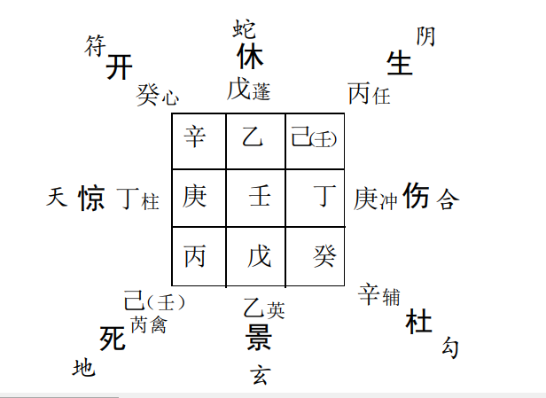

日干戊为赵x， 落离九宫， 被玄武落宫所克， 显是被盗贼所害之象也。 伤门为车落兑七宫， 生玄武落座之坎一宫， 天盘奇仪
亦是乙庚相合， 可象征盗贼得手。 勾陈为公安落乾六宫， 生玄武盗贼落宫， 说明派出所无人过问， 漫不经心于此事。 甲寅旬中子
丑空亡， 艮、 坎二宫落空亡之地， 玄武空亡， 盗贼难获， 克玄武者空亡， 没人管理制止盗贼的活动。 结果应验如所测。  

## 【 案例二十】 

一日， 我儿子在楼前玩耍， 不小心把钥匙弄丢了， 急忙以得知此信儿的时间率先以大六壬占得一课（ 己丑日癸酉时）见类神酉居辰地， 不空不破， 三传生合日干为失而复得之象， 于是心下稍宽。 待得第二日早起， 又用奇门遁甲预测其具体失落何方？(挺诡异的，为什么当时不用奇门预测，而是用大六壬？为什么要第二天才用奇门？)  

丁丑年壬子月庚寅日庚辰时， 阴遁一局用事， 甲戌旬， 天英星值符落艮八宫， 景门值使落震三宫， 日时庚干在兑。  

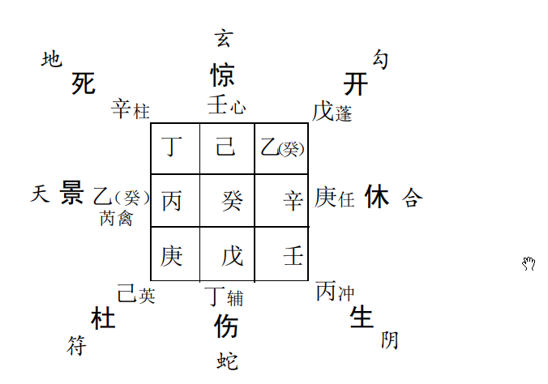

日、 时干庚加辛干之上， 辛下乘天柱星属金， 正为钥匙之象。遂以之为用。 察辛干天柱星落巽四宫， 八神乘九地， 显示说明在
楼角东南方向之杂草丛中可以寻得。 所乘之死门可说明钥匙本身是死物或尚未被人移动和捡拾。
于是， 急忙领着儿子径直来到其昨日玩耍过的巽地， 果然未出所料， 很快便在杂草丛中找到了。  

【 案例二十一】

 预测儿子在何方玩耍？ 有一天， 我儿子大清早就出去玩了， 直到中午还不见人影儿， 妻子焦急万分， 催着
我赶紧算算， 人跑到哪儿去了？ 别让坏人拐走了！ 于是便以发问时间起局预测。

丁丑年甲辰月甲申日辛未时， 阳遁一局用事， 甲子旬， 天蓬星值符落巽四宫， 休门值使落艮八宫， 日干甲在巽， 时干辛在兑。    

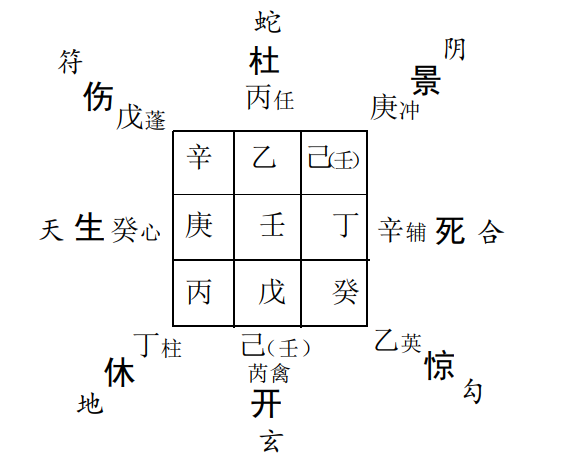

日干甲（ 戊）落巽四宫旺相之地， 儿子庚午年出生， 年命庚干落坤二宫， 亦庚金本身冠带临官旺地。 再者说玄武落坎一宫， 可代表坏人犯罪分子， 勾陈落乾六宫， 可表示勾索、 绑架、 道路、 刑伤等恶事。 今二者一生合日干落宫， 一落空亡之地， 可说明人在外平安无事， 不必担心。
日、月干、 值符同宫， 可说明儿子非一个人出去的， 必有同行者， 应该是3或4人。 乘伤门， 主从事捕捉、 渔猎、 车船、 玩耍等游
戏和活动。 时干辛可表示其所在的方位， 今落兑七宫， 说明大的方位应该是西方。 此外， 以儿子之年命日干落宫亦可推论他们也是在西南或西方玩耍。 后又起得《蒙》之《讼》卦， 知戌时可回。果然八点多钟， 儿子兴冲冲地回家了， 说是三个人到西南方
向（ 实际上所走的路径是先去西方， 后拐道西南方）其中一小孩舅舅家（ 郊区农村）捉泥鳅去了。    

## 【 案例二十二】

 与襄樊市某公安局长刘x等一行五人前往南漳县城， 与当地领导洽谈一个有关发展道教事业的项目， 途中即兴预测此行顺利与否， 及当地政府的接待等方面情况  .

戊寅年癸亥月丁亥日戊申时， 阴遁五局用事， 甲辰旬， 天蓬星值符落坤二宫， 休门值使落乾六宫， 日干丁在兑， 时干戊在震。  

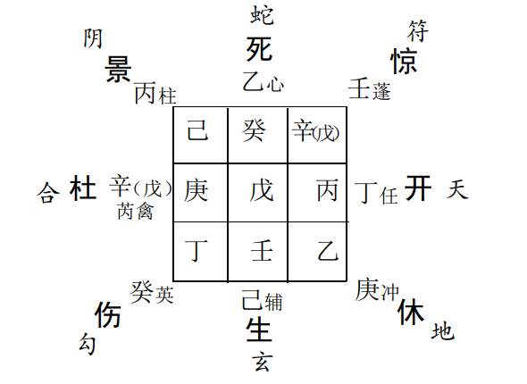

因为南漳县位居襄樊市西南方向， 故当时仅以坤宫的信息馈示， 做出了以下几个方面的预测分析。坤宫地盘综合信息代表当地政府和领导， 天盘综合信息则代表客方、 我方一行人等。
首先分析一下八门信息。 天盘惊门加临地盘死门之上， 惊门可表示说明我方是去进行项目宣传、 介绍等有关活动。 地盘死门为主， 为对方， 八卦万物类象信息常可代表西南方向、 农村、土地、 宗教等方面的一些情况和特征， 巧应我们此行亦正是与当地领导协商由当地政府出地皮， 我方出资金搞一个道教文化研究项目一事。 从地盘死门生助天盘惊门的信息看， 当地政府领导对我们的活动还是比较支持和配合的。
其次， 我们再从地盘奇仪、 九星、 八神的综合信息推论当地陪同我们的各位领导的一些具体情况。地盘坤宫所乘八神是六合， 可首先确定陪同我们的人肯定不只一个， 具体数目可应坤宫和五行土数。 五宫奇仪是戊， 因戊居年干， 故可象长者、 贵人、 领导。 实际情况果然是坐陪者有三位主要领导， 另外， 还有刘x之表舅， 原当地政府领导和一名办公室主任。    

此外， 从戊干下临之天禽星可推知其中最重要人物的性格特征应该是体态敦厚、 文质彬彬、 眉清目秀。 见面后果如其然。
另， 坤二宫奇仪辛干所乘之天芮星可为一般工作人员， 果有两名女同志坐陪， 面貌一般， 应天芮星之象  

## 【 案例二十三】 

井陉贸易公司总经理毕x， 一日约我同去某集团公司， 找其总裁冯x拆借点资金， 以完成上级领导交办的引资30万的任务。 顺便让冯x安排一下中午吃饭问题。 临行前急起局预测， 冯!在不在单位， 此行办事顺利与否？  

丙子年丁酉月癸酉日丁巳时， 阴遁一局用事， 甲寅旬， 天禽星值符落巽四宫， 死门值使落艮八宫， 日干癸在巽， 时干丁在艮。
（ 注： 本局之中八门排列实有误， 但是笔者认为误局比正确局象所反映的信息似乎还要更加接近实际情况， 所以这里亦就仍按
原误局进行分析推理。 或许这也是所谓“ 阴阳不测之谓神”的一种什么天意吧。 实践中亦提请大家注意研究一下这种“ 歪打正
着”现象。 ）  

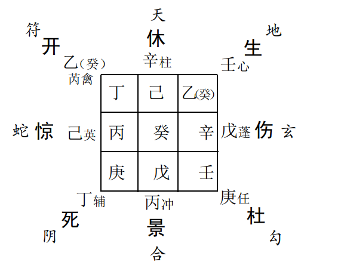

甲子戊乘天蓬星、 玄武、 伤门， 伤门代表活动、 业务工作等，天蓬星和玄武均带有一定的虚假性、 欺骗性， 可谓正应毕x拆借
钱假融资应付领导之事。 落兑七宫， 可应$、%之数， 实际数额指
标其实是$20余万。 今甲子戊落宫克日干落宫， 说明此事不易办 成。

日干乘开门落巽四宫， 亦应出行之事以及所往之方位、 方向， 遂以此宫信息为主分析预测如下（ 当时我在石市北郊， 毕x在井陉， 位石市之西）。 癸加丁干之上， 丁为月干， 可代表朋友、业务单位、 关系户等， 可象冯x。 格局 腾蛇夭矫， 和天盘客星天禽星受地盘主星天辅星所克的信息， 可反映说明此行不顺， 访人不易寻见。 因见天盘丁奇落艮八宫墓地空亡， 可概知其人应去了东北方向。 于是， 我又连忙给公司办公室打电话询问情况， 得到的消息果真是“ 冯x出差去南韩了。 ”
预测酒食类事般以景门为用， 今局象之中， 景门落坎一宫空亡之地， 应原计划中午冯x安排吃饭一事落空。 但见景门下临丙奇， 格局丙加戊飞鸟跌穴， 百事谋为洞彻， 可断中饭肯定有人安排。 又察丙奇地盘居震三宫， 必应东方草木姓氏之人。 果然，居东方之某广告公司经理曹x， 听说老毕来石了， 急忙邀请去他那里坐客， 并且中午进行了热情款待。  

## 【 案例二十四】

 前例在和襄樊刘x等人一行前往南漳县的途中， 在预测完“ 此行顺利与否”等情况后， 刘x忽然说到“ 以上预测都是对事情未来的预测， 准确与否还得等一会儿才能验证，我们现在能否验证一下过去的一些事情？”我说“ 可以， 权当游戏， 估且试试。 ”于是， 刘x请预测一下其中午吃饭时的一些情况， 有以下三个具体问题1.几人一起吃地饭； 2.有没有女同志坐陪？ 如有， 那么， 该是几位； 3.总共要了多少道饭菜。 随据外应起得己酉时辰局象进行预测  

戊寅年癸亥月丁亥日己酉时， 阴遁五局用事， 甲辰旬， 天蓬星值符落巽四宫， 休门值使落坤二宫， 日干丁在离， 时干己在兑。  

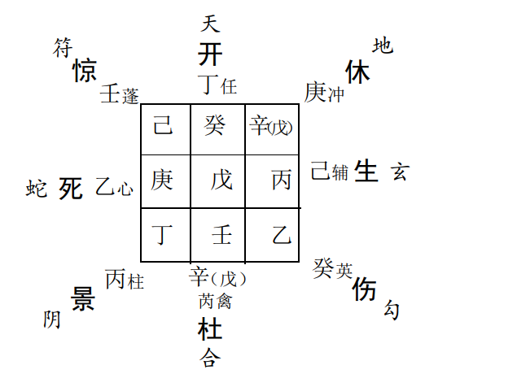

第一个问题的答案应该是： 吃饭者总计七人。 因为月干癸落乾宫主"数， 加上刘x自己， 故可断7数。 另据外应信息和九
星数除去心、 柱二空亡之星亦可断言7人。
第二个问题的答案是： 有两名女同志在坐。 因九星之中， 辅星、 英星属阴， 可代表女性， 故有此断。  

第三个问题因刘x当时亦不能记清当时到底上了多少道菜， 故无法验证。
最后， 我又继续补充了两点， 当场就得到了验证。 一是中午你们这顿饭是由两个人出钱请的客。 因为戊代表钱财， 上乘八神六合， 故知钱数该算合出， 而非只一份。 另外， 以值符代表主者， 为原计划出钱者， 但是， 丁干却落地盘景门之上， 景门为饭食之类， 说明出钱者必丁干而非值符壬干。 二是出钱者丁干必非襄樊市区内人员， 因有事求于那位领导， 故此， 代为出钱请客。是为丁乘九天合值符落宫壬干， 值符落宫生助丁干落宫故也 。

## 【案例二十五】 

某公司经理康x， 电话告诉我说准备去成都参加一年一度的全国糖酒食品展销会， 车票已买好， 请预测一下此行能否结交一些较有经济实力的企业， 有无生意可做以及出行途中顺利与否？  

首先， 以拆字法测其大略， 信手从身旁书中拈得一“ 退”字。“退”者可拆为“ 艮”上，“ 走”旁下两部分， 其中上“ 艮”为客， 下
“ 走”为主， 主者为人之先入之见， 或已有之计划、 愿望等， 客者则常为来自外部环境的影响和变化。 此字之中，“ 走”旁可谓奇应
康x的出行计划， 但是， 客旁“ 艮”者， 八卦意义常表示止、 停等含义。 所以， 由此字观象其事， 实为欲走不能之象。 在经过上述分
析并知其大概之后， 又根据时间起得奇门局象， 做了以下一些具体内容分析  

己卯年丙寅月乙丑日庚辰时， 阳遁一局用事， 甲戌旬， 天芮星值符落震三宫， 死门值使落艮八宫， 日干乙亦在艮八宫， 时干
庚在乾 . 

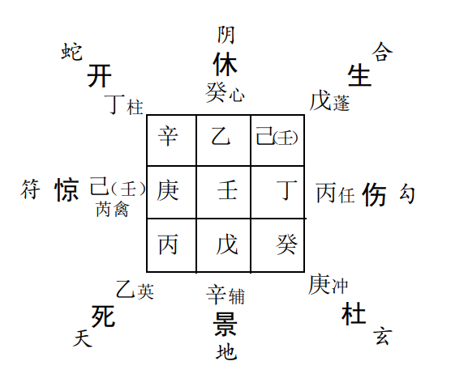

日干乙乘九天、 死门落艮八宫， 九天说明外出、 远行信息， 死门则示意此事结果不甚吉利， 或不能按原计划行事。 时干庚为事， 落乾宫乘杜门， 加临地盘开门之上， 格局庚加癸上逞凶， 亦有预示说明远行之事障碍重重之意。
再看西南坤宫所往之方， 天盘乘戊、 生门、 六合， 正与康x出差成都做生意一事契合， 但不幸的是， 时值初春， 坤宫衰死休囚，且居空亡之地， 象征说明一方面此行不会有什么大的生意可谈，另一方面也蕴含有“ 西南方向不能够到达或前往”的意思。
其他， 预测出行、 外出之事， 亦可以开门为用， 丁奇象车票。今开门、 丁奇落巽四宫克日干乙奇之落宫， 亦有票克人， 行克人，退票和不得行动之象。
最后， 还有一条比较重要的信息， 那就是值符落宫与日干落宫的关系。 因为值符象主者为康x之主管领导， 康x之行动必须经由他的批准和通过， 方可得以实现。 可是， 今此局象之中，值符、 年干己俱落震三宫旺相之地， 不但克日干所落之艮八宫，而且亦克日干所往之方坤宫， 这就说明康x的直接上司对其此 项活动极不感兴趣， 很有可能不予批准。
以上信息馈示， 如实告知康x。 果然， 第二天便得到康x的反馈信息， 其领导对此事的意见和态度是“ 糖酒会年年参加， 却年年不见成效， 今年就免了， 赶紧去火车站退票。 ”   

## 【 案例二十六】 

某火锅城老板张x， 说办公厅梁x经常在其酒店免费吃喝， 而且动辄便开口借钱。 昨天， 就又想借1.6万， 说是要去趟北京， 他没给。 要求预测一下此人的人格品性到底怎样， 是否值得一交， 以后能否给予他一些什么回报和帮助？
丁丑年乙巳月甲寅日乙亥时， 阳遁一局用事， 甲戌旬， 天芮星值符落离九宫， 死门值使落震三宫， 日干甲在乾， 时干乙在巽。  

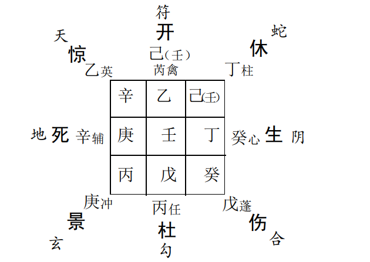

月干乙为用， 代表朋友、 兄弟等， 可象梁x， 天盘居巽四宫旺地， 说明其人确有一些社会地位和活动能力， 下乘天英星， 性喜吹嘘、热闹、 夸夸其谈， 为人不实。 格局乙加辛上， 判语提示“ 青龙逃走， 奴仆拐带， 六畜皆伤”， 可形容其在张x处骗吃骗喝等所做所为， 及最后“ 溜之乎也”等结果。 冲克日干戊所在之乾宫，可说明此人恐怕难以给张x带来什么好处。
再者， 生合日干戊之落宫者， 坤、 艮二宫也， 而今， 月干乙奇之落宫， 对此二宫却是相克关系， 可象征说明一切对张x有利的
事情， 梁x皆不太感兴趣。 所以， 也就不必再提什么回报和好处了。
综合上述信息可最后得出结论， 此人品性一般， 不必交往，应敬而远之。    

## 【 案例二十七】

 窦女士， 预测全国税务师统一考试能通过否？
戊寅年丁巳月乙卯日庚辰时， 阳遁四局用事， 甲戌旬， 天禽星值符落乾六宫， 死门值使伏吟坤宫， 时干庚落艮八宫， 日干乙
在离  

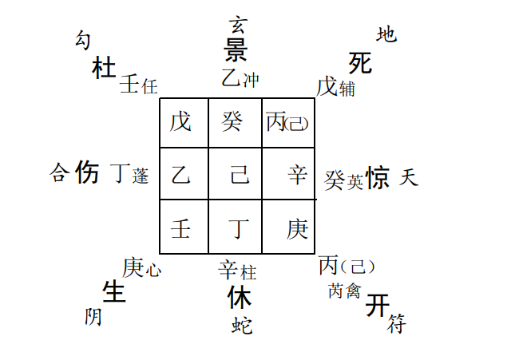

日干乙代表人， 为窦女士。 丁奇为试卷， 景门为考试总的情况。 今丁奇落震 三宫有气之地， 乘丁加乙“ 人遁吉格”生合日干
乙奇落宫， 且日干乙乘景门进气旺相， 格局“ 乙加癸”华盖逢星”，虽不十分吉利， 但亦不为凶。 乘玄武可表示小有舞弊行为。
所以， 最后综合上述信息推断： 可以通过考试， 但恐成绩平平。 果然成绩公布之后， 窦女士以70余分的成绩侥幸通过  .

## 【 案例二十八】

 翟(zhái)x之妻怀有身孕月余， 但因女方尚不到晚育年龄， 单位领导不愿意批给生育指标， 这日， 翟x卯地问生育指标能否批准？  

丙子年乙未月壬戌日己酉时， 阴遁五局用事， 甲辰旬， 天蓬星值符落巽四宫， 休门值使落坤二宫， 日干壬在巽， 时干己在兑。  

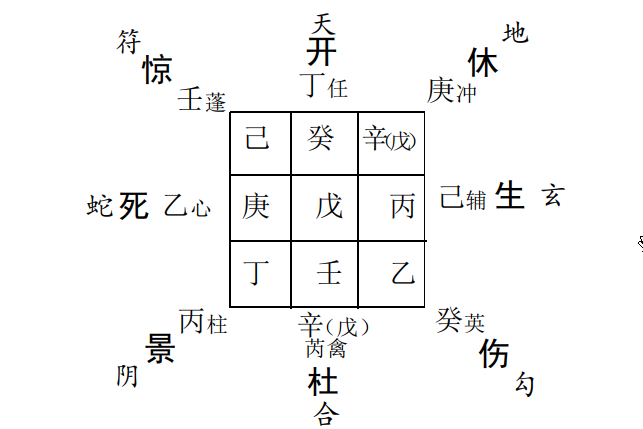

日干为翟x， 乘惊门， 象征惊恐忧疑之事。 加时干己上， 时干为事， 天盘己乘生门、 玄武， 生门可代表生产、 生育类事， 玄武
则常为不符合规定、 手续不全等信息或特性， 与翟x所问之事吻合。
景门与丁奇可象翟x向领导索要指标一事， 天盘景门空亡和地盘丁奇入墓空亡可说明其没有生育指标和尚未和单位领正式谈论等情况。 天盘丁奇落离九宫有气之地且与日干壬之所落巽四宫相互生合， 以及景门、 年干丙奇落宫与丁奇落宫和时干、 生门落宫依次相互生合， 可推知如果就此问题好好与领导谈谈， 应该说没有问题， 一切都可以解决 .

但是， 在对整个局象的分析判断过程中， 我注意到两条很不吉利的信息， 并且向翟x做了必要的提示。 其一是翟x问事时居震三宫卯地， 为天盘死门落座之宫， 可预示此事终非吉兆。 其二是坤宫孕产情况的综合表现信息不佳。 以天芮星象母， 天冲星为子， 今坤宫虽值旺地， 但冲星克芮星， 为子克母不利母之象，冲星入坤宫墓地， 依古法推论应是子死母腹之象。 其他， 奇仪庚加辛上， 格局白虎干格呈凶， 亦非吉兆。 后， 果不幸应验了这几条坏信息。
最后应验情况： 没过多长时间， 尚未等到领导把指标审批下来， 其妻便自动小产了 .

## 【 案例二十九】 

1996年夏天， 河北省西部山区发生特大洪涝灾害， 鹿泉市邮电局几名青年在抗洪抢险活动中英勇献身， 其中一名烈士的遗体被洪水冲走， 下落不明。 这天， 其局长等人一行来到《易经》研究会， 请求帮助预测寻找死难烈士的遗体下落。
丙子年丙申月己卯日己巳时， 阴遁二局用事， 甲子旬， 天芮星值符落坎一宫， 死门值使落乾六宫， 日、 时干己在巽。  

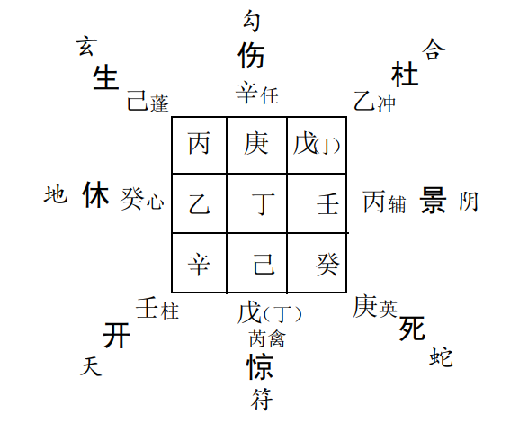  

值符为主者， 在此可象邮电局之领导， 天盘落坎一宫， 加临日、 时干己土之上， 是为局象兆机说明己干代表着他们所意在谋
为的事情。 再察天盘己干落巽四宫之地， 可进一步表明此事之最后克应必为东南巽地。
其他， 从值符落宫与日、 时干落宫相互生合的信息分析， 可知此事谋为易就， 必有结果。 此外， 局象中杜门居坤宫旺地， 也
意味着时下从事捕捉、 检查、 阻塞、 拦截等类事情动作大利。 最后， 我们由以上两点信息分析， 可基本得出结论， 此位烈士的遗
体应该能够找回。  

在完成了上述基本定位预测分析之后， 就又对具体的找寻地点和方位等特性， 进行了更加细致地模拟预测， 具体内容如下：
由日时干己土乘天蓬星， 八神乘玄武的信息分析： 因己土地理常为冈岭、 堤坝、 瓦石、 桥墩， 在人体则常象足、 手、 脚、 趾类，
故由此推论尸身很可能藏匿于桥梁、 堤坝等水流屯聚之地， 因此， 在具体寻找过程中须格外注意手足类等一些细微蛛丝蚂迹。
由日、 时干落巽四宫， 加之局长同志反映的某些具体情况，最后基本确定了找寻的矩离范围应在4—14里之间， 其中尤其是接近4里或14里的范围， 为重点搜寻区域。
最后， 以外应起得梅花易数卦象， 断搜寻之最佳时间， 得《离》之《丰》卦， 是为离火生体之象， 故推巳、 午、 未三日最为有
利。
应验情况： 癸未日下午， 鹿泉市邮电局打来电话， 告知本日近中午时分， 在鹿泉市东南近14里左右的地方， 终于找到了烈士遗体。 并且对我们给予他们的重要帮助表示最崇高的敬意。  

当时的具体寻访过程是： 找寻人员在距市区近14里的地方， 提高了警惕。 忽然间发现前面一座破废的土桥， 几名妇女正
在水中打捞物品。 突然， 一声惊呼， 就听其中一名妇女说到： “ 这个东西怎么好象人的手指呢？”搜寻者闻听此言， 二话没说， 急忙
奔了过去， 一经打捞。 正是其所要寻找的死难烈士遗体。  

## 【 案例三十】 

上例在我们帮助鹿泉市邮电局找到了死难烈士遗体后不久， 在附近地区， 消息很快传开。 没过几天， 就又来了一批人， 说是井陉县电力局的， 因为他们那里也有一名青年在抢架线路过程中被洪水冲走， 亦是活不见人， 死不见尸， 已近月余。 局领导和青年家属曾多方派人四处打探， 可是至今仍然是沓无音信， 请帮忙预测寻找一下。 随据来访时间起局预测  .

丙子年丙申月乙未日甲申时， 阴遁一局用事， 甲申旬， 全盘伏吟格。 天任星值符， 生门值使俱落艮八宫伏吟不动， 日干乙在
坤二宫。  

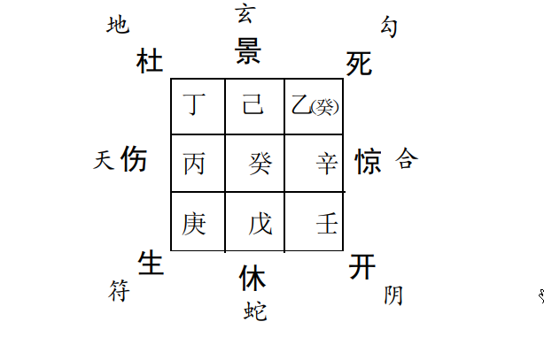

全盘伏吟局象主谋为不就， 办事没有结果， 说明对这位青年的寻访将是一件很不容易的事情。
此青年癸丑年生人， 局象中癸年干入坤二宫墓地， 上乘勾陈（ 白虎）死门， 且居旺相之地， 可谓大凶， 亦足以说明实际上其人
已受伤致死。
值符甲申庚、 庚时干落艮八宫墓地， 可代表领导和家属等主事者对此事的寻访办理亦是无能为力。
此外， 就大象伏吟格局和年命、 时干入墓等信息， 亦可说明 尸身藏匿的两个主要特点， 一是尸身没有被冲走多远， 二是有已
被人掩埋或被沙石埋没之象。
后来又根据实际情况进行了一些分析， 死者殉难至当时已有月余， 盛夏时节， 其尸体假如是在水中浸泡， 那么也早已是面
目全非， 无法辨认。 况又据其领导介绍， 当时下水之时， 可能还是没穿什么衣服， 这就又给尸身的判别辨认带来了很大的难度。
所以， 最后综合上述信息推断， 此青年确系死亡已久， 尸体恐怕难以找回。 由局象看来， 这也许是一种天意， 有时天意的确
是不可违的啊！ 后来结果， 基本如所测。   

## 【 案例三十一】 

丙子年冬月， 大师的父因患高血压等综合症致使左脚风麻酸软， 得知此消息后， 恐其病情恶化而进一步导致偏瘫或半身不遂， 忙起得一局， 测病情的变化和发展？  

丙子年辛丑月己巳日乙亥时， 阳遁九局用事， 甲戌旬， 天蓬星值符落艮八宫， 休门值使落坤二宫， 日干己在艮， 时干乙在震。  

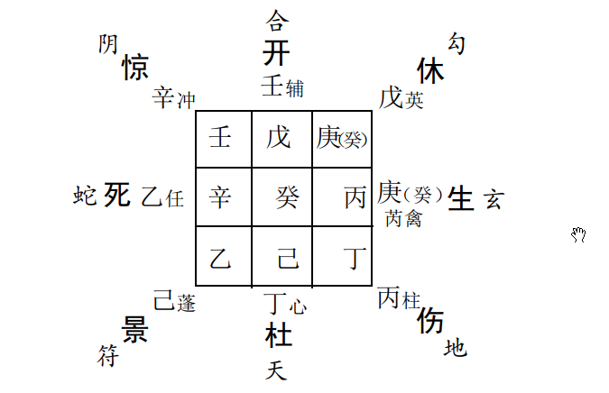

日干己加临艮宫乙奇时干之上， 己、 艮为脚趾， 乙奇为贵人、医者， 可说明是为父亲所患脚病而且欲求病因和诊治等事。预测脚病可以艮、 乾二宫取象为用。今乾宫得奇， 得丙加丁“ 朱雀贵人”吉格， 乘伤门， 在此可表示活动、 运动等， 以上信息可说明右脚健康状况良好。 再看艮宫信息， 居生旺之地， 且有值符生助， 可知最终亦不会留下什么后遗症， 但是， 己土乘天蓬星， 旺于冬月， 故病患之一应为中医之所谓水湿。 此外， 地盘乙木克日干己土和艮八宫， 或许病因之二应犯中医之所谓风患， 此二者可能就是诱发上述病症的直接原因。
另外， 我们还可以“ 戴九履一”之法拟象脏腑系统， 从脏腑功能进一步分析引发此病症的内在原因。
首先， 以天芮星为病神， 天盘落兑七宫空亡， 此项信息应父亲先天性肺部功能不佳的病史， 但是， 此次病患无论是从中医学角度分析， 亦还是从奇门局象信息判断似乎与肺脏关系不是很大。 其次， 我们可仔细察看一下震巽二宫的综合信息。 天盘八门情况， 震三宫乘死门， 巽四宫乘惊门， 俱与落宫相互克制； 奇仪格局信息， 震宫为白虎猖狂凶格， 巽宫是地网高涨凶格； 以上两点可在某种程度上说明大师父之肝木系统确实应该说存在着一些问题， 这一点也正与中医学认为导致此类病症的根本原因在于肝脏功能虚弱， 肝风内动等观点， 可以说不谋而合， 看来这可能才正是父病症的根本病因。
最后， 预测医疗诊治情况， 可以乙奇和天心星代表医者， 今此二者心星落坎一宫， 乙奇落震三宫， 均不能克制天芮星之落宫， 表明鉴于当地医院的医疗条件和技术等问题， 中西医治疗可能均无显著疗效。 最根本的治疗措施还是应该从各方面， 包括饮食营养、 体育锻炼、 精神治疗等全方位提高身体素质。应验情况： 最初仍然坚持医生和药物治疗， 可是结果吃了近一年的药， 不但没有收到明显的疗效， 反而对药物产生了一定的依赖性， 一旦停药， 病情马上就表现得严重一些。 后来， 偶然的机会接触了大雁功法， 从此， 热衷此道， 风雨无阻， 坚持不懈。 目前， 早已是摆脱了一切外因诊治， 全面恢复了健康。

## 【 案例三十二】 

本地有位神婆自称蛇仙附体， 众人亦将之吹嘘地神乎其神。 这天， 四通公司经理崔兆喜拉扯着我也想去看个究竟。 临行以前， 我说：“ 先别忙， 咱们不如先起她一课， 算算其功力到底如何？”  

乙亥年戊子月壬午日乙巳时， 先以六爻起得一《 坤》卦。 以卦象观之， 《坤》卦全阴， 是为阴灵附体之象， 非是正途之真正修炼结果。 因为真正的修 炼者必须是纯阳之体， 纯正之象。 笔者也曾以此法算得西藏之某位活佛， 得《 气》卦， 虽未得《 乾》卦， 但毕竟亦为阳刚之象。 说明此活佛的确有一定的修持和功力。在分析完上述卦象之后， 我又从爻象上做了进一步的分析，子孙持世空亡， 因子孙爻常代表除邪、 祛灾等信息， 故在此象征功夫、 功力。 目前， 时值子月， 世爻子孙酉金衰弱无力， 故可推其人根本没有什么功力可言。 相反， 爻象之中倒是应爻鬼爻受旺财之生， 后合卯木鬼局， 其力量远大于子孙酉金， 很显然神婆是在装神弄鬼， 骗取钱财 。

最后， 又起得奇门局象预测印证， 结果也是惊人地吻合。时值阴遁四局用事， 甲辰旬， 天英星值符落坤宫， 景门值使落艮宫， 日干壬在坤、 时干乙在兑。日干壬落坤宫， 与《 坤》卦卦义相符， 加临时干乙奇之上， 因乙奇常为助人解危济难之象， 是以局象兆机乙奇为用， 代表所要预测的神婆之功力和功夫。
察天盘乙奇落兑七宫， 可谓又正合《坤》卦子孙酉金之爻象，但今时值冬月， 兑宫衰休。 另， 乙落兑宫又为其自身绝地， 故亦
可得出前述同样的结论。 此外， 乙奇上乘生门， 知其谋财之意显矣  

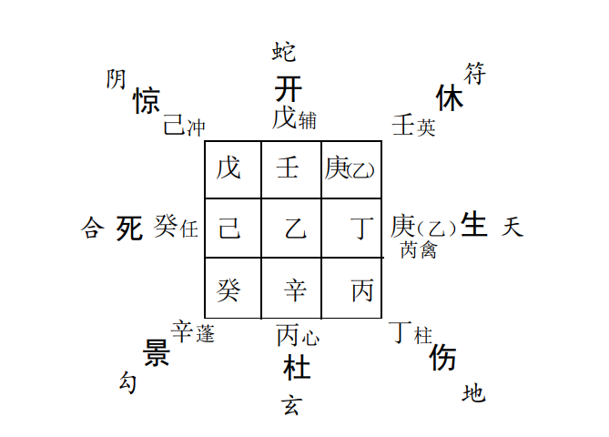

## 【 案例三十三】

 这日， 妻子忽然不知从哪儿来了一股精神，把楼道给整理清扫地干干净净， 异乎寻常， 凭感觉判断这可能是
一种什么征兆， 于是连忙根据时间起得一局， 察析其中情由。  

己卯年丁卯月庚午日辛巳时， 阳遁七局用事， 甲戌旬， 天任星值符落坎一宫， 生门值使落乾六宫， 日干庚在巽， 时干辛在乾，
与值使同宫。  

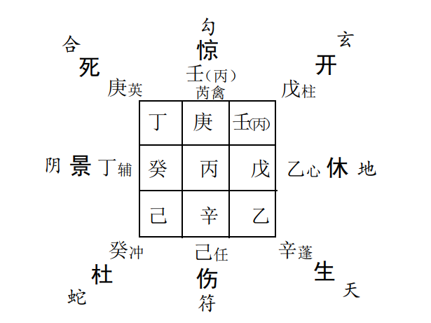

日干庚加丁上， 落巽四宫， 丁为消息、 电话、 印信等， 此事该首应东南方向之人事， 乘死门， 绝对又不是什么好事。
时干辛为事， 乘九天， 天盘落乾宫， 可概知此事必次应于异地， 西北方位。 再察地盘时干辛居坎宫， 上乘年干、 值符、 伤门，因年干为长者、 值符为主者、 伤门为变动、 活动、 出差等类事情，由以上这几条信息可概知此事当于父母等长者变动情况有关。
果然， 晚上7点多钟， 其母从东南巽地邯郸打来电话， 说老家北京密云昨天来电话了， 告知其姥爷病危， 因此， 岳母准备明日动身去北京探望， 因乘车不便， 故先到石家庄后再转乘去北京。 正与局象所反映出的信息惊人地相似。
此外， 在这个局象之中， 坎一宫的综合信息也很值研究和一提。
格局己加辛上， 解语是“ 游鬼入墓， 大人鬼魁， 小人家仙为崇”， 那么， 这句话究竟是什么意思呢？ 以前每遇此语皆不知其所云何事，因此， 也就很难知得其真正寓意所在， 最后， 还是经过这件事情的实际应验， 方使得豁然解得其中之意。    

## 【 案例三十四】

 张x， 习练中华养生功多年， 已熟练掌握了四步功法， 达到了一定的境界， 其人体之内在潜能如灵感书写功能已被充分地调动出来， 基本上可以意到笔到， 神形合一。 但是， 因其文化素质较底， 所以， 学理不通， 搞不懂灵感书写类功能究竟是怎么一回事， 而且还担心这些功能于己不利。 是故， 希望我给他预测说明一下其中的道理。  

巳卯年丙寅月癸卯日丁巳时， 阳遁三局用事， 甲寅旬， 天任星值符与日干癸同落离九宫， 生门值使落坤二宫， 时干丁在乾。  

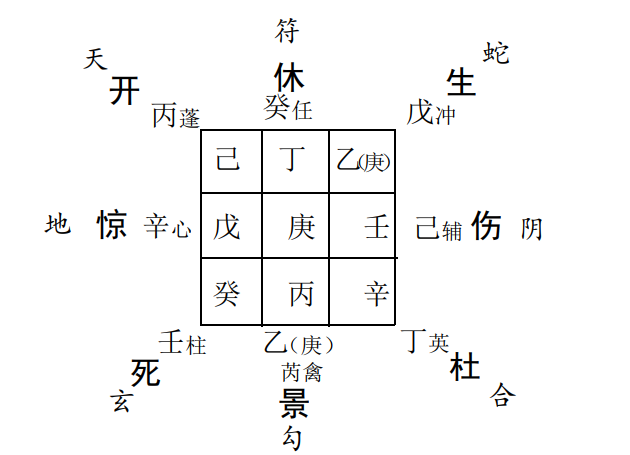

日干为人， 为张x， 天盘癸落离九宫， 加临地盘丁干之上， 丁为符号、 信息， 以上信息可说明张!意在弄清楚其自发灵感书写的这些符号究竟是怎么一回事。
天盘丁干落乾六宫， 加临地盘辛干之上， 辛干乘天心星， 大家知道天心星常可表示求仙、 合药、 治病、 祛邪类信息， 那么， 由此我们或可推知其书写的这些符号当与治病、 祛邪类有关， 即相当于符咒类的一些东西。  

然后， 我们再继续研究一下辛干在此表示何意。 因辛干常可表示犯法、 罪者等一些信息， 是以开始误以为可将之引伸理解为邪气、 鬼怪类信息。 但是， 稍加思索便觉不妥， 后经再三揣摸始觉领悟其中的一些真正寓意。
辛干在此处的实际意义应该是他本想以其所书写的信息符号给人们治病解灾， 但是， 却因功力不济或不懂某些因果关系，因而导致触犯“ 天条”亦即违反自然界的某些必然性的因果规律， 从而遭受一定的“ 天遣”或“ 罪责”， 也就是我们常说的“ 自然规律的惩罚”。 所以辛干在此所表示的真正含义仍然是“ 似乎带有“ 犯法”“ 犯罪”的一些意思。
那么， 其这样做也就是“ 书写符咒”给人治病祛邪的目的何在呢？ 我们从辛干落震三宫加临戊干之上， 和日干癸落离九宫生合坤二宫戊干和生门落宫的信息不难看出， 其最终目的亦无非是谋求一些钱财和费用罢了。  

最后， 为了进一步印证上述分析的正确与否， 我又起得一六爻卦《小过》之《大过》， 其中所反映的信息与以上分析结果基本契合。
在全部完成上述分析推理之后， 我最后告诉了他几个基本原则“ 一切要随缘， 大道当自然， 当为则为之， 不当则避之”。 为
人治病祛灾类事， 性命攸关， 没有真正的功夫和不通基本的医道学理， 切勿妄自行事。 

## 【 案例三十五】 

素有“ 中国西典”之称的某军事学院， 自98年入夏以来， 连续发生两起重大恶性伤人事故， 且均与火灾有关。 一次是在清除销毁废旧炸药的过程中， 新学员违背操作规程， 不慎将部分炸药引爆， 当场造成5名新生连死带伤。 另一次是汽车燃烧伤人， 亦有几名学员受害。另据情况介绍， 这两次事件均系发生在院内， 而且基本方位又都处于学院的西部位置。 这其中尤其令人担忧的是两次事故现场均系发生于学院弹药库附近， 严重影响和危及到了弹药库的安全。 假如一旦弹药库发生什么意外的话， 那么， 后果简直是不堪设想。
鉴于一个时期以来， 这个学院连续发生的几起与火有关的令世人倍感蹊跷的严重事故， 一日， 其学院的某位领导， 找到大师和市道教协会的李文普道长， 并邀请我们去给他们考察堪测一下其学院的风水状况， 同时， 再预测一下近期是否还会继续发生什么重大恶性事件？     

首先，分析一下当时的实地外形堪测结果。该学院位居一座山凹之中， 三面环山， 其中， 西部山势最高，山峰也最具气势。 大门朝向正东方位。 学院的正中部位是一条宽阔笔直的柏油马路， 且横贯东西， 把整个校园齐刷刷从中间一分为二， 整条大路中间无任何屏障设施， 自西向东， 居高临下， 形成十分典型的白虎气势， 咄咄逼人。
风水典籍有云“ 东低西高， 富贵英豪”， 一见此象我们便知曾几何时， 此校确系培育国家高级军事指挥人员的摇篮， 确为祖国培养输送了一批又一批的军事人才。 果然， 据这位领导介绍声称， 以某军区为例， 有关部门曾做过调查， 中层以上人员有相当 一部分比例来自于这所院校的毕业生。但是， 我们从风水学的另一个角度来看， 中间道路笔直横贯东西， 是又所谓“ 白虎穿膛”， 煞气太重。 这种情况， 如果建造当运， 且建筑物旺山、 旺向， 那么， 可保平安无事。 但是一经衰运，即刻立现凶危。此学院建筑大都70年代中期修造， 时值中元六运， 如今早已进入90年代， 该当下元七运主事。 是以影响到其在同类院校中的地位亦已是今非昔比， 进而乃至出现各种衰微现象以及上述恶性事故的连续发生等等， 可以说气运所至， 绝非偶然。 以下是奇门预测的具体比照分析   

戊寅年壬戌月辛卯日丙申时， 阴遁三局用事， 甲午旬， 天英星值符与日干辛同落坤二宫， 景门值使与时干丙皆落兑七宫。
先看八门气场分布大象吉凶。 景门落兑， 死门在乾， 杜门在坤， 可见西方气场大凶。 故， 事故频现于西方， 势在必然。
再察值符天英星属火落坤二宫， 天盘景门下乘时干丙火落兑七宫， 又适值夏季火旺， 由此看来， 事故频发于火种也非偶然。
其它， 日干辛落坤二宫， 因为， 辛干常表示有某些“ 犯法”“ 犯罪”信息， 询问其领导， 果然春夏之交， 坤方动土， 修建了一些工程项目， 正好冲克流年寅方太岁， 犯了堪舆修造之大忌， 这或可以说许是两次事故发生的重要原因吧  

另外， 此局象信息中还有一条也是应验的非常神奇。 这就是原离宫方位放置有一辆为教学训练准备的军用坦克， 后无故被校方挪走， 结果也就在坦克被移没多长时间， 便开始接二连三发生事故。 我们可先分析一下离九宫信息， 天盘伤门， 可象车辆， 坦克其实也是车辆的一种， 天辅星为文化、 教育类有关信息，  应其坦克正是教学训练用品， 格局“ 青龙逃走”， 可以说又奇应坦克被移一事。
那么， 究竟坦克的移走与火灾的发生有没有什么必然的联系呢？ 如果单就局象所显示的综合信息看， 应该说确有一定的关系。 大家可以注意， 先前坦克放置于离九宫之上， 那么， 它就有力地克制了兑七宫天盘景门落宫， 也就有效地抑制了天盘景门离火能量的爆发。 另一方面重型坦克其本身也是一件很好的镇物， 自坐离宫之上， 也可以极大限度地压制地盘离火的上焰。
可是， 后来坦克一经移往他方， 便使得这种克制离火能量爆发的信息大大减弱， 于是， 火神肆虐逞狂也就不足为怪了。 由以上信
息， 我们或可推论， 坦克的移走或许充当了事故发生的导火索吧。  

最后， 又根据局象综合信息预测分析了其近几个月的情况，因注意到戌亥月一过， 子月惊门主事， 再往后开、 休、 生吉门主
事， 故可推当不会再有什么恶性事故发生。 所以， 也就劝谕他们不必再为此而提心吊胆的了。
在全面分析了上述风水情况信息之后， 当时我又据此局象对其本人近几年来的事业运势情况大概进行了一下预测， 如明
确指出其人去年年初有提职晋升之机遇， 但最终恐有缘无份； 今年初春， 有草木、 点水傍姓氏之人， 无职或退役， 陷害污告本人有
钱财贪污类事， 数应3、8之数， 目前， 此事已查明， 事态平息等情况， 亦均应验如神。  

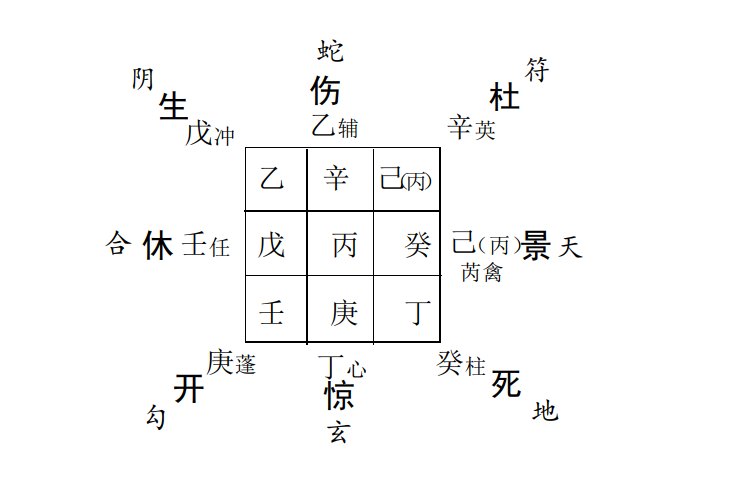

## 【 案例三十六】 

某亲威张x，30多岁了， 尚自孤身一人， 其父母屡次请求预测一下其子的婚姻情况， 同时希望能够通过调整改善其家居风水的状况来帮助解决一下其子的婚姻问题。 

这天， 来到他家， 发现其家在风水上的确存在着许多较为严重的问题， 于是， 当时便错以为这可能正是导致其子光棍命运
的主要原因吧。 接下来亦便是不顾原则和忘乎所以地把其家的风水大大的点化改造了一番， 而且心里还寻思着， 过几个月后就
可以欣赏我这副作品的风水效应了。 

其实， 当真命运的改善就是如此简单和轻而易举吗？ 实则未必。 诚然风水效应， 不可忽视， 但是， 我们又不能片面夸大和过份强调风水的作用， 那种寄一切希望于风水效应的思想和观点是愚蠢和天真的。 实际上， 要想真正改善自身命运， 那么， 还须诚尊古训所云“ 一命、 二运、 三风水、 四积阴德、 五读书”。 如果我们改用现代语言解释一下上述观点， 那么， 就应该是人类自身命运的改善， 关系诸如思想品德、 学识性格、 人际交往、 社会关系以及物质基础等多方面的内容， 它称得上是一项复杂的系统工程。 为了改善自身的命运， 那么， 我们必须从以上各个方面进行全方位的调控和治理， 这样才能够逐渐取得一些可喜的效果。
然而， 话虽如此， 道理听起来也似乎非常简单， 但是， 一旦将这些道理付诸于实际行动却又是一件很不容易的事情。 因为， 这就
又要求我们不但要有“ 高高山顶立， 深深海底行”的品格心性， 还需要具有“ 勿以恶小而为之， 勿以善小而不为”的不懈努力。  最
后， 可以说这才是我们真正改变自己命运的正确途径。
然而， 在本案例事发当初， 笔者却未能够正确认识和看待上述问题， 结果也就难免导致了许多荒唐的所为以及错误结论的  产生。 其家的居住环境确实得到了良好地改善， 但是， 毕竟由于其子的许多内在的客观条件实在太差， 可用古人的话一言以敝之， 那就是“ 命相不够， 命运不济”。 所以， 也就不论你如何改善调整其风水气场这个单方面的外在因素， 那么， 其最终结果也无异于‘ 积雪堆炭， 何以生火’ 。   

由此， 忽然又令我想起了《解》卦中的六三爻辞， “ 负且乘， 致寇至， 贞吝”。 这句卦辞之所以如此记忆犹深， 说来还有一段小
插曲， 很有些借鉴意义， 在此亦值得一提。 那是前二、 三年， 当时电台、 电视台正在掀起气功打假之风， 这对于同样是从事此类传
统神秘文化研究的我， 实在深感忧虑， 开始很是为气功界朋友们鸣不平， 亦确有似乎唇亡齿寒之感。 这一日， 中央电视台新闻联
播节目再一次报道伪气功骗人的事， 于是， 忙以新闻播出的时间， 起得一卦， 想“ 问问天意”这究竟是怎么回事？ 当时恰得此《解》之六三爻辞。 读完卦辞， 心中疑虑豁然顿释， 实在是形象之极。 爻辞说“ 本来背负物件是卑贱小人的事情， 车子则是贵族才能拥有的物品， 然而， 小人不自量力， 总想一心拔高自己， 偏偏又弄了辆车子， 耀武扬威， 结果终于引来了强盗的觊觎之心， 因此，孔子对此进一步解释说“ 自我致戎， 又谁咎也？”。  

对于一般百姓而言， 气功本来确是一项很有意义的全民健身活动， 然而， 某些气功大师为了一些个人私利， 便不顾一切地大肆渲染特异功能和奇异现象， 大谈子所不语之“ 怪力乱神”， 结果招致气功打假的后果， 的确可谓咎由自取。
其实， 这对于许多初识易学的朋友来说， 又何尝不是极易常犯上述同样类似的错误呢？ 因此， 笔者在这里再次提醒大家， 前车之辙， 后车之鉴， 希望某些持错误观点的学者， 能够从中汲取 一些有益的经验和教训。
此外， 本案例之中还有一个问题须提请大家注意研究一下，此事也许完全纯粹出于某种巧合， 也许当真是佛道所言某种因
果关系的作用。 就在我为其家大规模地整治风水之时， 儿子的脚不可思议地被扭伤， 而且伤势不轻。 当我回到家中知悉此事之后， 也略感到其中似乎有些微妙关系。 于是， 便在家人的一片报怨声中， 连忙筮得一奇门局象， 察看分析其中的究竟与原尾。

#### 以下便是当时的局象记录分析。

己卯年丙寅月癸卯日辛酉时， 阳遁三局用事， 甲寅旬， 天任星值符和日干癸、 值使生门俱落乾六宫， 时干辛在坤。  

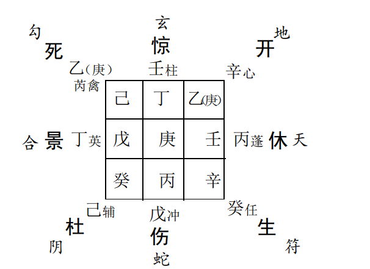

日干癸加临地盘辛干之上， 辛干乘天心星， 或许正可说明不顾原则地给人妄治风水、 解灾祛邪， 因之触犯了某些法则而咎由自取吧。 天盘辛干加临地盘坤二宫乙（ 庚）之上， 概亦可象调治风水的目的在于解决其子之婚姻问题。 那么， 其子的婚姻本该又是一种什么状况呢？ 察天盘乙（ 庚）落巽四宫， 乘死门， 或在说明其子命中实没有姻缘吧。 又继续注意到天盘乙（ 庚）加临地盘己土之上， 己土本身象脚趾， 落地盘八宫， 艮亦有脚象， 乘杜门，受旺木之克， 又逢“ 地刑玄武”凶格， 重又加临日干癸上， 或许正是儿子脚伤因我而起的信息馈示吧。
后来， 为了进一步核实以上的这些想法， 就又起得往赴其家时的局象信息， 可象其子各方面的综合情况。 庚申时局象， 日干
癸落坤宫加临地盘乙（ 庚）之上， 天盘乙（ 庚）乘死门落座艮八宫空亡之地， 亦或可说明其父母意在解决其子之婚姻问题， 而其子
又可能确系和尚命运吧    

## 【案例三十七】 

许多研究过风水的朋友们都知道“ 门转星移”， 都深知大门口纳气的利弊与影响， 因此， 更换门庭、 装修门面亦必择得吉日、 吉时， 否则， 常易诱导出现“ 更换领导、 企业变更、 转让破产”等恶性事件的发生。 此例就是一个生动的事实说明。
某商业银行行长周x， 系大师之故交， 一次闲谈中， 得知其企业准备更换门面， 因而对之做了些善意地提醒， 不料周x不信这一套。 结果却是事实胜于雄辩， 没过多长时间， 也许确系或由此因， 最起码来说二者亦必有“ 天人合一性质”的某些信息联带沟通关系， 便招来了一系列的麻烦。 所幸者周x反映认识很快， 忆起了当初我的提醒， 连忙急时抱佛脚， 请求帮助“ 指点”。 后来回
忆起议论此事的时间， 起得以下奇门局象。  

己卯年丙寅月甲午日甲戌时， 阳遁八局用事， 甲戌旬， 天英星值符， 景门值使俱伏吟离宫， 日干甲在艮， 时干甲戌时在离。  

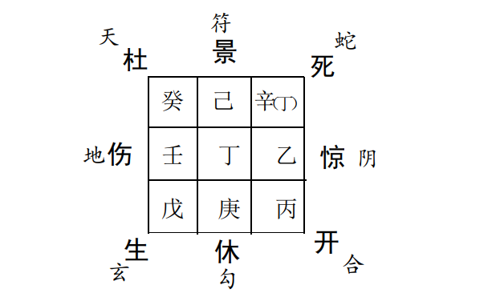

日干甲（ 戊）为周x， 伤门可代表其更换门面事宜， 时干为我之提醒、 忠告， 即景门常主所谓的献计、 策略等事。 

伤门居震三宫， 乘“腾蛇入地网”凶格克日干落座之艮八宫， 可说明更换门面一事， 应该说确实与之不利。
从震巽二宫乘伤门、 杜门和壬癸天网地网凶格来看， 须谨防官讼和检查设卡类恶事。
大象格局伏吟， 可说明事件虽严重， 但尚可以闯过。应验情况： 先是三月份该银行被某企业起诉， 周x当上了被告。 接下来是他们的一个贷款大户因触犯刑法， 被拘捕入狱， 致使千万元贷款近乎呆滞死帐。 最后是四月份， 其上级主管人行派人专门查帐， 据周x的意思是说有人背后意在搞夸周x， 使之下台。
经过上述几个月的系列实践检验和教育， 周x算是彻底改变了对中国传统神秘文化的态度和观念。

## 【 案例三十八】 

河北省三胞文化传播公司总经理李x， 邀请大师来到他的公司观测风水和预测企业未来前途。
通过此例， 可从中看出风水形法预测和奇门理法预测在预测结论上的互补和统一。 尽管两种方法观察事物的角度形式截然不同， 但是它们所反映出的事物的本来面目和发展规律却是同步和一致的。
己卯年丙辰月己亥日己巳时， 阳遁一局用事， 甲子旬， 天蓬星值符落坤二宫， 休门值使落乾六宫， 日、 时干己在震。

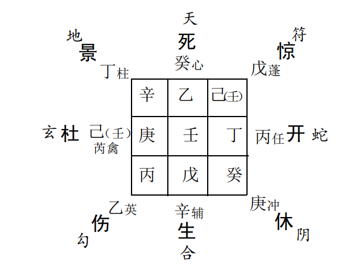     

整栋楼宇坐北向南， 一式共有五六间。 经理办公室位居东头震位， 风水术中常比拟称作“ 龙头”位， 得流年卯木太岁生助。这一点和奇门局象中， 己日干落震三宫并得与年干同宫所反映的信息均系同步。 两者都可以显示说明李x确有许多高层领导的帮助与支持， 且本年度常得“ 贵人提携”。
主办公区域居兑位， 由几间房屋打通组合而成。 这和奇门局象之中开门落兑均可说明， 其人93年事业运兴旺， 且开始下海创办公司。
主办公区域因是几间房屋的组合， 故其天花板上留有四条横艮突出的水泥横梁， 据风水形法研究， 其寓义常为工作、 事业压力不轻。 这一点从奇门局象开门、 甲子戊落宫冲克日干落宫的信息亦得到了同步说明。 据李x自己介绍， 他拥有四五个企业， 有公司， 也有加工厂， 工作负担确实很重。 另外， 资金周转方面也确实很紧张。
其他， 从建筑物外观整体来看， 离宫缺限不足， 这亦和局象离宫乘死门的信息相互吻合。 据此二者， 我们均可推论， 午火流
年常遇难遭劫。 又见八神、 九天、 天网癸寄位离宫， 因此， 进一步具体推断，90年夏月当遇刑事方面的一些麻烦， 且应于外地。
果然， 李x90年确因受学生事件之牵连， 被唐山市公安机关拘留一天， 后经公安厅同学查问， 第二天就被无罪释放。    

## 【 案例三十九】 

某易友告诉我说， 他最近一个时期正在研究堪舆风水， 因受其中某些观点的影响， 认为客厅都应安排在家居最大的房间内， 于是， 他便开始照猫画虎， 可结果却弄了个东施效颦。 客厅移位后不久， 首先是其爱人下岗了， 其次是自己各方面的事业也似乎不如以前。 请帮助解析一下。
他家的基本情况是： 南北向楼宇，5楼西门三居室， 巽、 坤、乾三个方位皆可作客厅。 原以乾位居室为客厅， 感觉各方面情
况良好。 后移置坤位， 于是同时出现了上述变化。
己卯年己巳月乙亥日壬午时， 诹得阳遁三局用事， 甲戌旬，天辅星值符落兑七宫， 杜门值使落震三宫， 日干乙在坎， 时干壬
在艮。 先以奇门预测占断， 继之筮得三个卦象分占各居室风水气场的财、 官诱导信息。  

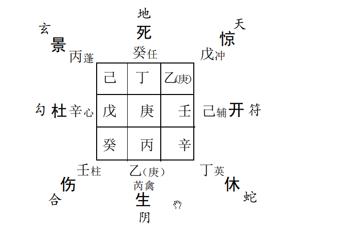

坤位居室为客厅情况：
以坤宫信息为用， 得惊门， 天冲星， 主变动、 惊疑之事， 显不为吉  

六爻预测结果：  

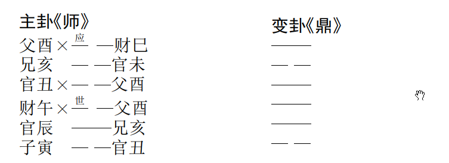

卦中爻象乱动， 父母爻受克， 主工作、 单位等变动不利。此外， 见卦象之中， 应爻酉金出现， 因应爻在此为事， 必代表坤位居室， 该为未、 申， 随疑其家屋向不正， 并建议他取罗盘测试， 后告诉我屋向果然稍偏癸丁。 鉴于这种情况， 故当时又以兑宫信息进行了推论。
兑宫得开门， 值符、 年、 月干生助， 总的来看应该不错。 不利方面的信息为奇仪格局相冲， 天辅星受地盘宫位克制。
那么， 为什么这却与六爻预测以及实际情况正好相反呢？后来忽然又想起源于奇门遁甲的玄空风水学似乎更加强调九星到宫， 因此怀疑天辅星、 四绿旺星落兑七宫， 受天柱星、 七赤衰星之克或为主导吉凶的决定因素。 这一点可权作笔者个人意见供学者们参考， 且留待智者探讨解悟其中之秘。
乾位居室为客厅情况：
得休门， 受地盘宫位之生， 奇仪得丁奇， 且七宫年、 月干己土、 开门共比合生助， 天英星旺相， 故可以吉断。
六爻预测结果  

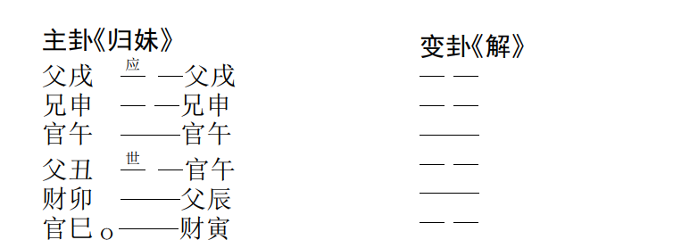

应爻父母戌土， 正应西北乾室， 月建官鬼生助， 大利事业前途。
巽位居室为客厅情况：
得景门、 丙奇， 冲克兑宫开门， 因开门主工作、 前途、 事业， 故于此不利。 天蓬星巳月不做旺论， 亦非全吉。 但得坎宫生门生
助， 故此居室作客厅， 可谓利财。  

六爻预测结果：  

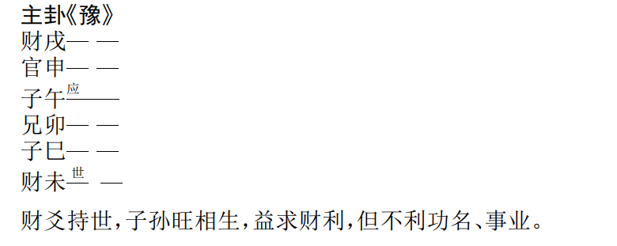

## 【 案例四十】 

原石家庄市双鸽企业集团公司总裁张云山先生， 希望从易学角度分析了解一下其企业衰败的客观原因。 当时张已被免职， 但企业尚未正式宣布破产。 按其来到时间起局。 

乙亥年辛巳月己未日壬申时， 阳遁八局用事， 甲子旬， 天任星值符落震三宫， 生门值使落兑七宫， 日干己在坤、 时干壬在巽。   

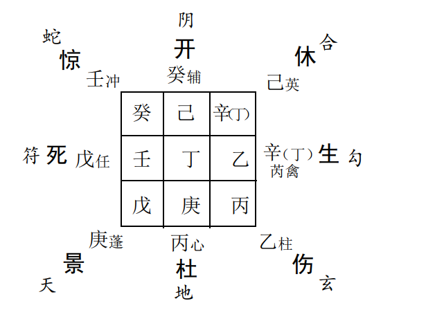

日干己乘休门， 落坤二宫， 休门主休息、 无事， 象征其时张已在家待业休息。 甲子戊乘死门落震三宫， 且犯六仪击刑凶格， 可
说明其企业在资金方面已是周转不灵， 并存在较为严重的财产诉讼或法律纠纷等方面的问题。 年干乙落乾六宫， 值流年旺地，
生助坎一宫之水， 乘杜门冲克开门落座之离九宫， 实应其各级主管部门和领导对此企业已经失去信心， 并准备允许、 宣告其正式
破产一事。 
除了以上这些信息推理之外， 还是结合风水方面的相关内容， 做了如下一些具体推论。
（ 一）以开门为用， 在此代表企业的生存和发展。 居离宫属火， 说明最有利于此企业发展壮大的方位空间应该是震、 巽、 离三木火之方， 其中， 离宫为其企业之本位。 为此， 我们就风水角度而言， 其纳气之口大门方位， 在选址设计之初， 就应该建造于上述三方， 因为这样就可以最大限度的纳入生助于我的天地造化之气。
此外， 就经验风水而论， 饮食加工类企业的有利方位亦确在东、 南、 东南， 其次是西南方位。 因为这种观点认为此类企业的生产加工过程， 均与电、 光、 火等热能相关， 而震、 巽、 离三方恰为此类火源、 火能的天地本气所在， 能得天地本气生助， 那么当然就会万事皆吉。 再者， 我们从该企业的主要产品“ 火腿”的冠名中， 亦可发现些许端倪， 没有火， 那么就只剩腿了。
然而， 该企业的实际情况却正好是截然相反。 其纳气之口在正北， 所纳之气皆为坎宫湿水， 如此以来焉能利于企业发展？
另外， 还有一点就是其门前道路亦犯有“ 鸭颈蛇身”之忌， 正所谓 “ 局如鸭颈并蛇身， 若是公衙最可嗔， 官政每乘虚府库， 境中民物
受灾深”。 不单狭窄不说， 而且延伸百十多米， 方才到达正式建筑街道。 如此道路， 又岂能够财源广进？ 财源不广不丰， 谈何长
久持续？
（ 二）既然离宫为其企业本位， 那么， 就应该首先把企业的主要部门， 如办公区或主要车间规划其上， 并且要求离宫建筑应该绵延有靠， 再就是注意震巽生我之方亦该高耸为宜。 因为风水学认为这就能够诱导并形成有利于企业稳定发展的环境气场。
我们来看一下其企业内部建筑布局概况， 乾位是企业办公区， 最高； 坤、 兑二宫为其生产车间， 次高； 艮方为厂内招待所， 再次；
震、 巽、 离为单身宿舍、 食堂、 卫生所等杂区， 最矮。 另外， 我们从奇门局象中亦可大概看出这种信息馈示， 可以得奇与否断建筑
物高矮。
综合上述几点， 这些不合理的规划设计和布局， 或许亦正是导致其企业缺乏发展后劲， 乃至最终落得破产倒闭结局的重要客观因素吧。
最后， 大家再一起研究一下流年气运与该企业兴衰变化的神奇应合。80年代初， 流年金水气运， 该企业为一个几十人集体形式的煮肉、 罐肠作坊；
1986-1987年前后， 木火盛行， 该企业在国内同行业中，率先引进全套进口生产设备， 是为企业发展的积蓄准备阶段。
1989年、1990年间， 火运大盛， 企业开始突飞猛进， 一跃成为中商部、 省、 市食品加工行业的典型和排头兵；     

1991年至1993年间， 企业进一步开拓市场， 产品远销俄罗斯、 南韩等世界各地。 此段时期奇门局象休门、 生门主事， 亦可
谓其企业的成长收获之期。
1994(年下半年， 突转水运， 企业内部开始进行人员调整， 衰败从此开始。
1996年岁在丙子， 值盛冬水旺之时， 企业正式宣布破产倒闭  

## 【 案例四十一】

 前例二， 在湖北省物资集团某总裁预测完毕之后， 其同行之合作伙伴李x请求预测， 于是， 按下一个时辰己未时局象分析。
戊寅年己未月戊午日己未时， 阴遁二局用事， 甲寅旬， 天心星值符、 开门值使俱落坎一宫， 日干戊在兑， 时干己在艮。  

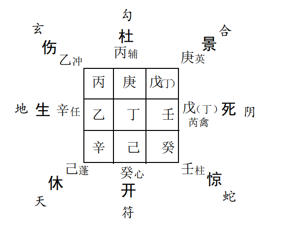

首先分析预测了他近几年来的基本运势， 大体与局象信息吻合， 其中， 尤其是明确指出以下三个具体问题时， 令李x吃惊不已， 大叹遁甲之奇！
（ 一）87年3月， 夫妻间该有一次矛盾冲突， 影响夫妻感情，88、89年， 爱人恐有些非份之想。因为震宫流年应卯， 而87年为卯年， 格局辛加乙上， 呈白虎猖狂凶格， 乙为女， 为其妻， 冲克日干戊及丈夫庚之落宫。 巽宫格局乙加丙上， 丙为第三者男性， 乘八神玄武， 亦主桃花、 酒色、淫佚类事， 故有此断。
（ 二）93年秋月， 其父死于肺癌， 因戊年干代表长者， 乘死门、 太阴落兑七宫故也。
（ 三）本人大利东北方位， 年内冬腊月会遇朋友、 贵人鼎力相助， 尤其在资金方面， 数目该应5、8艮宫土数。 当时据李x透露， 可能是500万元左右的资金支持。    

## 【 案例四十二】

 工行一办事处沈x测其同事马x事？  

己卯年丙寅月己酉日甲戌时， 阳遁六局用事， 甲戌旬， 天柱星值符， 惊门值使俱伏吟兑宫， 日、 时干均与之同宫。  

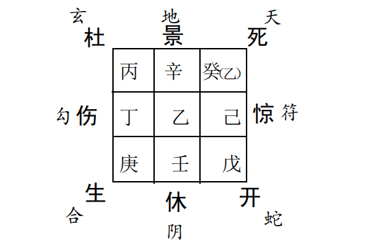

预测朋友、 同事， 以月干为用。 今丙月干落巽四旺地， 可象征其同事马x各方面综合实力呈明显上升趋势。 但是， 丙奇落宫冲克日干、 值符落宫， 日干在此可代表沈x， 这一点可反映说明马、 沈之间可能有隙。
此外， 这里又出现了一个新的奇门预测格局———悖格， 即丙奇加临值符或年、 月、 日、 时干之上， 常主倒行逆施、 紊乱纲纪、 乱
臣贼子及不忠不孝之人。 这一特殊格局的出现， 不仅证明了上述推断， 而且还进一步反映出马x的所做所为及其明显的抗上情绪， 乘八神玄武者， 说明其人品性恶劣， 阴险奸诈。
以上还没等大师把话全部说完， 沈x早已按捺不住心头气火，连忙把事情真相全盘托出。
原来马x原系沈之部下， 沈见其头脑灵活， 便用心举荐， 没料想小人一经得势， 顿时趾高气扬起来， 哪里还把沈x放在眼里？ 而且据沈介绍， 马x其人胆大妄为， 经常不顾银行内部制度， 擅自行事， 有时连行内领导都敢欺瞒。 目前， 沈已掌握了马x部份违纪证据。 此次找大师的目的， 亦正是准备选择个最有利时机， 向领导反映马x的情况， 打他个小报告。
预测挫败小人， 制服对方类事， 常以死门和克制对方用神之落宫信息为用。 以死门为用者， 因遁甲有云“ 若问死门何所为，只宜吊丧与行刑”， 故可以之代表我方用事及所采取的行动。 今死门伏吟坤宫， 另日干与值符同居兑七共同冲克月干丙之落宫，因此推断申、 酉日或为下手的最好时机。
实际应验情况： 尚未待得沈x的小报告汇报上去， 未、 申二日， 马x自动犯事， 因擅自违反汇票承付操作规程， 为其关系户
私开汇票， 结果被领导发觉， 给抓了个典型在全系统通报批评，险些离职下岗。   

## 【 案例四十三】

 一日， 在朋友家中串门， 偶逢其在重庆某医院工作的女友赖小姐， 经朋友介绍之后， 赖小姐强烈要求一睹奇门预测风采。 其实起初赖x肯定是半信半疑， 但是， 在不断深入且具体而细腻的预测中， 赖x彻底折服了， 连连竖起拇指， 交口称赞， 并怀疑我真的具有特异功能！ 后来我又从科学角度给她解释了些奇门遁甲的哲学思想及思维原理， 这更增添了她对奇门遁甲的兴趣， 并表示一定要尽快加入我们的易学研究行列， 以下分析介绍当时的预测应验情况  

己卯年庚午月己亥日庚午时， 阳遁九局用事， 甲子旬， 天英星值符落坤二宫， 景门值使落乾六宫， 日干己在艮， 时干庚在兑  

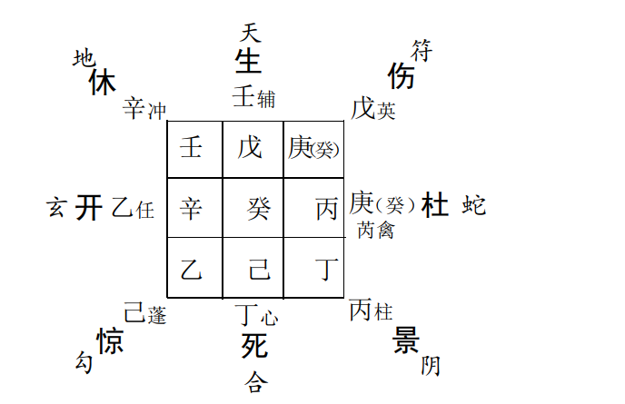

第一条： 日干己落艮八宫， 再以外应奇断赖小姐芳龄25岁，属虎。
第二条： 月干庚落兑， 兑数为2， 知其为姊妹二人， 天芮星可象其姐， 体态稍胖， 长相一般， 不如其本人。
第三条： 另月干庚既表示姐妹， 同时亦可表示男人、 丈夫， 今同居兑七， 故凭此又断其姐夫应与其姐在同一单位（ 医院）工作。
第四条： 开门落震三宫， 乾宫与之相合， 再结合赖x的一些实际情况， 断其94年开始参加工作。
第五条： 乾宫乘景门， 表示工作之初， 富于理想， 热情极高。又乾主骨胳， 故奇断其工作之初， 当为医院骨科护士。
第六条： 震宫开门， 可代表其现在的工作， 乘玄武， 为临时、非正式职业。 格局乙加辛上， 青龙逃走， 奇应其此次出行未得主
管批准， 并因此与之吵架擅自出走一事。
第七条： 己年干与日干同居艮八， 可代表其父母的一些情况， 应验两点。   

①其父亦在同一所医院工作， 因落自身旺地， 故推其父必曾就职于医院之关键部门， 但不一定有职务。 实情是其父一直在
人事劳动部门工作。
②其母患肠胃系统疾病。
第八条： 四天之前， 有远行外出之象。 离九宫乘八神九天故也。 巧应其从渝来石一事。
第九条： 在校学习期间， 活泼好动， 一直担任班干部。
第十条： 工作之后， 感情方面一直不顺， 为此运乙、 庚冲克故也  

## 【 案例四十四】 

某电影制片厂画家， 美工设计师周x， 研习易学多年， 尤在四柱命理方面有一定造诣。 这天找到我， 拿出他的生辰八字， 说有几个具体问题尚不太肯定， 希望我用奇门遁甲帮助验证一下。 

首先以问事时间起一局象， 后又以其出生时间的局象合而参之。 可是， 结果 却发现问事时间局象有误， 这又是前面曾经提到过的歪打正着现象。 好在误局与正确局象八门大运一致， 尚未影响大运推演结果。   

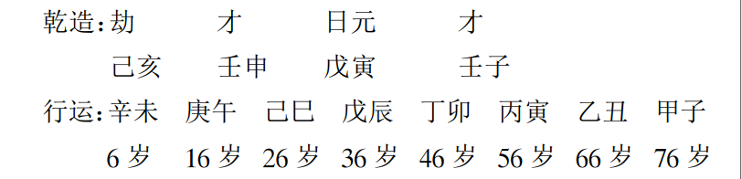

三个模糊问题：
（ 一）婚姻问题为何迟迟未决？
（ 二）八字命局喜、 用神是什么？
（ 三）事业运大概何时能够好转？  

己卯年庚午月己亥日己巳时， 阳遁九局用事， 甲子旬，（ 误局： 天英星值符伏吟本宫， 景门值使落坤二宫， 日、 时干己俱在
坎。 ）天英星值符落坎一宫， 景门值使落坤二宫， 日、 时干己在离。  

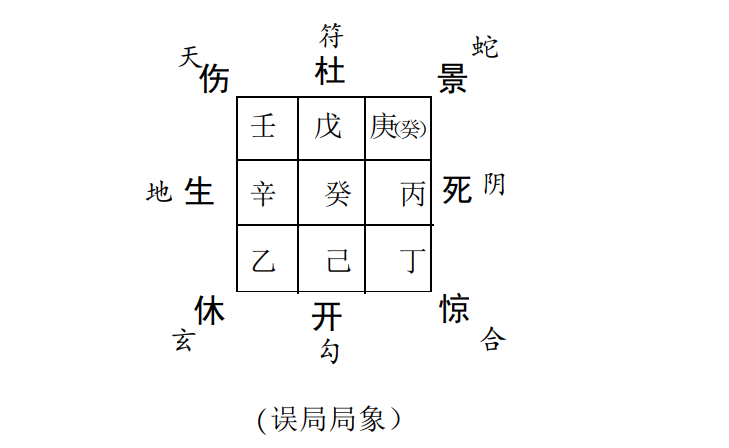

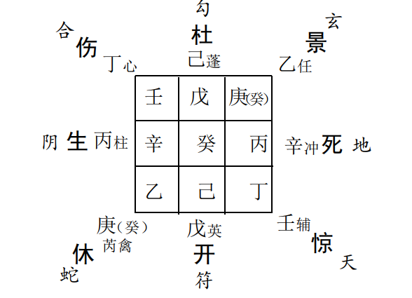

出生时间局象： 己亥年壬申月戊寅日壬子时生人。 因本日卯时， 恰交处暑节， 如果按拆补法规则选局， 当仍为立秋下元。
但是， 当我同时列出处暑下元的局象之后， 便发现其与周"的实际情况和当时问事时间局象所反映出的信息似乎更加接近。 如
两局象中， 开门均落坎宫， 因坎水、 休门常可代表绘画、 艺术人才等， 应该说与其现在的事业基本吻合。 还有， 两局象所反映出的  

婚姻信息也大体与实际情况相符， 故此， 当时我便以处暑下元，阴遁七局起用。 甲辰旬， 天冲星值符伏吟本宫， 伤门值使落巽四
宫， 日干戊在兑， 时干壬在震。  

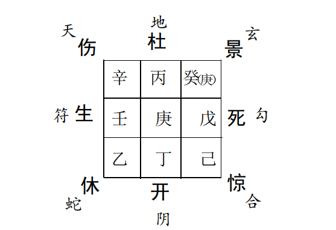

首先， 分析第一个问题。
从四柱看，26岁—46岁正行己巳、 戊辰劫财、 比肩大运， 因为命局身弱， 所以在此二十年中， 妻财易劫， 对象难成。 此或为
其晚婚的主要原因。
从两个奇门局象看， 乙、 庚落宫均系对冲， 五行皆又属土， 故争斗之象明显， 此其婚姻不顺的内在原因。再来看一下行运。 己巳、 戊辰二十年大运之中， 巽宫伤门主事， 大家知道伤门常主变动、 更改、 繁频、 不定， 正应其自身的实际情况， 对象谈了一大批， 就是没能有一个看得上， 留得住。 此外， 这二十年中， 火土气旺， 更加增强了乙、 庚两者落宫的能量，亦因此使得二者冲克不休， 争战不已。 故此， 其婚姻问题的解决， 必待接近丁卯大运， 生门主事之期， 乙、 庚落宫受制， 因之无暇交战， 或可。 具体而论， 当在45岁左右， 流年坤宫景门主事， 乙、 庚、 落宫逢冲填实之际。  

就本命造而言， 喜用取舍有两种看法， 一是身弱取助， 一是身弱从势、 从强。 如以身弱取助为用， 那么， 己巳、 戊辰二十年大
运之中， 周x必该有一番较大的发展， 但是， 实际情况与此不符。如论身弱从势呢？ 周x说自己实拿不准。 其实， 这个问题， 如果
从奇门局象看， 那么， 应该说一目了然。
46岁行震宫大运， 生门主事， 接下来艮宫休门和子运开门主事， 因三吉门皆为水木旺地， 因此， 必然应该是身弱而从强。
最后， 为了做进一步验证， 又测得其近几年流年运势， 亦基本符合此论。  

## 【 案例四十五】

 李驿华女士， 东北某工业大学教授，1999年5月29日下午预测各方面情况。
首先对其姓名进行了一些大概分析， 有如下几个明显信息。
（ 一）动态特征较为突出， 且活动的范围较为广阔。 这一点引伸到其人性格方面， 那么， 则常常表现为活泼好动， 积极进取，
有一定的理想和志向。
（ 二）笔画均匀， 起伏不大， 音韵平和， 抑扬顿挫， 可反映其人从总体行运上看， 较为流畅， 不易出现太大的坎坷与风波。
然后， 开始下面奇门预测分析。 诹得戊戌时局象。
己卯年己巳月辛巳日戊戌时， 阳遁五局用事， 甲午旬， 天任星值符， 日干辛落坤二宫， 值使生门在震， 时干戊在艮。  

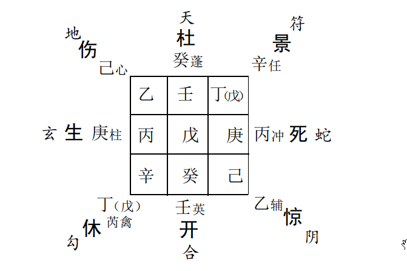

一、 格局方面的显著信息
（ 一）年干己落巽四宫旺地， 代表其父母必有相当地位和能量。 乘伤门， 天心星可说明其父母曾为军人、 医生或技术性较强
的工作或职业。 果应其父母均系延安时期老革命， 现已离休， 具体工作保密不提。
（ 二）日干辛落坤二宫， 可谓相气， 乘景门， 正与她在大学从事文化教育工作相互符合。 八神值符可象征有一定的职务、 权
限， 或在较为重要的岗位、 部门任职。
（ 三）伤门落巽四宫旺相之地， 因伤门主动， 另大象九星反吟， 亦均可反映出其人在性格等方面表现出的显著动态信息。
二、 基础大运分析
依子平命理八字大运排法， 从月上己巳始逆行九宫， 当时概定5岁起运， 每10年为一大运。
（ 一）早岁戊辰（5岁—15岁）。
乘伤门， 主变动、 移徙、 居无定所； 己年干可象父母、 长辈； 九地可代表农村、 土地、 后方；综合加临在一起， 可基本上反映了其人幼时随父母在延安， 后转战迁移保定、 石家庄、 天津等地流动式的生活。 巽四宫虽克日干落宫， 但幸得其中巳火之生， 及年干贵人相助。 综上， 概括其早年生活应该是得父母、 长辈荫佑， 但亦饱尝艰辛， 可谓吉凶参半。
（ 二）中青年时期丁卯、 丙寅16岁—35岁）
虽得生门、 休门， 但直接冲克日干落宫， 象征压抑、 阻隔等信息。 应其在文化大革命等一系列政治运动中， 父母被整， 自己亦倍受牵连等事。 生门、 休门可说明当时在物质生活方面， 相对来说还算不错， 其实， 那时也谈不上什么贫富差距。
（ 三）中晚运乙丑、 甲子（36—55岁）
乙丑运后几年， 确切说来是从1984年冬月正式转运。 先是父母得到平反昭雪， 而后， 自己的工作亦得到妥善安置， 事业从
此逐步攀升。      

三、 近期流年运势具体分析
（ 一）86年—87年， 派驻英国某研究所， 国家津贴补助相当不错。
（ 二）88年—89年， 转赴美国开展工作。
（ 三）90年运势一般， 回国一段时期。
（ 四）91年—92年， 再次以某课题组代表团组长的身份派驻美国。
（ 五）93年按局象信息反映， 该有些不顺之事， 但据其反映，不太明显， 亦未做深入追问。
（ 六）98年后半年， 肠胃手术， 为其生命历程的一大劫难。  

 

