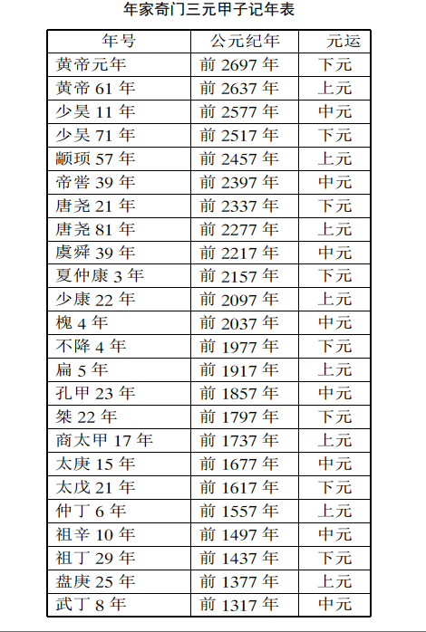
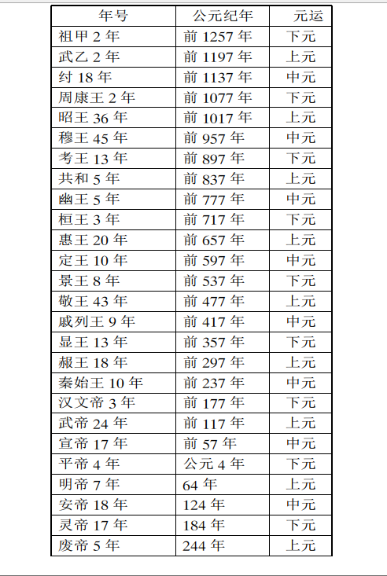
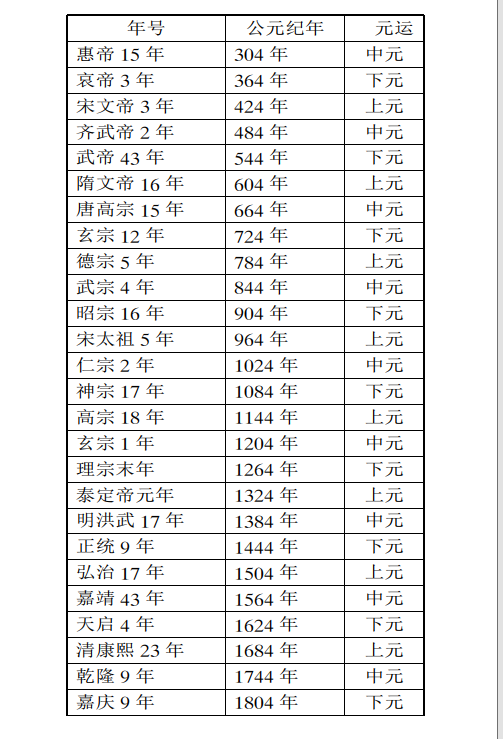
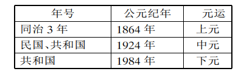

# 流派分类

奇门预测从用局时间上分， 除了**时家**奇门预测之外， 尚有**年家**奇门、 **月家**奇门和**日家**奇门。 年家奇门主要
应用于国家大事和年内吉凶的预测， 月家奇门、 日家奇门则常可预测月内和一天之内的吉凶及用事趋避选择等。  

此外， 从具体布局方法上， 除本书所用之**排宫法**（ 活盘法、 转盘法）之外， 尚有**飞宫法**、 **飞宫小奇门**等流派方法。  

# 第一节 年家奇门预测  

## 一、 三元甲子说

据说公元前2697年， 黄帝命大桡氏作干支记时， 并确定此年为黄帝元年甲子始元， 以后每60年即为一个花甲周期，180
年为一大运周期， 含三个花甲周期， 其中， 第一个花甲周期又称作上元甲子， 第二个花甲周期又称作中元甲子， 第三个花甲周期  

又称作下元甲子  

page403