# 1.九星属性及其运行规律  

## 一、 九星概说  

九星， 实际上是北斗星群， 也就是现代天文学大熊星座的又一别称。   

北斗星群 ， 在天它运行于中央， 临制四方， 分阴阳，建四时， 均五行， 推移节气度数， 在下与朝庭王世对应， 是帝王指
示意向的象征， 决定人间纲纪， 掌管吉凶祸福。  

九星目前只能看到七星  

九星与北斗星群以及奇门地盘宫位的对应关系， 具体列表如下：  

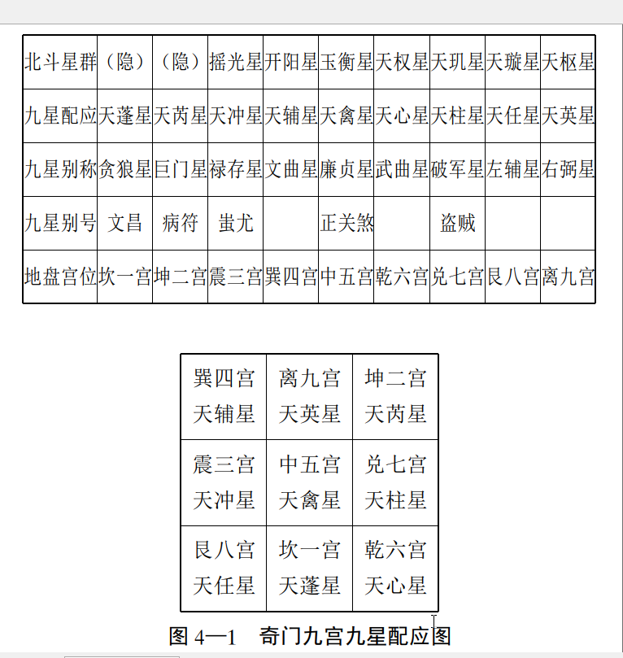

## 二、 九星属性  

### 天蓬星

字子禽， 别号贪狼， 文昌。 属水， 阳星， 位居地盘坎一宫， 旺于冬春， 乾宫、 坎宫次旺， 其余季节和宫位衰死。 生旺时， 利安抚
边境， 修筑城池， 利文途， 得官禄， 进财喜， 艺道远扬。 衰死时， 则易遇贼盗， 破财， 酒色之灾， 淫佚、 夭亡， 流荡等恶事  

### 天芮星

字子成， 别号巨门， 病符， 五行属土， 阴星， 凶星， 位居地盘坤二宫， 旺于申、 酉和四季月， 乾兑坤宫生旺， 其余季节和宫位衰
死。 生旺时授道交友， 妇人掌权， 置田兴家， 多谋吝啬。 衰死时，损财招鬼， 阴人陷害， 脏腑疾病等。  

### 天冲星

字子翘， 别号禄存， 蚩尤， 五行属木， 阳星， 小吉， 位居地盘震三宫， 旺于春夏和震巽离三宫， 生旺时忙忙碌碌， 动中觅利。 衰
死时， 则易静不宜动， 易招惹诉讼， 官非， 车祸， 兄弟刑伤等恶事  

### 天辅星

字子卿， 别号文曲， 属木， 阳星， 大吉， 位居地盘巽四宫， 旺于春夏和震巽离三宫。 生旺之时， 文职加官， 登科甲第， 盖世文章。
衰死时， 体弱多病， 优柔寡断， 处事不利  

### 天禽星

字子公， 别号廉贞， 属土， 阳星， 吉星， 位居中五宫， 一般寄居在坤二宫， 四时皆旺， 遇天禽星值符， 入官见贵， 应举谋望， 嫁娶
移徙， 商贾营建等百事皆宜  

### 天心星

字子襄， 别号武曲， 五行属金， 阴星， 吉星， 位居地盘乾六宫，旺于秋末初冬和坤、 兑、 乾三宫。 生旺时， 升官得权， 尤利武职，
疗病合药等事亦吉， 得遇医道， 技艺超群之人。 衰死时， 官场是非， 刑妻伤子， 易患头痛、 胸痛和金属伤害等病  

### 天柱星

字子申， 别号破军， 又称盗贼星， 五行属金， 阴星， 小凶， 位居地盘兑七宫， 夏末、 秋季和坤、 兑、 乾、 坎宫生旺。 生旺时， 形藏宜  守， 屯兵自固， 宜静以制动， 退以为进， 不宜谋为进取。 衰死时，口舌诉讼， 惊恐怪异， 破坏损伤， 病患喉肺。  

### 天任星

字子韦， 别号左辅， 五行属土， 阳星， 吉星， 位居地盘艮八宫，旺于初春、 四季、 月和乾 、 兑、 艮三宫。 生旺时， 富贵功名， 置业旺产， 百事皆宜， 衰死时， 谋为阻滞， 移徙筑室凶， 病伤脾胃小口、手脚、 筋骨、 腰脊  

### 天英星

字子威， 别号右弼， 五行属火， 凶星。 位居地盘离九宫。 旺于春夏和震巽离三宫。 生旺之时， 宜饮宴作乐， 嫁娶婚姻， 文书
献策， 声名远扬。 衰死之时， 性躁易爆， 火灾回禄， 文字官司， 病患心脑血管、 眼疾。  

## 三、 九星旺衰和吉凶推断  

九星的旺衰规律  具体如下表所示。  

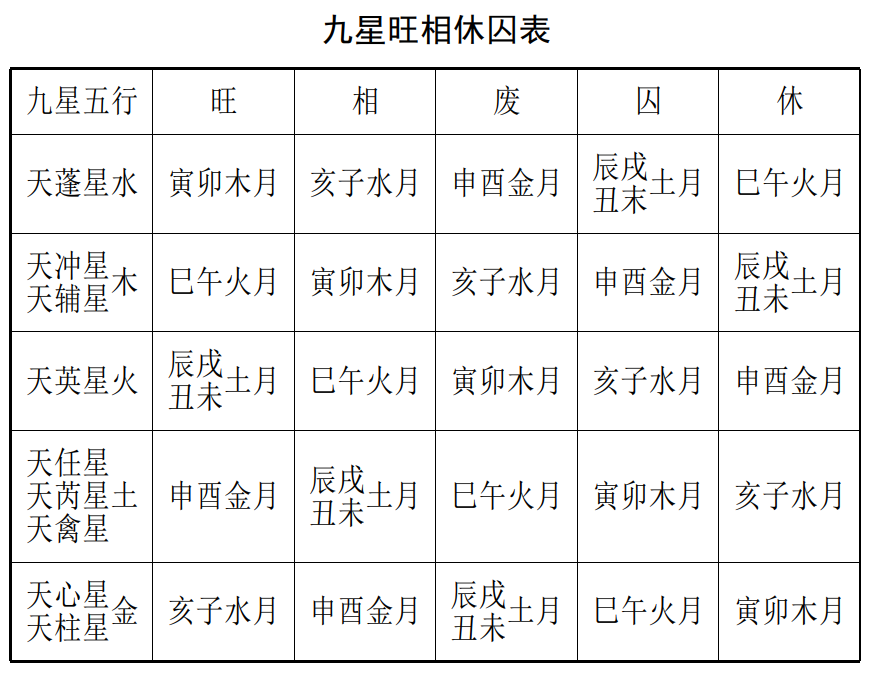

#### 九星旺衰之吉凶  下六句歌诀自己推断  

辅禽心星为上吉， 冲任小吉未全亨； 大凶蓬芮不堪使， 小凶英柱不精明； 大凶无气变为吉， 小凶无气一同之  

## 四、 九星运行规律  

### 1，九星配地盘奇仪  

举例如下：  

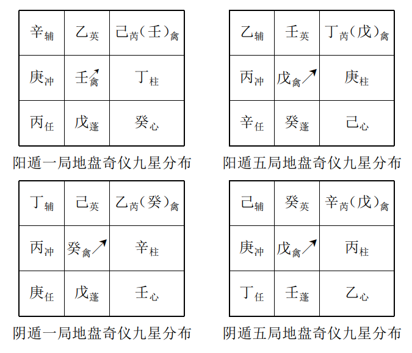

### 2、 根据时辰旬首， 确定九星值符

在六十甲子记录时辰变化的过程中， 我们首先有以下几个
规定；
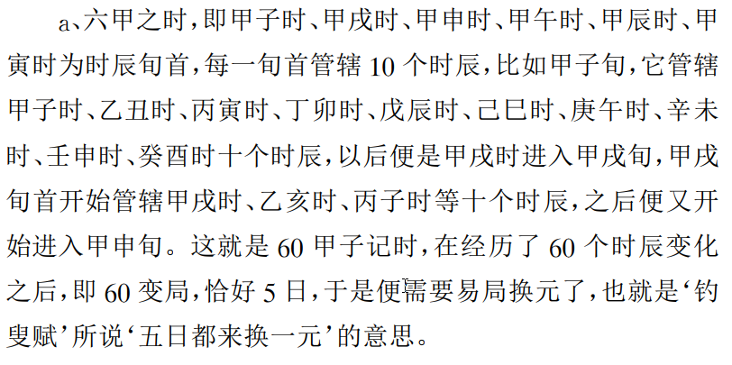

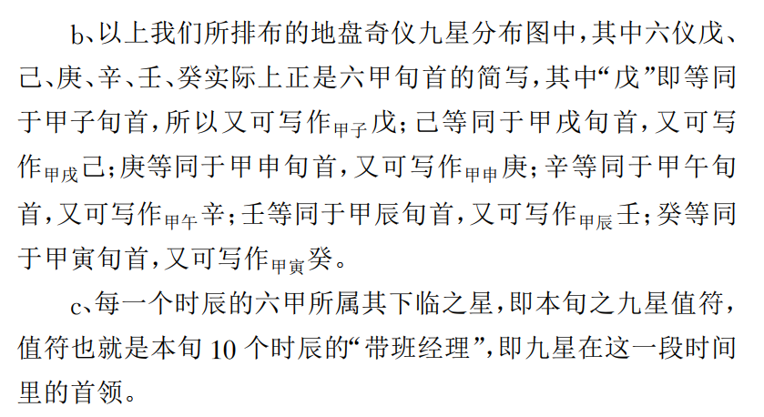

#### 举例

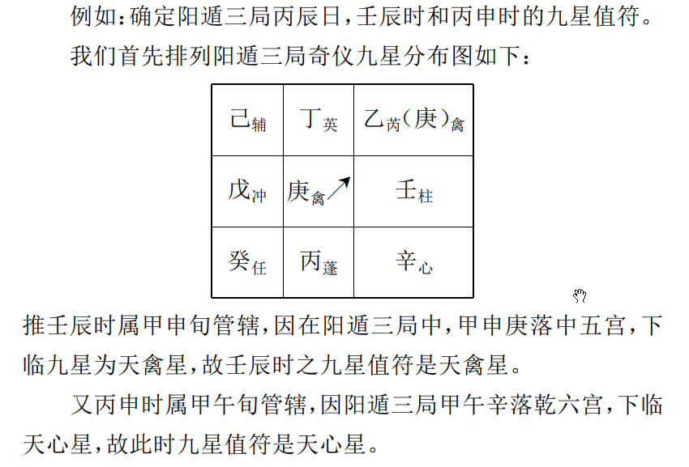

### 3、 值符变化随时干， 其余星仪依次加临飞布。  

我们以阴遁六局甲己日的九星奇仪的变化情况具体说明如下  

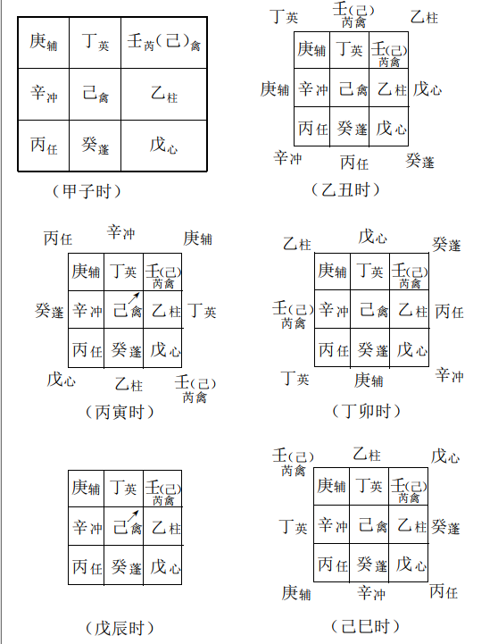

甲子时， 天心星值符随甲子戊加临时干甲（ 戊）之上， 因“ 遁甲”的意思即是甲隐于戊下， 甲、 戊同看， 今甲（ 戊）加临甲（ 戊）之
上， 亦即星仪皆不做变化， 那么， 其它的奇仪九星也就随之而不 再变化， 奇门中称此种现象为“ 伏吟”。 其它如本日戊辰时， 亦作
“ 伏吟”。  

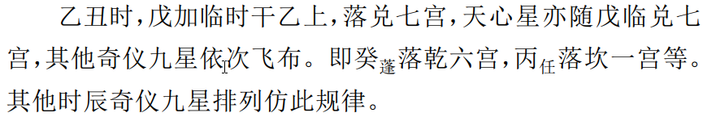

# 2，八门属性及其运行规律  

八门即开门、 休门、 生门、 伤门、 杜门、 景门、 死门、 惊门， 奇门遁甲谓之人盘， 代表人事谋为的成败与阻顺等信息， 其运行规律
随时支的变化而变化。  注意值使门和日元所临之门， 往往是人事预测和推理判断的主要依据。  

## 一、 八门属性  

### 开门

属乾， 时配戌亥， 虽为万物杀尽之时， 但乾中有亥， 纳甲壬，金动水生， 水生而育万物， 故为资生万物之初， 是谓吉门。
五行属金， 喜居乾兑之宫， 为相气， 入坎宫为旺气， 皆吉。 落艮宫入墓， 震宫为迫， 死气， 巽宫反吟， 离宫受克皆不利。
用逢开门， 开业经商， 参军考学， 加官进职， 谋为可就， 添丁进口， 乔迁婚喜， 病患痊愈， 作事欣然  

### 休门

属坎， 时配子月， 乃一阳复始之初， 草木值此而萌动， 返本还源之门， 所以是吉门。  

五行属水， 旺于震宫， 相于坎宫， 生于乾兑皆吉。 落坤、 艮被土克制， 巽宫入墓， 离宫反吟， 皆不利。
用逢休门， 灾害皆无， 财官自足， 心情舒畅， 万事合美。  

### 生门

生长发育， 生旺发达的意思， 卦配艮， 时配丑寅， 当此之时，阳气回转， 三阳俱足开泰， 万物皆生， 所以为至吉之门。
临乾兑二宫为旺， 居艮中宫为相， 生于离宫， 皆吉。 入坎宫为迫， 震宫被克， 巽宫入墓， 皆不利。
用逢生门， 求财谒贵， 谋划大业， 百事皆吉， 事业尤利房地产业、 种养殖业、 农林牧渔业。 不利埋葬治丧  

### 伤门

动遇创伤， 伤害之意， 卦配震， 时为卯月， 当此春分之时， 万物嫩甲发生， 当以吉论， 奈何物之精液自内而出， 发阳于外以致
根本泄之太过， 所谓外华而内虚， 不能胜其劳， 因此而受伤， 所以凶也。居震、 巽、 离旺相， 生于坎宫， 临兑、 乾反吟被制， 坤宫入墓，艮宫被迫， 皆凶。
用逢伤门， 宜静中求吉， 动则刑伤灾害， 求谋劳而无功， 经商、 建筑、 埋葬、 嫁娶、 上官赴任遇此亦皆不利， 出行则易遇车祸
等恶事。 但却适合捕捉渔猎、 索债、 戏耍、 赌博、 收敛财货。  

### 杜门

阻塞不通之意。 居地盘巽四宫， 时配辰、 巳， 时值夏初， 木气发生于外而津液已泄， 阳气亢极， 一阴将至， 木性至此而力屈， 欲
收敛而不能收敛， 欲生旺而力已尽， 又不能泄其力以实其子， 惟待阴伏藏其子于坚密之处， 恐有伤于子， 是谓杜门小凶。  

五行属木， 坎宫受生， 震、 巽、 离旺相， 落乾宫反吟， 兑宫受克， 坤宫入墓， 艮宫被迫。用逢杜门， 只宜遁迹潜形， 躲灾避难， 塞穴捕捉， 余事皆不利。  

### 景门

外盛内衰之意。 卦配离， 时配午月， 当此夏令之气， 万物壮盛， 将老之时， 与死门坤宫相近， 又为阳之盛气， 天数至此时， 将
有杀物之情， 虽是上明下亮之方， 亦不全吉， 惟利文书之事， 因之次吉。
五行属火， 地盘居离九宫， 坤艮中宫小吉， 震巽平， 坎一宫反吟， 乾、 兑二宫被迫凶。用逢景门， 只宜上书献策， 选士荐贤， 酒食饮宴， 余事皆不利。 凶事常主口舌、 诉讼、 血光之灾。  

### 死门

死丧、 灭亡、 失败之意。 与坤卦相配， 时主未申月， 当此秋冬之气， 天地肃杀自此始彰， 草拂色变， 木逢叶落， 故为死门。 五行
属土， 生于离， 旺于兑、 乾， 相于坤， 震宫受克， 巽宫入墓， 坎宫被迫。用逢死门， 得奇相助， 顺天之序， 只宜吊丧行刑、 捕捉、 狩猎等阴凶之事， 其他皆不利  

### 惊门

惊恐、 忧疑斗讼之意。 卦配兑， 时主酉月， 值八月秋令， 寒气肃杀， 草木凋零， 是为凶门。五行属金， 居地盘兑七宫， 旺相于兑、 乾、 坎三宫， 生于坤， 落震巽死气， 离宫受制。  用逢惊门， 常主破损、 毁折、 官非、 口舌、 惊疑、 斗讼等事， 若得
三奇相助， 且明主客之道， 则假词献诈， 捕捉设疑， 伏兵待敌可用  

## 二、 八门运行规律  

### 1、首先规定地盘九星值符所对应的地盘八门为值使门  

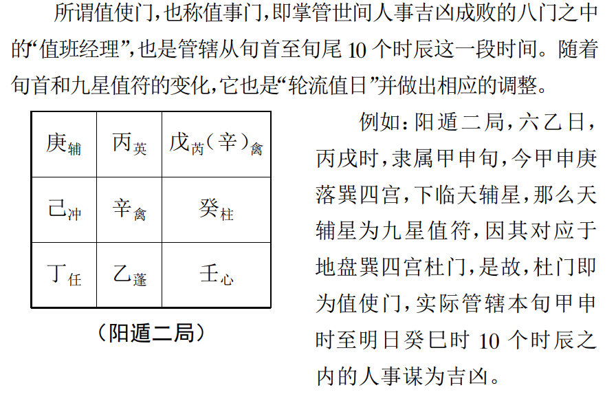

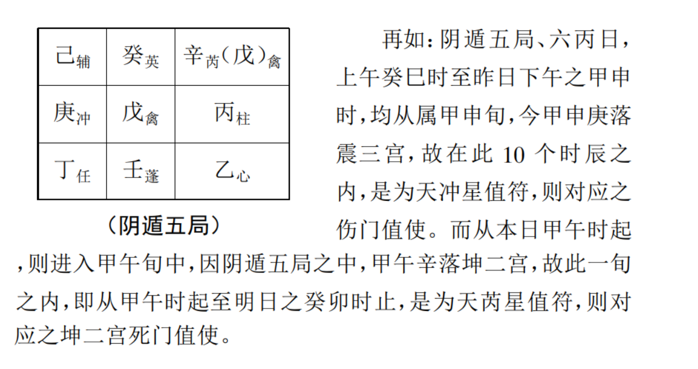

### 2、 值使门变化随时支  

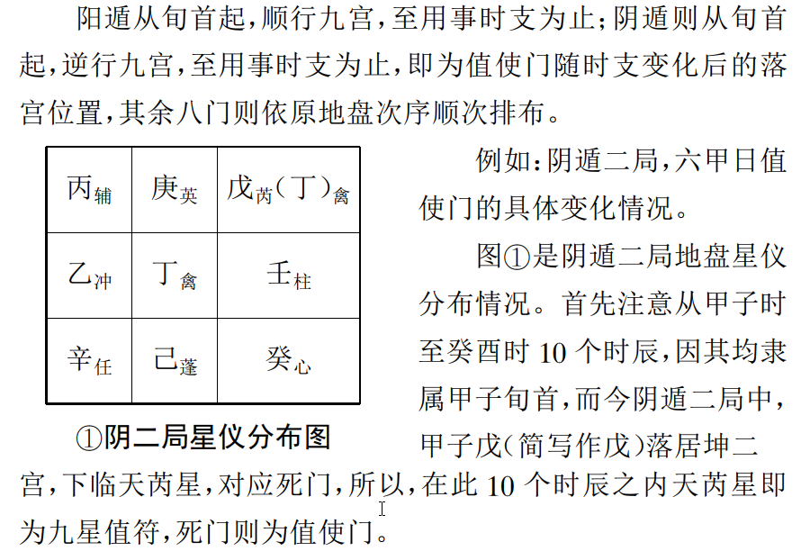

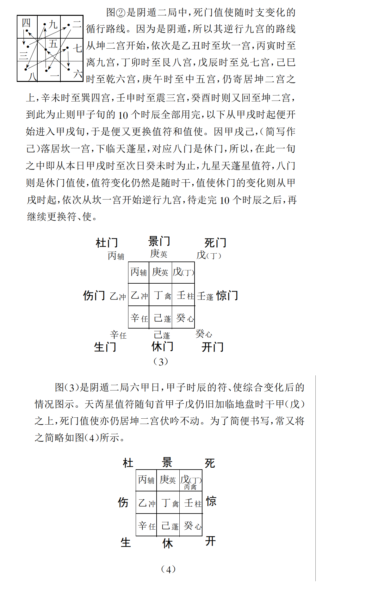

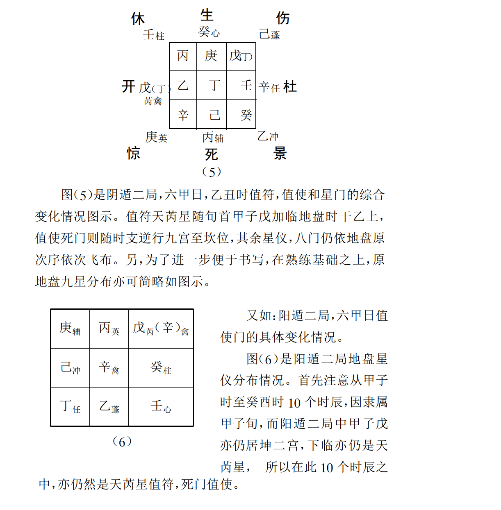

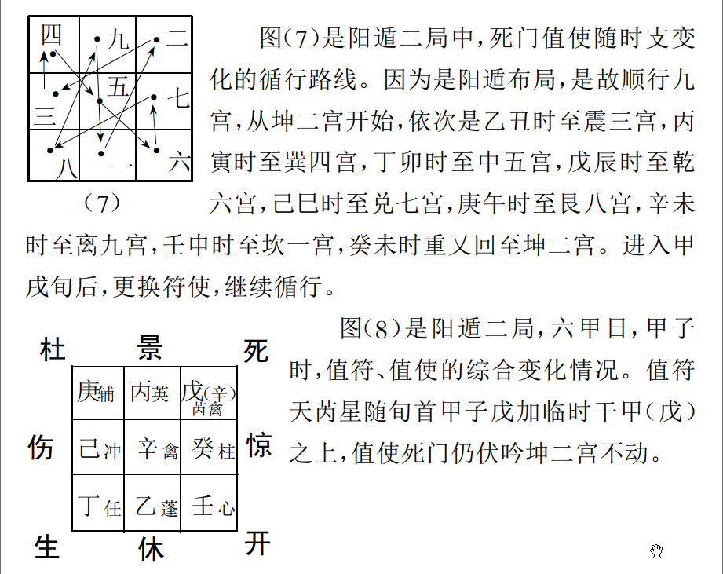

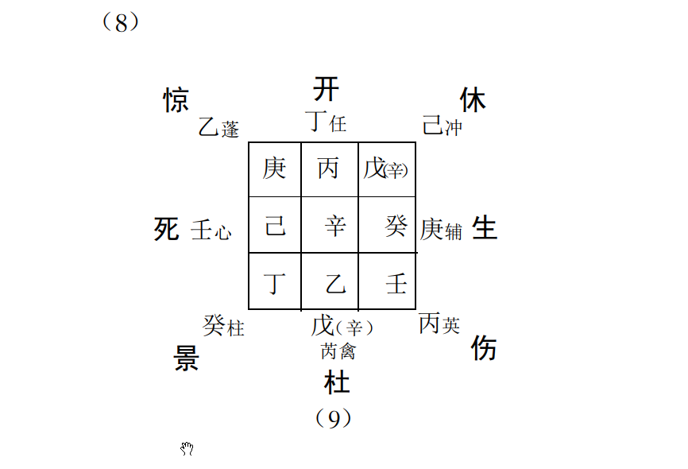

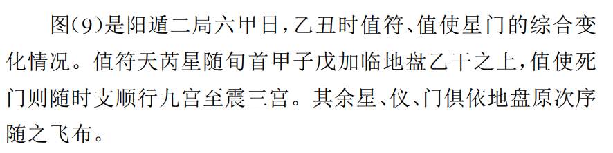

## 三、 人盘八门与地盘宫位生克关系  

奇门遁甲中将随值使门依次飞布的八门称之为人盘。 根据人盘八门和其落座之九宫的五行属性， 我们可将其两者的关系
划分成制、 迫、 义、 和、 比五种关系。
所谓制， 是指宫克门， 如伤门落乾兑二宫； 迫， 是指门克宫，如伤门落坤， 艮二宫； 义， 指宫生门， 如伤门落坎一宫； 和， 是指门
生宫， 如伤门落离九宫； 比， 是指门宫五行同属， 如伤门落震巽二宫。
在具体应用过程中， 一般来讲吉门被制、 被迫， 则吉事难成，遇生、 比、 和则吉上加吉； 凶门被制、 被迫， 则凶事受制， 凶事不起
或凶中有解； 遇义、 比、 和， 则凶门之信息愈加强烈， 凶之更甚。

# 3.八神属性及其运行规律  

八神即奇门遁甲中值符、 腾蛇、 太阴、 六合、 白虎、 玄武、 九地、 九天、 八种信息符号的总称， 它们一起构成奇门遁甲的神盘，
也称八诈门盘、 八将盘、 顶盘、 针盘， 代表来自宇宙空间的又一种影响自然界万物和人类生活的神秘能量信息  

## 一、 八神属性  

### 值符

值符为八神之首， 它具有中央戊己土的性能， 可化育矛盾，消除百恶。
人物： 常代表贵人、 官员、 长者， 失时失地者可为说合调解、牙婆媒人、 组织者、 主事者。
物品： 财物类可象贵重物品、 珍宝、 高档家俱、 高级耐用消费品等， 其它现代生活中亦可代表官职、 调令、 权印等与“ 权贵”有
关或较为“ 重要”的信息或物品。
病患： 脏腑、 头目等人体主要器官之寒热病痛。
动物： 牛、 马、 麟角动物。
农作物： 谷麻稻。
鬼崇： 宗神、 鬼庙。
形状： 厚实、 方正。
颜色： 黄。  

数日： 五、 八。
事件： 旺相得奇， 则常可遇贵人提携， 否则， 死囚且刑克用
神， 则易遭官非嗔斥， 或其它不顺心意事。  

### 腾蛇

丁火之化气， 性虚柔而口毒。
人物： 经商之人， 政法部门工作人员， 惊狂妇人， 嚼舌小人，奴仆婢人等。
物品： 形状曲而长， 有花纹斑点之物品， 如绳索、 网罟等。 光滑润泽、 漂亮， 但形状不美， 中虚不实， 有疵瑕之物品。
病患： 头目、 血虚、 四肢瘫肿见血。
动物： 蛇、 蛟、 蚯蚓等。
农作物： 豆、 黍。
鬼崇： 木火土神， 不葬客鬼。
形状： 长而曲， 不规则， 虚、 尖。
颜色： 红、 赤、 花纹。
数目： 四、 九。  

### 太阴

西方阴金之化气， 性格阴匿、 暗昧。
人物： 常代表妇女， 少女， 或性格乘戾、 阴昧之人， 职业可能与教师、 新闻、 文秘、 参谋、 策划等相关。
物品： 财帛、 金银、 首饰、 金铁刀针、 金属装饰品、 妇女化妆品或其它妇女生活用品等。
病患： 肺、 腹患， 腰、 筋损。
动物： 鸡、 雉、 飞鸟。
农作物： 麦类。
形状： 瘦、 方。
颜色： 白、 亮、 金属色。
数目： 七、 四、 九  

事件： 吉庆婚姻， 阴私密谋类事， 戾则阴私损失， 远信未致，疾病缠绵， 谋事迟滞未成。  

### 六合

东方木之化气， 性格柔顺和平， 能通委曲， 和合人事。
人物： 文儒、 九流、 隐贤仕宦、 贸易交易人员、 民间工匠艺人。
物品： 印章、 书信、 通知、 函件、 草木制品、 羽毛、 服装、 彩纹、
装璜、 机车、 果品等。
病患： 阴阳不调， 风麻肿痛。
动物： 兔类等食草动物。
农作物： 粟类。
鬼崇： 草木之精。
形状： 秀、 长。
颜色： 绿、 多彩。
数目： 六、 三。
事件： 婚姻喜庆， 求望交易， 媒约牙保， 交契财物， 木植、 车船等物事。  

### 白虎

庚金之化气， 其性刚猛， 专主权煞。
人物： 得令得奇， 则职居大将军， 气雄威猛。 失时失地， 则凶
恶狼狈。 现代社会人物常类象公安、 刑警、 军人、 屠夫、 外科手术医师等。
物品： 金属制品、 刀剑等， 失令者或为朽铁瓦石。
病患： 四肢头腹不宁， 外伤、 创伤。
动物： 猿、 猴、 虎、 兽类。
农作物： 麦、 麻。 

鬼崇： 杀、 伤、 恶死之新鬼。
形状： 锐利、 有棱角、 坚硬、 形方。
颜色： 白、 金属色。
数目： 七、 五。
事件： 道路、 兵戈、 权威、 宝物， 戾则死丧疾病， 杀伐灾害， 惊恐刑戮， 口舌狱禁。

### 玄武

水之精， 统辖北方之气， 性好阴谋， 淫邪， 喜贼盗。
人物： 旺相得时， 配奇门， 多主聪明多智， 文章技巧， 艺术人才， 戾则常为奸诈小人， 女子阴私， 一般戏曲、 影视艺人， 舞女或
舞厅、 酒店服务人员， 及非正式工作人员等。
物品： 水、 液态食品， 盐卤酒油， 煤炭、 石油等。
病患： 心腹胀满， 邪湿淋漓， 不实之症。
动物： 猪、 虫、 水族。
鬼崇： 河伯、 水神， 厕鬼。
形状： 不圆满， 缺陷、 瑕疵。
颜色： 黑。
数目： 四、 一、 六。
事件： 反复无常， 浮泛难成， 不实之象。

### 九地     

坤土之化气， 性格柔顺、 安静、 迟滞、 吝啬， 母后之象。
人物： 得时得奇， 则清真廉洁， 高贵尊崇， 为宫庭后妃， 贵流妇人； 失令者为卜者、 医师、 道姑、 师婆、 尼姑、 农民； 戾则淫滥邪，杂乱人伦， 贫贱妇人。
物品： 布匹、 织物、 五谷、 土中之物、 药品、 废旧物品  

病患： 脏腑脾胃， 阴阳不调， 大小便不利。
动物： 羊、 牛、 雌性兽类。
鬼崇： 土神、 女鬼。
形状： 厚实、 方正、 可塑。
颜色： 黑、 黄。
数目： 二、 五、 八。
事件： 谋事迟缓， 易受阻， 利以柔克则， 静以待变  

### 九天

乾金之化气， 性格刚强好动， 奋发向上。
人物： 得时得奇， 为父辈、 官长、 贵人， 其别于值符之处， 如值符象企业之厂长、 经理、 国家之总理， 则九天可象公司之董事长，
国家之主席。 九地则常象书记类职务或人物。
物品： 文书、 印信、 远方， 占天则飞鸟为应。 圆物、 金器、 玉器、 宝剑， 或有声有足能转动、 行动之物品。
病患： 头目、 神志、 筋胁。
动物： 龙、 虎、 狮、 象、 天鹅。
农作物： 圆果、 坚物、 珍稀植物。
形状： 圆、 坚硬。
色： 白。
数目： 一、 六。
事件： 远行、 博奕或谋为前途类事  

## 二、 八神之运行规律  

与天盘九星值符相对应的即八神值符之位， 值符之位确定之后， 八神其余定位， 遇阳遁则依次顺排 腾蛇、 太阴、 六合、 白虎、
玄武、 九地、 九天； 阴遁则依次逆排。 另白虎与勾陈、 玄武与朱雀有时通用。
例如： 第二节中例， 阴遁二局， 六甲日， 乙丑时， 我们继续给之排布八神， 因值符天芮星在震三宫， 则从三宫起逆行， 八宫
腾蛇， 一宫太阴， 六宫六合， 七宫白虎， 二宫玄武， 九宫九地， 四宫九天， 如图所示。  

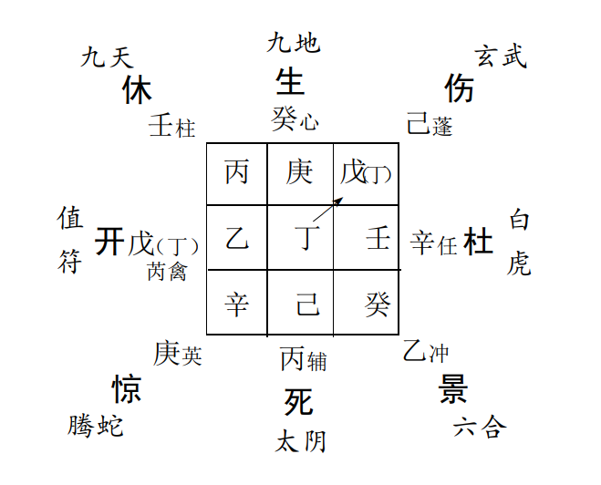

再如， 阳遁二局， 六甲日， 乙丑时， 天芮星值符落坎一宫， 死门值使在震三宫， 八神从坎一宫起顺行， 依次是八宫腾蛇， 三宫
太阴， 四宫六合， 九宫白虎， 二宫玄武， 七宫九地， 六宫九天， 如图  

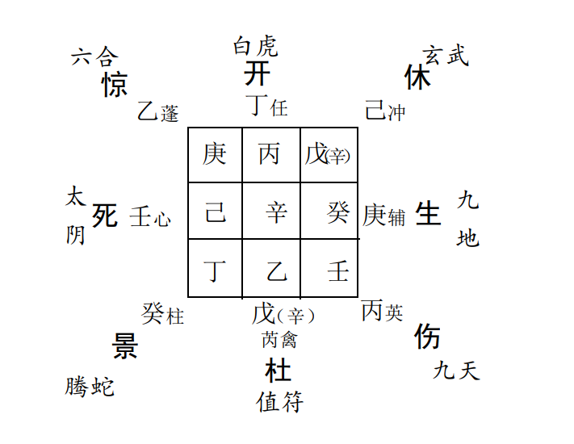

# 4、奇门象数理模型综合演局示范  

## 案例1

1、查万年历或采用时间快速推算法， 得出用事时间之农历干支记时为： 辛未年庚寅月丙辰日癸巳时； 属立春节气， 并被中
元符头甲寅所管辖， 故首先即可选定用事局象当为立春中元， 阳遁五局用事。
2、 布阳遁五局地盘奇仪， 配九星。
3、 据癸巳时辰之旬首甲申庚， 确定其下临九星天柱星为九星值符， 则对应之惊门为八门值使， 如图所示。  

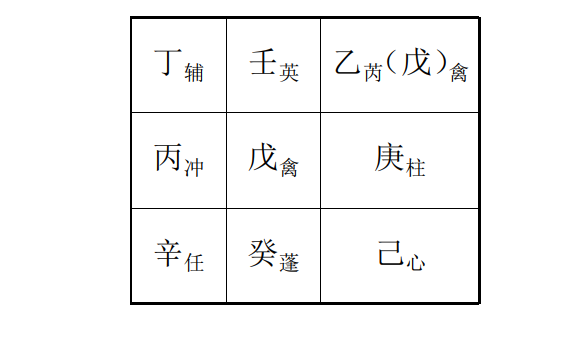

4、 值符变化随时干， 值使变化随时支。 排布变化后的奇仪、符使、 星门。
将甲申庚天柱星加临地盘坎一宫， 即时干癸之上， 其余星仪依次排列； 值使门惊门甲申时居兑七宫， 乙酉时至艮八宫， 丙戌时离九宫， 丁亥时至坎一宫， 戊子时至坤二宫， 排至癸巳时， 又回至兑七宫， 八门其余依次排列。 如图所示  

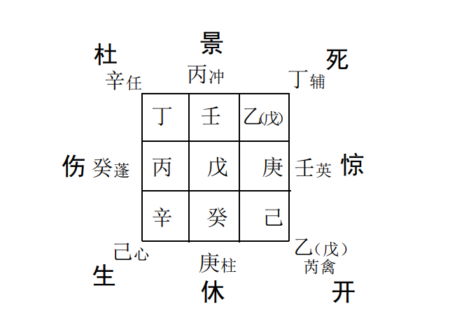

5、 确定值符神位在坎一宫， 依次顺布八神。  

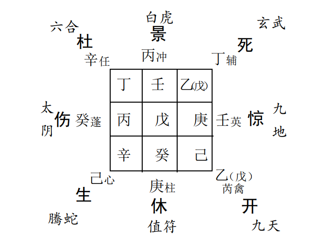

## 案例2

例二：1999年1月20日14时：30分， 用事起局。
1、 查万年历或快速推算本日干支为： 己卯年乙丑月壬申日丁未时， 因本日20时16分交大寒节，所以尚属小寒用事而非大寒节气范围， 日元被己巳符头管辖， 故首先确定用事局象当为小寒中元， 阳遁八局用事。  

2、 布阳遁八局地盘奇仪， 配九星。
3、 据时辰丁未之旬首甲辰壬， 确定其下临天冲星为九星值符， 对应之伤门为八门值使。 如图所示。  

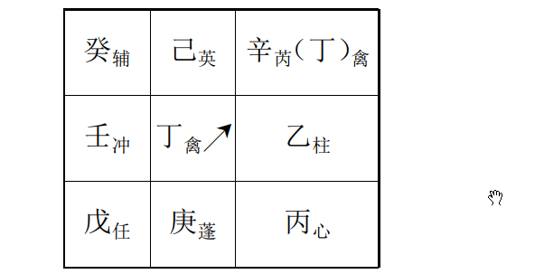

4、 布变化后的奇仪、 符使、 星门。
将值符奇仪甲辰壬天冲星加临地盘时干丁之上， 即中五宫寄居坤二宫之上， 其余星仪依次排列； 然后再排布值使门和八门其余， 甲辰时值使门伤门居震三宫， 阳遁依宫数顺行， 乙巳时至巽四宫， 丙午时至中五宫（ 坤二宫）， 丁未时至乾六宫， 确定伤门在乾， 则八门其余依次排布。 如图所示  

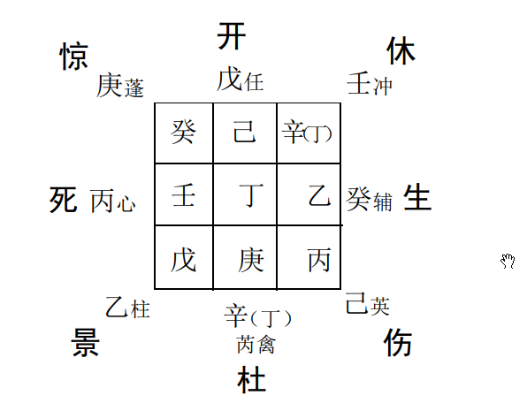

5、 确定值符居坤二宫， 依次顺布八神。  

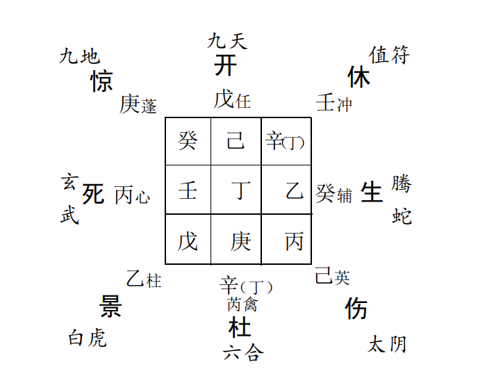

## 案例3

例三：1999年8月5日21: 30分， 用事起局。  

1、 本日干支记时： 己卯年辛未月己丑日乙亥时， 大暑下元用事， 阴遁四局。
2、 布阴遁四局地盘奇仪， 配九星。
3、 据时辰乙亥之旬首甲戌己， 确定其下临天冲星值符， 对应之伤门值使。 如图所示  

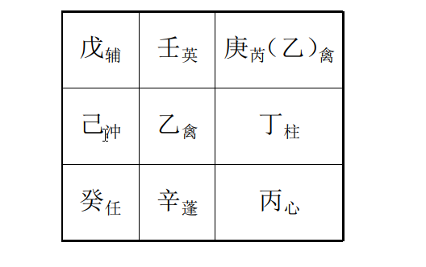

4、 排布变化后的奇仪、 符使、 星门。  

将值符天冲星随奇仪甲戌己加临地盘时干乙， 坤二宫之上，其余星仪依次排列； 然后再排值使门和其余八门， 据值使变化随时支， 阴遁逆行九宫， 那么， 甲戌时， 伤门伏吟震三宫不动， 乙亥时， 则值使伤门逆行至坤二宫， 确定值使伤门在坤， 则八门其余依次排布。 如图所示。  

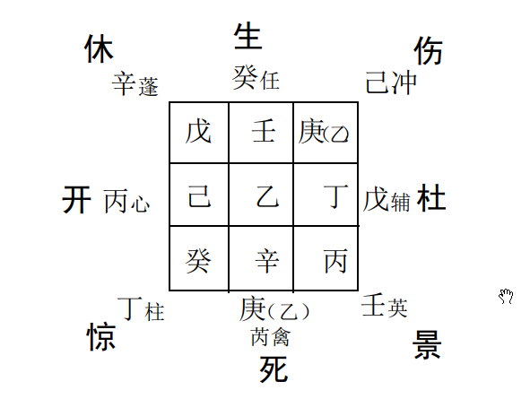

5、 确定八神值符居坤二宫， 八神其余 腾蛇、 太阴、 六合、 白虎、 玄武、 九地、 九天依次逆布。  

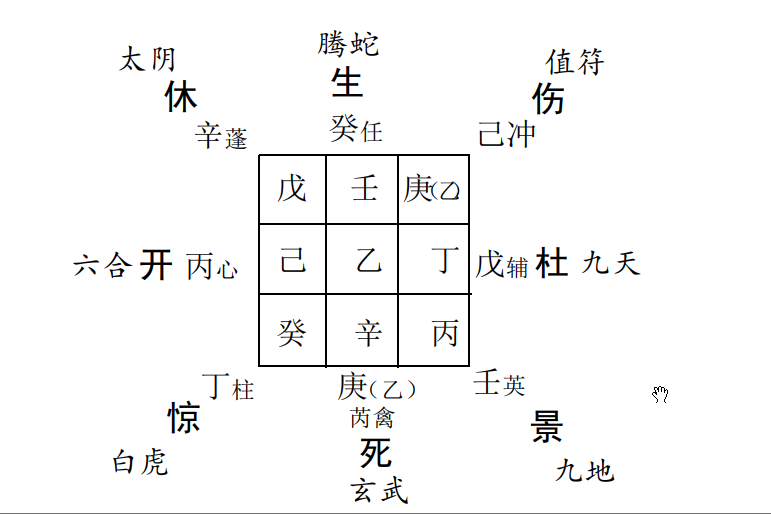
