# 1.奇仪格局主应  

奇仪格局是指天盘奇仪加临地盘奇仪之上后， 形成许多错综复杂的关系， 并代表一定的意义和吉凶悔吝信息， 又称格局主应。 所谓主应， 就是说奇门遁甲模型中各类符号综合加临 后在预测过程中所表示的某种意义和信息。 奇仪格局主应是奇门预测的基本依据  

## 甲（ 戊）加临奇仪主应  

甲（ 戊）加甲（ 戊）： 名伏吟， 凡事闲塞， 静守为吉。
戊加乙： 青龙合灵门， 吉事更吉， 凶事更凶。
戊加丙： 青龙返首， 动作大利， 逢墓迫击刑， 吉事成凶。
戊加丁： 青龙耀明， 利谒贵求名， 值墓迫， 招非。
戊加己： 贵人入狱， 公私皆不利。
戊加庚： 值符飞宫， 吉事不吉， 凶事更凶。
戊加辛： 青龙折足， 吉门生助尚可谋为， 逢凶门则招灾、 破财、 足疾类事。
戊加壬： 青龙入天牢， 阴阳皆不利。
戊加癸： 青龙华盖， 吉门招福， 凶门多破败  

## 乙加临奇仪主应  

乙加甲（ 戊）： 利阴害， 逢凶门墓迫， 破财人伤。
乙加乙： 日奇伏吟， 只宜安分守吉， 不利谒贵求名。
乙加丙： 奇仪顺遂， 吉星迁官进职， 遇凶星夫妻离别。
乙加丁： 奇仪相佐， 文书事吉， 百事可为。
乙加己： 日奇入墓， 被土暗昧， 门凶必凶。
乙加庚： 日奇被刑， 争讼财产， 夫妻怀私。
乙加辛： 青龙逃走， 奴仆拐带， 六畜皆伤。
乙加壬： 日奇入地， 尊卑悖乱， 官诎是非。
乙加癸： 华盖逢星， 宜遁迹修道， 隐匿藏形， 躲灾避难等事吉。  

## 丙加临奇仪主应  

丙加甲（ 戊）： 飞鸟跌穴， 谋为洞彻。
丙加乙： 日月并行， 公谋私为皆吉。
丙加丙： 月奇悖格， 文书逼迫， 破耗遗失。
丙加丁： 朱雀贵人， 文书吉利， 常人宜静。
丙加己： 火悖入刑， 囚人被刑杖， 文书不行， 吉门则得吉， 凶门转凶。
丙加庚： 荧入太白， 门户破败， 盗耗遗失。
丙加辛： 谋事成就， 病人不凶。
丙加壬： 火入天网， 为客不利， 是非颇多。
丙加癸： 华盖悖格， 阴人害事， 灾祸颇多。  

## 丁加临奇仪主应  

丁加戊（ 甲）： 青龙转光， 官人升迁， 常人威昌。
丁加乙： 人遁吉格， 贵人加官进禄， 常人婚姻财喜。  

丁加丙： 星随月转， 贵人高升， 常人乐极生悲。
丁加丁： 星奇入太阴， 文书即至， 喜事遂心。
丁加己： 火入勾陈， 奸仇冤事因女人。
丁加庚： 年月日时格， 文书阻隔， 行人必归。
丁加辛： 朱雀入狱， 罪人失囚， 官人失位。
丁加壬： 五神互合， 贵人思诏， 讼狱公平。
丁加癸： 朱雀投江， 文书口舌俱消， 音信沉溺  

## 己加临奇仪主应  

己加戊： 犬遇青龙， 门吉谋望遂喜， 门凶枉劳心机。
己加乙： 墓神不旺， 地户逢星， 遁迹隐形为宜。
己加丙： 火悖地户， 阳人以冤相害， 阴人必致淫污。
己加丁： 朱雀入墓， 文状词讼先曲后直。
己加己： 地户逢鬼， 病者必死， 百事不遂。
己加庚： 刑格返名， 词讼先动不利后动利。
己加辛： 游鬼入墓， 鬼魁、 小人、 阴人为崇。
己加壬： 地网高张， 狡童佚女， 奸情伤杀。
己加癸： 地刑玄武， 男女疾病垂危， 词讼有囚狱之灾  

## 庚加临奇仪主应  ，没有一个好

庚加戊： 太白天乙伏宫， 谋为百事皆凶。
庚加乙： 太白逢星， 退吉进凶， 谋为不利。
庚加丙： 太白入荧， 占贼必来， 为客进利， 为主破财。
庚加丁： 亭亭自奸， 因私匿起官司， 门吉有救， 门凶事凶。
庚加己： 刑格， 官司被重刑。
庚加庚： 太白同宫， 官灾横祸， 兄弟雷攻。
庚加辛： 白虎干格， 远行车折马死  

庚加壬： 小格， 远走迷失道路， 男女音信嗟呀。
庚加癸： 大格， 行人不至， 官司破败， 生产母子皆伤。  

## 壬加临奇仪主应：  

壬加戊： 小蛇化龙， 男人发达， 女产婴童。
壬加乙： 小蛇得势， 女子温柔， 男子嗟呀， 占孕生子。
壬加丙： 水蛇入火， 官灾刑禁， 络绎不绝。
壬加丁： 干合蛇刑， 文书牵连， 贵人匆匆， 男吉女凶。
壬加己： 凶蛇入狱， 大祸将至， 顺守可吉， 词讼理曲。
壬加庚： 太白擒蛇， 刑狱公平， 立判邪正。
壬加辛： 腾蛇相缠， 纵得奇门， 亦不能安， 若有谋望， 被人欺瞒。
壬加壬： 腾蛇入地网， 外人缠绕， 内事索索， 动荡不安。

壬加癸： 幼女奸淫， 家有丑声。  

## 癸加临奇仪主应  

癸加戊： 天乙会合， 财喜婚姻， 吉人赞助成合， 若门凶迫制，官非灾祸。
癸加乙： 华盖逢星， 贵人禄位， 常人平安。
癸加丙： 华盖悖格， 贵贱逢之皆不利。
癸加丁： 腾蛇夭矫， 文书官司， 火焚莫逃。
癸加己： 华盖地户， 男女占之音信皆阻， 躲灾避难为吉。
癸加庚： 太白入网， 明暴争讼力平。
癸加辛： 网盖天牢， 占病占讼， 死罪莫逃。
癸加壬： 复加 腾蛇， 嫁娶重婚， 后嫁无子， 不保年华。
癸加癸： 天网四张， 行人失伴， 病讼皆伤    

### 下表就是上面的总览

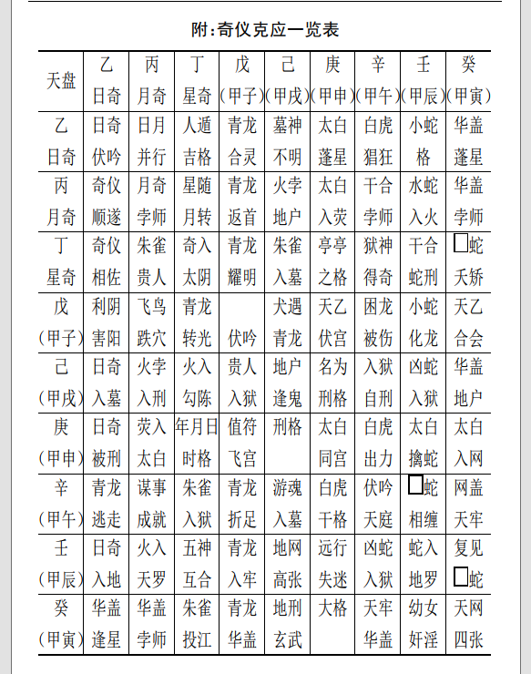

# 2.八门主应和八门奇仪主应  

八门主应指人盘八门变化后落地盘九宫， 与地盘八门形成的某种生克制化关系， 及其所象征的意义和吉、 凶、 悔、 吝的信息提示。

 八门奇仪主应则是指人盘八门和天盘奇仪组合加临到一起所表示的某种意义和吉、 凶、 悔、 吝信息的某种提示  。

## 一、 开门加八门和奇仪主应  

### （ 一）开门加八门主应

开加开： 主贵人、 宝物、 财喜、 官运、 事业。
开加休： 主见贵人、 财喜， 开张店铺， 贸易大利。
开加生： 见贵人， 谋望所求遂意。
开加伤： 主变动、 更改、 移徙等事， 皆不吉。
开加杜： 主失脱文印、 书契等， 小凶。
开加景： 见贵人， 因文书事不利。
开加死： 官司、 惊扰、 恶事， 先忧后喜。
开加惊： 词讼、 惊疑之事  

### （ 二）开门加奇仪主应

开加甲： 财名俱得；
开加乙： 小财可求；
开加丙： 贵人印绶；
开加丁： 远信必至；
开加己： 事绪不定；
开加庚： 道路词讼， 谋为两歧；
开加辛： 阴人道路；  

开加壬： 远行有失；
开加癸： 失财小凶。  

## 二、 休门加八门和奇仪主应  

### （一）休门加地盘八门主应

休加休： 求财进人口， 谒贵吉， 朝见上官， 修造大利。
休加生： 得阴人财物； 于贵谋望， 虽迟应吉。
休加伤： 上官主喜庆； 求财则不易得； 其它分产、 变动等事亦主不吉。
休加杜： 主破财、 失物难寻。
休加景： 主谋望文书印信等事不成， 反招口舌。
休加死： 主文印官事不吉， 远行， 僧道事不吉， 占病凶。
休加惊： 主损财、 招非并疾病惊恐事。
休加开： 主开张店铺及见贵， 求财等事大吉。  

### （ 二）休门加奇仪主应：

休加甲（ 戊）： 财物和合；
休加乙： 求谋重， 不得； 求轻， 可得；
休加丙： 文书和合喜庆；
休加丁： 百讼休歇；
休加己： 暗昧不宁；
休加庚： 文书词讼先结后解；
休加辛： 疾病退愈， 失物不得；
休加壬、 癸： 阴人词讼牵连。  

## 三、 生门加临八门和奇仪主应  

### （一）生门加八门主应：

生加生： 主远行， 求财， 吉
生加伤： 主亲友变动， 道路不吉。
生加杜： 主阴谋、 阴人损财， 不利。
生加景： 主阴人、 小口不宁及文书事， 后吉。
生加死： 主田宅官司， 病则主难救。
生加惊： 主尊长财产、 词讼， 病迟愈， 吉。
生加开： 主见贵人， 求财大发。
生加休： 主阴人处， 谋财利。  

### （二）生门加奇仪主应  

生加甲（ 戊）： 嫁娶、 谒贵， 求财皆吉；
生加乙： 主阴人生产迟， 吉；
生加丙： 贵人， 印绶、 婚姻、 书信等喜事；
生加丁： 词讼、 婚姻、 财利， 出行大吉；
生加己： 得贵人维护支持， 吉；
生加庚： 财产争讼、 破耗遗失；
生加辛： 主产妇疾病， 后吉；
生加壬： 遗失财物， 后得， 捕盗易获；
生加癸： 主婚姻难成， 余事皆吉  

## 四、 伤门加临八门和奇仪主应  

（一）伤门加八门主应
伤加伤： 主变动、 远行皆主折伤  

伤加杜： 主变动、 失脱、 官司、 刑狱， 百事凶。
伤加景： 主文书、 印信、 口舌、 动挠、 啾唧。
伤加死： 主官司、 印信凶， 出行大忌， 占病凶。
伤加惊： 主亲人疾病、 惊忧， 谋为不利， 凶。
伤加开： 主见贵人、 开张、 走失、 变动等事不利。
伤加休： 主男人变动或托人谋干， 财名不利。
伤加生： 主房产、 种殖业等变动。  

### （二）伤门加奇仪主应

伤加甲（ 戊）： 失脱难获；
伤加乙： 求财不得， 反盗耗失财；
伤加丙： 道路损失；
伤加丁： 音信不实；
伤加己： 财散人病；
伤加庚： 讼狱被刑杖；
伤加辛： 夫妻怀私怨怒；
伤加壬： 囚盗牵连；
伤加癸： 讼狱被冤， 有理难伸。

## 五、 杜门加八门和奇仪主应  

### （ 一）杜门加临八门主应

杜加杜： 主因父母疾病、 田宅出脱事， 凶。
杜加景： 主文书、 印信阻隔， 阳人小口疾病。
杜加死： 主田宅、 文书失落， 官司破财小凶。
杜加惊： 主门户内忧疑、 惊恐、 词讼事。
杜加开： 主见贵人、 官长谋事， 先破财后吉。  

杜加休： 主求财小益。
杜加生： 主阳人小口破财， 田宅求财不利。
杜加伤： 主兄弟争田产破财。    

### （ 二）杜门加奇仪主应

杜加甲（ 戊）： 主谋事不易成， 密处求财可得。
杜加乙： 主暗求财物， 后则不明至讼；
杜加丙： 主文契遗失；
杜加丁： 主阳人讼狱；
杜加己： 主私谋害人招非；
杜加庚： 因女人词讼被刑；
杜加辛： 主打伤人至词讼， 阳人小口凶；
杜加壬： 主奸盗事凶；
杜加癸： 主百事皆阻， 病者不食。  

## 六、 景门加临八门和奇仪主应  

### （一）景门加临八门主应

景加景： 主文状未动， 有预先见之意， 内有阳人、 小口忧患。
景加死： 主官讼， 争田宅事， 多啾唧。
景加开： 官人升迁， 求文印事皆吉。
景加休： 主文书遗失， 争讼不休。
景加生： 主阴人生产大喜， 更主求财旺利， 行人大吉。
景加伤： 主亲眷口舌， 或因隙挠乱。
景加杜： 主失脱文书， 败财后平  

### (二）景门加奇仪主应  

景加甲（ 戊）： 因财产至讼， 远行则吉；  

景加乙： 讼事不成；
景加丙： 文书急迫、 火速不利；
景加丁： 主因文书、 印状招非；
景加己： 官司牵连；
景加庚： 讼人自讼；
景加辛： 阴人词讼；
景加壬： 因贼牵连；
景加癸： 因奴婢受刑伤。  

## 七、 死门加临八门和奇仪主应

### （ 一）死门加八门主应

死门加死： 主官事， 无气凶。
死加惊： 因官司事不结， 忧疑患病凶。
死加开： 见贵人求文书、 印信事利。
死加休： 主求财物事不吉， 向僧道求方吉。
死加生： 主丧事， 求财则得， 占病死者复生。
死加伤： 官司变动遭刑杖凶。
死加杜： 破财， 妇人风疾， 腹肿。
死加景： 因文信、 书契、 财产事见官， 先怒后喜不凶  

### （ 二）死门加奇仪主应

死加甲（ 戊）： 主作伪财；
死加乙： 求事不成；
死加丙： 信息忧疑；
死加丁： 老阳人疾病；
死加己： 主病讼牵连凶；  

死加庚： 主女人生产、 子母并凶；
死加辛： 主遭盗贼， 失脱难获；
死加壬： 主讼人自讼自招；
死加癸： 主妇女嫁娶事凶。  

# 八、 惊门加临八门和奇仪主应  

### （ 一）惊门加临八门主应

惊加惊： 主疾病、 忧虑、 惊疑。
惊加开： 主忧疑， 官事惊恐， 见喜贵则不凶。
惊加休： 求财事至口舌， 迟吉。
惊加生： 主因妇人生产或求财而生惊忧， 吉。
惊加伤： 主因商议同谋害人事泄， 惹讼凶。
惊加杜： 失脱破财事， 惊恐， 不凶。
惊加景： 主讼词不息， 小口疾病， 凶。
惊加死： 因田宅中怪异而生是非， 凶。  

### （ 二）惊门加临奇仪主应

惊加甲（ 戊）： 损财、 信阻；
惊加乙： 谋财不得；
惊加丙： 文书、 印信、 惊恐；
惊加丁： 词讼牵连；
惊加己： 恶犬伤人成讼；
惊加庚： 道路损伤、 盗贼凶；
惊加辛： 因女人成讼；
惊加壬： 官司囚禁、 病者大凶；
惊加癸： 主被贼盗， 失物不获。  

# 3.九宫旺衰和生克关系论断  

## 一、 九宫旺衰和用事吉凶论断  

冬至节至立春节， 坎一宫旺；
立春节至春分节， 艮八宫旺；
春分节至立夏节， 震三宫旺；
立夏节至夏至节， 巽四宫旺；
夏至节至立秋节， 离九宫旺；
立秋节至秋分节， 坤二宫旺；
秋分节至立冬节， 兑七宫旺；
立冬节至冬至节， 乾六宫旺；  

相， 是我生之时； 休， 是生我之时； 囚， 为克我之时； 死， 是我克之时。 如震三宫， 旺在春分节至立夏节木旺期间， 相于巽离夏
季火旺我生之时， 死于立秋至秋分期间， 我克之时， 囚于秋分至冬至金旺克我之时； 休于冬至至立春水旺生我之时； 立春至春分
期间， 艮八宫主事， 被我所克， 但震木进气， 故应以进气或休论。其他可依此类推  

## 二、 九宫间之生克制化关系  

坎一宫属水；  

坤二宫、 中五宫、 艮八宫属土；
震三宫、 巽四宫均属木；
乾六宫、 兑七宫属金；
离九宫属火。  

假如日干为我为用落天盘离九宫， 时干为事落天盘震三宫，则时干落宫与我之落宫为相生关系， 事情与我有益； 如时干落天
盘坎一宫， 则为克我关系， 事情必与我不利； 如时干落天盘乾兑二宫， 则为我克关系， 事情易为我掌握和控制； 如时干落宫在坤、艮二宫， 则为我生关系， 耗我之力， 事缓成。
论吉凶， 一般来说吉门、 吉星、 吉神与我生合则吉， 相互克制则吉事不就， 或中有阻隔； 凶门、 凶星、 凶神相克与我， 则灾祸不
轻， 与我生合， 则常可凶中有解。 此外， 还必须参以各宫和日干、用神的旺衰休囚关系综合论断  

# 4.奇仪、 日、 时干用神旺衰  

## 一、 十二支配九宫  

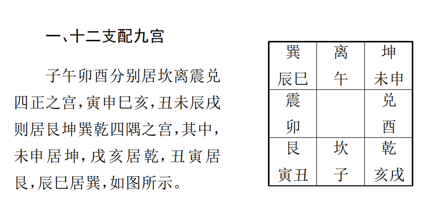

## 二、奇仪九宫旺衰  

甲木养、 生在戌、 亥， 故甲木落乾宫为养生之宫； 沐浴在子，故甲木入坎宫则为其沐浴之宫； 冠带， 临官在丑寅， 故甲木临艮
则为入冠带、 临官之旺宫； 我们依此类推则震为其帝旺之宫， 巽为其衰病之宫， 离为其死地， 坤为其墓绝之宫， 兑为其胎宫。

乙木属阴， 逆行十二宫， 长生在午， 故乙落离宫为长生之宫；沐浴冠带在辰巳， 故乙木入巽宫则为其沐浴、 冠带之旺宫； 临官
在卯， 帝旺在寅， 衰在丑， 故乙木临震为临官旺宫， 临艮宫亦做入旺宫看待， 依此类推坎为其病宫， 乾为其死墓之宫， 兑为其绝地
之宫， 坤为其胎养之宫。  

戊土如为日、 时干、 用神， 在论及其落宫之旺衰时， 仍以戊土之十二宫旺衰化配九宫之旺衰而断， 不以甲木之九宫旺衰论断。
因为戊土养生在丑寅， 沐浴在卯， 冠带， 临官在辰巳， 帝旺在午，衰病在未申， 死在酉， 墓绝在戌亥， 胎在子， 所以化配九宫则戊土  

落艮为入养生之宫， 落震为沐浴之宫， 巽为冠带临官之宫， 离为帝旺之宫， 以上皆为之生旺宫， 坤为其衰病之宫， 兑为其死地， 乾
为其墓绝之宫， 坎为其胎宫， 皆可视为衰弱之地  。其它落九宫之旺衰规律  仿此类推  。

## 三、 三奇旺衰  

三奇旺衰， 奇门专业术语又称三奇喜怒。 三奇落旺宫即谓之喜， 三奇临衰地即谓之怒。 三奇在奇门预测中可代表贵人、 喜
庆、 吉事等信息， 日干、 时干， 用神如得三奇欢喜生助， 那么， 遇事则常常会得到贵人帮助， 谋事易就。 反之， 三奇怒且克日时干，用神， 则往往遇事不得贵人提携， 行事障碍重重， 求谋不利。  

### 乙奇旺衰

乙奇（ 日奇）落离宫， 称玉兔当阳， 旺， 喜；
落巽宫为玉兔步贵， 旺， 喜；
落坎宫为玉兔投泉， 旺， 喜；
落乾宫为玉兔入天门， 受伤， 衰， 怒；
落兑宫为玉兔受制， 衰， 怒；
落坤宫为玉兔暗风， 衰， 怒。  

### 丙奇旺衰

丙奇（ 月奇）落艮宫为凤入丹心， 旺、 喜；
落震宫为月入雷门， 旺， 喜；
落巽宫为火行风起， 旺， 喜；
落离宫为月照端门， 旺， 喜；
落坤宫为子居母舍， 旺， 喜；
落兑宫为凤凰折翅， 衰， 怒；  

落乾宫为光明不全， 衰， 怒；
落坎宫为火入水池， 衰， 怒。  

### 丁奇旺衰

丁奇（ 星奇）落兑宫为贵人升殿， 旺， 喜；
落坤宫为玉女游地户， 旺， 喜；
落离宫为乘龙万里， 旺， 喜；
落巽宫为玉女留郎， 旺， 喜；
落震宫为玉女独明， 旺， 喜；
落艮宫为玉女乘云， 旺， 喜；
落坎宫为朱雀投江， 衰， 怒；
落乾宫为火入天门， 衰， 怒。  

## 四、 日、 时干、 用神生旺  

### 九宫生旺

凡日、 时干、 用神落九宫旺相之地， 是为九宫生旺。 如冬月坎宫旺相， 日、 时干、 用神落坎宫， 即为落九宫旺相之地。  

### 自身生旺  

凡日、 时干、 用神落自身之长生冠带临官之地， 则谓之日、 时干、 用神自身生旺。
在具体的推理预测过程中， 如日、 时干、 用神生旺， 乘吉门、吉星则必喜事重重， 心想事成； 乘凶门凶星则常谋为不就， 灾非
难逃。 另外， 九宫生旺与自身生旺之力相比较， 则九宫旺衰为君， 而自身落宫旺衰为臣  

#### 例： 某领导预测为其朋友投资办企业事？

丁丑年乙巳月甲子日壬申时， 阳遁五局用事， 甲子旬， 天禽  星值符落离九宫， 死门值使落巽四宫， 日干甲（ 戊）与值符同宫，
时干壬在巽与值使同宫。  

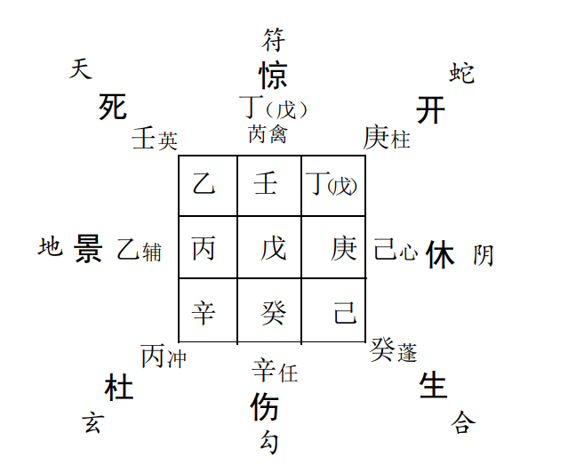

日干为此位领导即求测者， 甲（ 戊）同宫， 因奇门预测中， 戊常表示钱财、 资金方面的事情， 故正与其所问投资事宜相互吻
合。 丁与日干甲同宫， 丁为年干代表上层人士、 大人、 长者， 可说明此人确有一定的背景和支持者。
但是， 今甲落离九宫为其自身衰死之地， 则可表明其对此项投资信心不足， 故而也就不肯全力以赴大力支持。  

最后， 看时干壬落巽四宫自身墓地， 虽时下巳月为旺宫， 但八门乘死门， 可谓凶象已露。 所以， 最后可得出结论： 此事难就。
应验  

#### 例2： 河北中医学院教师贾X在其留学加拿大之前求测出国事宜。

丙子年戊戌月壬午日戊申时， 阴遁六局用事， 甲辰旬， 天芮星值符落乾六宫， 日干壬与之同宫， 值使死门落兑七宫， 时干戊    

在艮。  

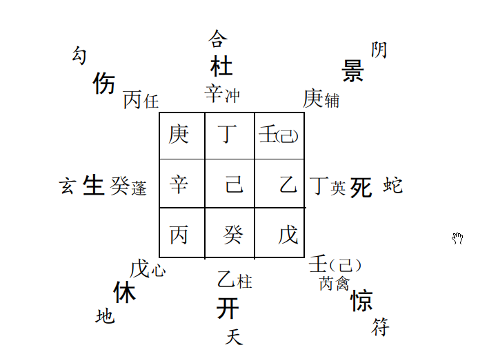

日干壬不但落九宫生旺地， 而且又自座其本身之冠带临官旺地， 亦可谓自身旺相。 再看用神开门、 九天均象远行、 前途类
事， 落坎进气之宫， 亦不为弱。 另者， 时干戊虽处空亡之宫， 但戌月， 艮宫不衰， 并且其格局星门俱吉， 又喜生合日干落宫。 因此，综合而断此事必能如愿以偿。 后果如所测。  

# 5.日、 时干、 用神落宫空亡、 墓绝、 击刑  

## 一、 日、 时干、 用神入墓  

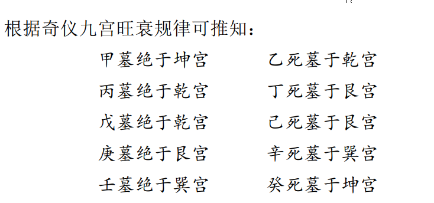

在实际应用过程中， 一般来讲凡日、 时干、 用神旺相入墓， 那么， 事情会往往应验于冲墓之年月日时， 成败吉凶情况则参以所
乘星门之吉凶具体推论； 凡日、 时干、 用神衰死入墓， 那么， 一般情况则常常是谋事难遂， 吉事不成， 凶事亦不凶。
具体如在预测疾病过程中， 凡遇久病、 危病之症， 己测病得日干入衰死之墓， 子测病得时干入衰死之墓， 他人测病， 得病者
年命入墓（ 年命者即如测者乙酉年生人， 则乙即其年命）那么， 在这种情况下往往是凶多而吉少。 然而对于新病、 近病、 非危重之
症， 值遇此类情况， 则常常不必过虑， 如是生旺而入墓， 则更加不必担心。  

其它， 预测事业得日、 时干、 用神旺相入墓， 则待冲墓之年月， 必遂心愿， 衰死入墓， 则终无成日。 预测诉讼， 得日、 时干用
神衰死入墓， 且上乘或下临壬、 癸与凶门凶星者， 那么难逃刑罚，易遭不测， 反之， 旺相而入墓者， 再得吉门吉星生助， 则终无灾咎
临身。 预测行人， 得日、 时干用神或行人年命旺相入墓， 则待冲  墓之年月必归， 衰死入墓者则行人在外非病即流徙他乡。

此外， 尚有时干入自身时支之墓者， 奇门遁甲中亦常以之为不就、 难遂之象， 亦强调值遇此时不可用事。 这种情况共计有六
个时辰， 分别是乙、 庚日之丁丑时、 癸未时、 丙戌时， 丙、 辛日之壬辰时、 己丑时、 戊戌时。    

### 例： 母亲问本亲长者之病况， 丁巳年生人， 患半身不遂多年，适逢久病而年命入墓。  

丙子年丙申月庚子日庚辰时， 阴遁四局用事， 甲戌旬， 天冲星值符落坤二宫， 伤门值使落乾六宫， 日、 时干庚在坎。  

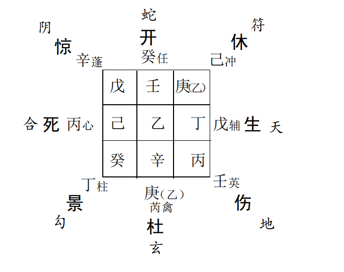

年命丁干入艮八宫墓地， 适值申月坤宫旺相， 艮宫墓地受冲， 属危险信息， 果然， 病者逝于卯辰日凌晨。 

### 例： 一日去朋友曹!那儿办事， 临行前起得一局， 遇日干入墓。  

丙子年丁酉月甲戌日庚午时， 阴遁四局用事， 甲子旬， 天辅星值符落坤二宫， 日干甲与之同宫， 杜门值使落兑七宫， 时干庚在乾。   

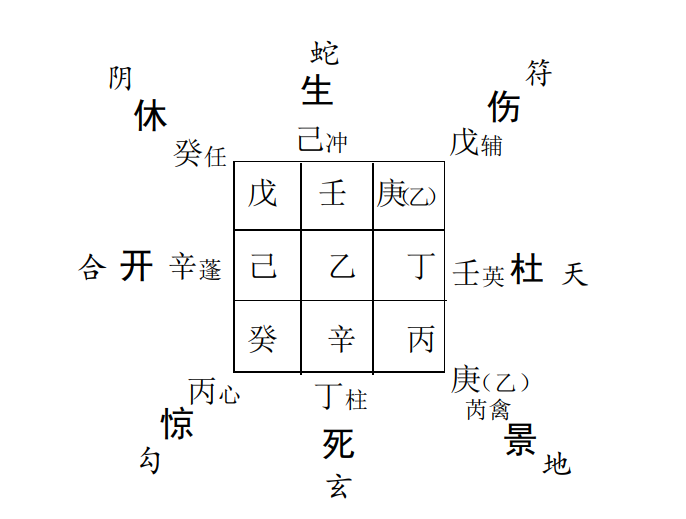

日干乘伤门为出门之象， 但入坤宫墓地， 恐欲往而不能动。再看时干庚落乾宫空亡之地， 概推曹!恐不在家， 或谋事不成之
象。 于是， 连忙打电话与朋友联系， 果然没有联系上。  

## 二、 日、 时干、 用神空亡  

论时上空亡， 首先需要确定用事时间的旬首。 比如， 六甲日壬申时， 隶属甲子旬， 甲子旬中空戌亥， 而戌亥居乾宫， 故在此六
甲日甲子旬中， 乾宫奇仪、 星门落空。
再如， 六丙日壬辰时， 隶属甲申旬， 而甲申旬中空午未， 午未居离、 坤， 是故， 在此甲申旬所辖10个时辰之中， 离、 坤二宫奇  

仪、 星门落空。 其它， 依此类推。奇门预测中的空亡之说类似于六爻预测学中的空亡论， 亦可分为真空、 假空之说。 一般来说， 日、 时干、 用神临旺宫空亡，测事者落坐空亡之宫但受他宫、 他人旺相相生等情况均可视为假空； 而日、 时干、 用神落衰死空亡之宫， 受旺宫所克等均可视为真空。 假空者， 出空、 冲空、 填实之年、 月、 日、 时为应， 真空者则为无用之空， 常主不实虚事或谋为不就  

### 例： 石市合作银行张石林预测去保定办理业务， 收缴贷款和利息， 看明日出行顺利与否？ 恰为用神空亡例  

戊寅年戊午月乙未日丁亥时， 阳遁六局用事， 甲申旬， 天任星值符落震三宫， 生门值使落坤二宫空亡之地， 日干乙在兑， 时
干丁在巽。 

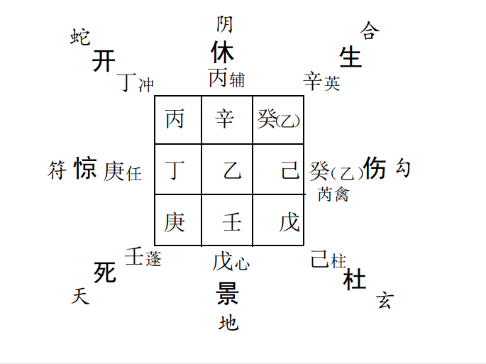 

日干为张!， 时干为事， 今时干丁落巽四宫， 临开门， 丁表示文书、 票据等信息， 开门代表出门远行类事， 可以说正应其去保  

定出差办理银行转帐手续等文书票据类业务一事。格局丁加丙上， 星随月转可表明办事顺利， 落巽四宫， 结合实情可推明日上午巳时可基本办完手续类方面的事情， 乘八神腾蛇可说明在上述这些方面会出现一点“ 小的插曲”， 当提请引起注意  预测收缴款项利润类事， 具体又当以生门为用。 今生门落坤二宫， 可首先说明款息数额当应二、 五之数， 张!随即确认实为余万250。 落旺相空亡之地， 且生合日干乙奇落宫， 故在此该视为假空， 事情必待出空之年月日时方可有望彻底解决。 如果我们从大的时间周期推论， 那么， 大部分款息恐怕要拖至未申月份收回。 如果从小的时间周期而论， 明日下午未申时， 坤宫填实出空亦有希望收缴部分款息。  

另外， 格局辛加癸天牢华盖， 辛加乙白虎猖狂， 皆不为妙， 可显示在具体的办事过程中应该不是十分顺利， 但最后从总的情
况来看， 尚不会有什么大的问题发生。结果应验情况是： 第二日上午办理进帐手续类事情时确实一切都很顺利， 但后来果然是出现了“ 印签不符”还是“ 印章忘带”一类的问题， 没办法急忙又驱车返回石家庄， 下午未申时才又回至保定办完余下的事情。 款息收缴状况： 当日下午只收得50余万， 余款终至秋分节前大部分收回  .

### 例2： 因爱人工作调动问题， 想约请某市长吃顿饭并帮忙予以解决一下， 由某公司总经理请客做东出面协调， 看能成否？ 适遇时干空亡。  

丁丑年丁未月庚辰日壬午时， 阴遁七局用事， 甲戌旬， 天心星值符落震三宫， 开门值使落兑七宫， 日干庚在坎， 时干壬在坤。  

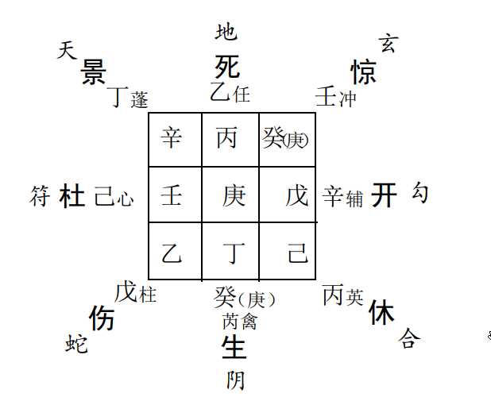

时干壬落坤二宫空亡之地， 虽为旺相， 怎奈克制日干庚所落之坎一宫， 是以可知此事之机缘尚未成熟， 许待申酉月填实出空
之后方可予以联系。  

那么， 不成之因何在？ 察年干、 月干丁奇乘八神九天， 即贵人外出之象。 忙电话联系询问， 果然市长去了香港， 某总经理亦
出差南京未归。 

## 三、 六仪击刑  

即六甲值符或六甲为日干、 时干、 用神临干， 加临地盘受刑之宫， 具体有以下几种情况。
天盘甲子戊即戊加临地盘震三宫（ 子刑卯）
天盘甲戌己即己加临地盘坤二宫（ 戌刑未）
天盘甲申庚即庚加临地盘艮八宫（ 申刑寅）
天盘甲午辛即辛加临地盘离九宫（ 午自刑）
天盘甲辰壬即壬加临地盘巽四宫（ 辰自刑）   

天盘甲寅癸即癸加临地盘巽四宫（ 寅刑巳）  

古书云“ 六仪击刑为极凶之格， 遇者必有被捕、 牢狱之灾”。  但要结合现代社会的实际情况， 合乎情理地推断， 不可一味
迷信古人， 一概而论  

### 例： 某区检察长陈某预测工作事业？  

丙子年戊戌月乙未日丁亥时， 阴遁五局用事， 甲申旬， 天冲星值符落艮八宫， 值使伤门落离九宫， 日干乙在兑， 时干丁在坎。  

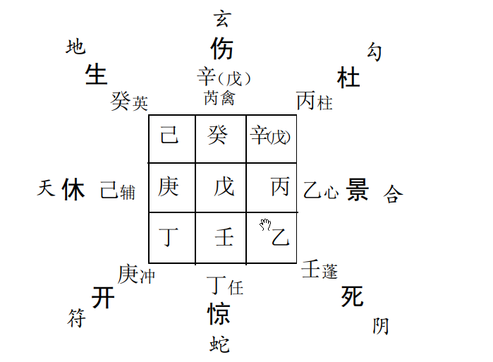

预测事业工作以开门为用神。 局象之中开门下临奇仪甲申庚落艮八宫艮寅之地， 恰为六仪击刑之格。 击刑之格前面已讲
述常代表拧劲、 阻力和事端， 在这里因为是庚加丁上， 故而推测其事业上， 目前应存在着一些问题， 且当由文书信息、 群众舆论、
女人等方面的事情而引起。 后经陈!如实相告， 时正班子换届  选举之际， 背后的确有些小人造谣生事， 实于己不利。
后又对其财运状况进行了预测。 以生门为用， 乘干甲寅癸落巽四宫， 亦为六仪击刑之格。 格局癸加己上“ 华盖地户”， 判语
“ 男女占之音信皆阻， 躲灾避难为吉”， 均可象其财运状况不很亨通。 于是， 告之钱财方面不宜过份强求， 求则易惹是非与麻烦。
陈某说“ 几年来其财运状况确实一般”， 并表示谨遵劝谕。  

此外， 此局象之中大家还需注意一下离九宫亦是击刑格局。因注意到辛与月干戊同宫， 并克害日干乙奇落座之兑七宫， 又因
月干常代表朋友、 同僚， 辛干常表示犯罪、 犯案等一些信息， 再结合检察院的实际情况， 于是推论其在具体的工作过程当中， 当有
一些案件十分棘手， 尽心办理不是， 不办搪塞也不行， 可谓进退两难， 以至因此而被某些同僚视为把柄， 陷害中伤。  

后据其介绍的实际情况， 果然如此。 其辖区内发生了一起震惊国内的特大增值税票据盗失案， 引起了有关领导和部门的
极大重视， 并限期结案。 然而， 此案案情复杂且牵涉人员众多，因此审理工作极其困难。 但是， 迫于上面的压力， 硬着头皮还得
办。 正可谓“ 击刑”之象。  

### 例2： 石家庄双鸽集团总经理贾!上任伊始， 求测企业前途？  

丙子年丁酉月丁丑日戊申时， 阴遁四局用事， 甲辰旬， 天英星值符落巽四宫， 值使景门落坤二宫， 日干丁与之同宫， 时干戊
在震。时干戊落震三宫衰死之地， 亦正犯空亡和击刑之格。在预测企业综合情况时， 戊常代表资本， 生门则常表示利润状况。 今戊和生门俱落震三宫衰死、 击刑、 空亡之地， 足见其企  业流动资金和利润方面均不容乐观， 而且很有可能还存在着一定的法律责任方面的问题。  

此外， “ 值符”在预测企业状况时， 常可代表主管领导和单位主要负责人。 企业集团内部领导的一些情况， 往往可从值符落
座之宫的信息得到反映。 大家注意今此局象之中， 值符落巽四宫， 临干甲辰壬亦犯有六仪击刑凶格。 那么， 我们根据击刑格局
的一些特性便亦可得出某些结论， 如单位领导易出问题， 此集团领导之位置很不易坐， 弄不好就极易招惹各类麻烦等等  

后经询问， 又了解了其企业近期的许多实际情况， 可以说基本上与局象所反映出的信息相互吻合。 原来该企业拖欠银行贷
款近亿元， 实在是已不堪重负， 难以正常经营运转。 集团之原导早已被免职且受到检察机关传讯， 其上级主管单位的主要领
导， 今对此也是力不从心， 乃至忧虑过度， 告病在家。 最后， 没过多久， 这样一个全国闻名的大型肉制品企业集团便宣告破产。
我们由此例亦不难看出， 有时六仪击刑也确实可谓凶格。  

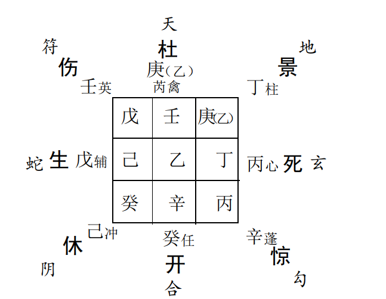

# 6.奇门预测学常用预测格局  

格局的划分总的来讲有吉、 凶两大类。 一般而言得三奇、 吉门、 吉星、 吉神搭配在一起时多为吉； 非奇、 凶门、 凶星、 凶神搭配
组合多为凶； 诸要素相互间相生、 比和者多为吉； 五行相互克制，刑害者多为凶； 遇庚者多为凶。  

## 一、 伏吟格局  

伏吟的意思就是不动和没有变化。 奇门伏吟格局包括三种  情况， 即九星伏吟， 八门伏吟和星门俱伏吟。 所谓“ 九星伏吟”就
是九星在地盘原宫位不动；“ 八门伏吟”就是八门在本宫不动；“星门俱伏吟”则是指六甲之时， 星、 门、 值符具停留原地盘宫位
不做变化。
伏吟是奇门凶格， 在奇门预测过程中遇伏吟格局， 一般主欲动不能， 不做变化和求谋不遂。 如所求者为喜变动之事， 那么，
就该偃旗息鼓， 静以待变； 反之， 如所求者为不喜变动之事， 那么， 遇伏吟局象则常能遂心如愿  。

### 例： 天津某大学邀请某大事去作易学报告， 如有可能的话， 同时想顺便搞几期奇门遁甲学习班， 在大学生中培养一批易学人才。根据天津来电话的时间起局预测其结果如何？ 适遇九星伏吟格局。 

丁丑年庚戌月甲辰日戊辰时， 阴遁二局用事， 甲子旬， 天芮星值符落坤二宫伏吟不动， 值使死门落兑七宫， 日、 时干甲（ 戊）
亦同居坤二宫不动   

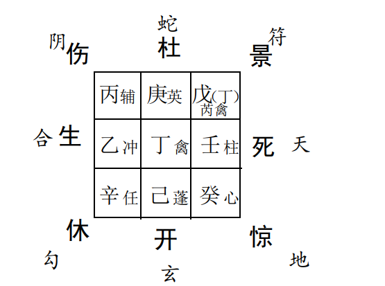

日、 时干乘景门居坤二宫， 景门表示文化事业， 谋划、 策略、  想法、 意向等事， 可说与大师准备筹划讲学和去作易学报告一事
正相契合。  

天芮星、 时干在此可代表学生、 弟子， 年干丁为长者、贵人， 值符可象此事之组织者， 两者均可象学校领导和组织此项
活动的教师， 今亦同居坤二， 可说明易学报告深得民心， 一定会受到大学生们的支持与欢迎。  

但是， 不妙者九星伏吟格局， 表明目前此事之机遇尚不成熟， 不可以即刻就采取行动， 否则， 势必中途有阻和另有羁绊。
鉴于以上预测结果， 于是， 回电话婉言推辞。  

### 例2： 白求恩国际和平医院某护士长预测其婚姻能否离异？遇八门伏吟格局。  

戊寅年辛酉月庚辰日癸未时， 阴遁七局用事， 甲戌旬， 天心星值符落坤二宫， 值使开门伏吟六宫不动， 日干庚， 时干癸同在
巽，  

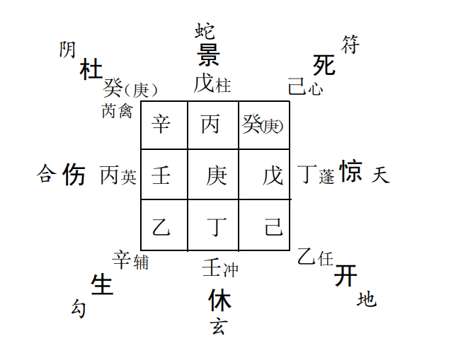

预测婚姻和夫妻双方关系。 般以乙、 庚为用， 乙代表女方  庚代表男方。 此局之中庚、 乙落宫互相冲克， 看来双方的感情确
实出现了裂痕。  

但是， 如果是预测婚姻家庭前途之最终结果如何， 则还必当以八门信息为重。 今日、 时干乘杜门， 大象八门伏吟说明双方均
在不断做出忍耐、 克制和让步， 尚不至于闹至法庭而最终决裂。于是， 告之女护士长， 放宽心怀， 其夫不至于弃之而去， 须以静止
动。 而后， 又适当调整了一下其居住环境的风水状况， 除掉了一些易造成阴差阳错气场效应的家俱和物品摆设。 后来， 果然闹
过一段时间之后， 至今相安无事  

### 例3： 湖北省某厅局肖厅长预测事业前途？ 时遇星门伏吟格局  

戊寅年丙辰月甲午日甲戌时， 阳遁四局用事， 甲戌旬， 六甲之时， 日、 时干甲均在巽， 天禽星值符， 死门值使俱伏吟坤宫不
动  .

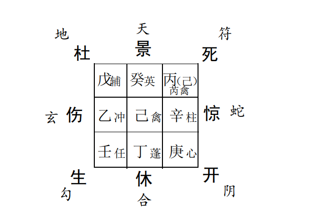

格局星、 门俱伏吟， 可首先表明肖!最近几年的事业和运势应呈平稳发展状态， 既没有多少麻烦和坎坷， 也不会有什么升迁  

之机遇。  

又见日、 时、 年干同居巽四宫， 可进一步表明其人不但确有一定的群众基础， 而且还深得上层领导的赏识， 且年富力强，!"
岁刚刚出头， 正可谓年轻有为， 前途不可限量。
但是， 日干乘杜门、 似乎另一方面局象又在示意“ 韬光隐晦，暂避锋芒为宜。  

## 二、 反吟格局  

反吟就是反冲、 反克的意思。 反吟格局有三种情况， 即九星反吟、 八门反吟和星门俱反吟。 所谓九星反吟是指九星分别落
入地盘对宫， 即天蓬星落离九宫， 天英星落坎一宫， 天冲星落兑七宫， 天柱星落震三宫等， 总之， 九星全部对冲错位。 八门反吟
则是指八门分别落入地盘对宫， 即开门落巽， 杜门落乾， 伤门落兑， 惊门落震等。 星门反吟是指九星和八门全部落入地盘对冲
之宫， 每一宫星门之间全部错位对冲。  

遇到反吟格局， 常为反复、 变动、 更改之象。 做事简练雷厉， 成败易兮； 预测出行， 常中途而返； 预测长远
谋为， 则往往有始无终， 中道而变； 预测婚姻， 则常主感情破裂，破镜难圆； 预测求财， 忙忙碌碌， 往返空跑， 劳而无功； 预测合伙同谋， 则反目成仇， 人心离散； 预测疾病， 近病逢之则散， 久病逢之则死； 惟则与我不利之事或克制伤害我之事， 逢冲则易散， 但
仍要日元或用神旺相， 得奇、 门生助， 否则， 日元、 用神衰弱无依，再得凶门、 凶星克制伤害， 亦仍然难逃其咎。  

### 例： 惠州妙才禅师来石， 因其修建庙宇的过程中， 有一些事情需要和当地政府协调、 沟通， 特约某位领导， 看其能否疏通有 关环节？ 适逢九星反吟之格  

丁丑年丙午月庚辰日乙酉时， 阳遁六局用事， 甲申旬， 天任星值符落坤二宫， 值使生门落离九宫， 日干与值符同宫， 时干乙
在艮。  

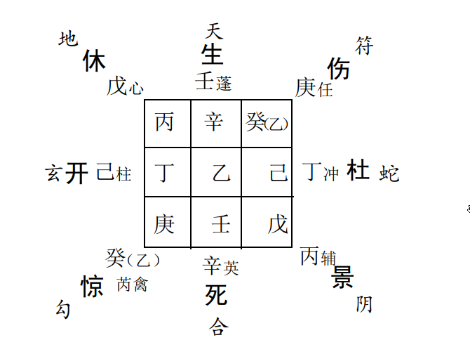

整体局象为九星反吟， 反吟常主谋事不就， 长远大计必中道而卒， 可谓此事大象不佳。 此外， 因九星常可表示人物， 故而， 九
星反吟在此亦可以引伸为人物来去匆匆， 彼此间偶然相聚、 互不了解等意思， 这一点和妙才出差进京来石小住等实际情况可以
说亦基本相符。  

日干庚为禅师， 乘伤门， 主变动求谋之事， 落坤宫， 应宗教、庙宇、 田产等方面的事情。 格局太白逢星， 判语“ 退吉进凶， 谋为
不利”， 可说明其此次活动的结果将不甚令人满意  。

时干为事， 落艮八宫与日干落宫相互冲克， 格局乙加庚上，日奇被刑， 判语提示“ 夫妻怀私”， 说明领导和宗教界人士来往恐
有一些想法或不同观点。  

此外， 如果我们再以丁奇年干代表此领导， 则或可看出其所虑的某些事情。 丁奇与九宫之壬干相合， 壬干乘生门九天， 暗合
南方惠州之方位， 生门为费用、 钱财， 说明如果求人办事， 疏通关系可能会需要一些费用， 而今却落空亡之地， 也许此即其持怀疑
保留态度的根本原因吧。
最后， 从上述总的情况分析， 可见此事恐不会有什么结果，因此无需巧为周旋， 再费心机， 只做广结善缘尽地主之宜罢了。  

### 例2： 市政府周秘书综合预测？ 适逢八门反吟格局  

丁丑年丁未月甲寅日乙亥时， 阴遁二局用事， 甲戌旬， 天蓬星值符落震三宫， 休门值使落离九宫， 日干戊（ 甲）在乾， 时干乙
在离。 

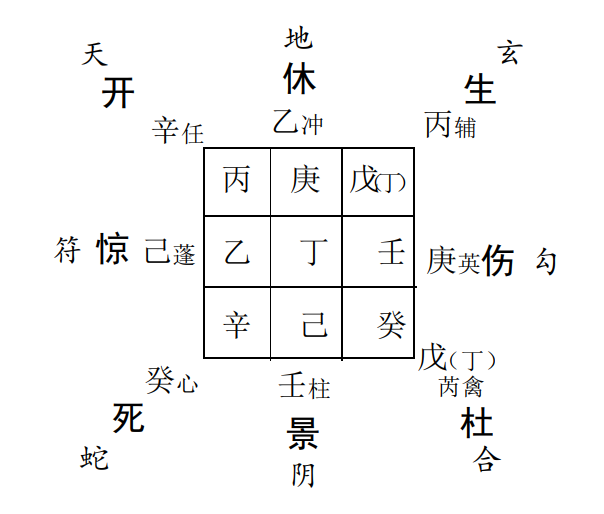 

八门反吟在综合预测个人事业运势时， 可一方面说明其人性格外向， 闲不住， 另一方面还可说明其最近一个阶段忙忙碌
碌， 风风火火。 以上两点可以说当场即得到了实际证实  

周秘书， 女， 年龄!"岁左右， 说话干练、 行事果断， 堪称女中  豪杰。 其人最近一个阶段正在参与一起传销业务， 四面拉人入
网， 到处作传销报告， 真可以说忙得热火朝天而不得片刻之休闲  

后来， 周又问到能否测知其传销公司的地点和方位， 因见开门乘九天落巽四宫， 便首先确定其公司地址应在东南方向， 又因
阴遁一、 八、 三、 四宫主外， 主远， 故又补充一点， 如果是国内公司， 那么， 当应江浙一带， 果然其公司地址位于上海。  

继之， 再问其传销商品当为何物？ 因为在贸易预测中， 常以甲子戊所生者为商品。 今此局象之中， 戊所生者坎一宫， 乘景门
太阴， 于是据此推其传 销物品当为金属或硬塑料制品， 且与水、电、 热能有关。 再据反吟局象以及格局壬加己上， 天地盘奇仪相
互冲克的信息特性， 又断其商品应为组合式， 可分离式， 不稳定式之物品， 果又奇应分离式电饮水机之物象。  

最后， 测问其工作情况， 看近期会有什么变化与否？ 首先又据八门反吟这一大象信息可知其工作确有动象， 但是， 细察日干
乘杜门， 年、 月干、 丁奇又与之同宫， 说明其人与领导和同事的关系相处不错， 不见遭受排挤和变动之象， 于是， 只得远推其工作
变动之时间当应辰巳年月。 果然至今未变。  

### 例3： 某饮食服务公司董事长麻x打电话告知， 由我举荐她处的黄x在为其承包经营快餐分店不到月余的时间， 竟然亏损2万余元， 并说准备与黄x谈谈话。 我一听便觉得其话中有话， 弦外有音， 于是， 连忙以电话时间起得一局， 适逢八门反吟， 随知黄x之工作大凶。 果不出所料， 第二天上午， 麻x就给黄x发了张解聘书。 此例可见八门反吟之凶之快  

丁丑年己酉月庚辰日丁亥时， 阴遁七局用事。 甲申旬， 天禽  星值符和日干庚均落坎一宫， 死门值使落艮八宫， 时干丁在巽。  

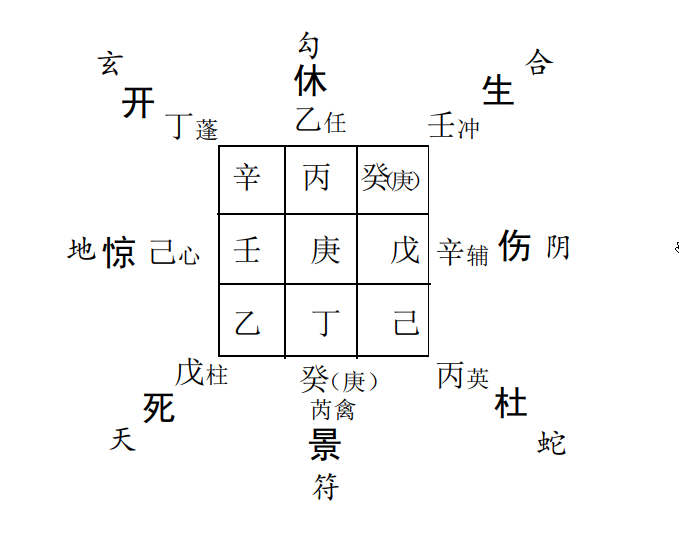

日干庚和其下临之天禽星可视为客， 代表麻x， 加临时干丁上， 丁及其下临之天蓬星可视为主， 代表黄x。 先以主客关系而
论， 酉月旺相之天禽星克衰弱之地盘天蓬星， 即客克主， 确于黄x不利。 再以格局来看， 庚加丁上， 亭亭自奸之格， 因私匿而起
官司， 看来双方确因一些阴匿或说不清楚的事情产生了意见分歧和矛盾。  

再看时干丁奇之落宫， 可代表黄!的一些综合信息， 乘开门， 应其工作之事， 八神玄武又应其临时试用， 非正式录用之象，
格局丁加辛上， 朱雀入狱， 判语“ 罪人失囚， 官人失位”。 正可说明黄x的经理工作恐怕要被革职了。 果应验于次日之上午。  

### 例4： 邻居张成测子病？ 适遇星门反吟之格。  

丙子年乙未月癸亥日壬戌时， 阴遁五局用事， 甲寅 旬， 天英星值符， 景门值使， 日干癸均落坎一宫， 时干壬在离。 

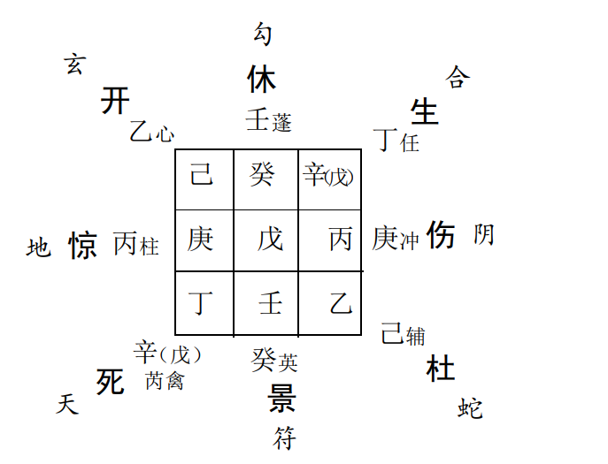 

其子癸酉年生人， 年命天干与日干相同， 居坎一宫， 乘景门，可说明其子病患热邪。 实际情况正是其子持续高烧两天未退，
是以其父母十分担心， 恐发生什么意外和危险。 又察大象星门俱反吟， 于是当即告诉张成不必担心， 不会发生什么意外， 因为
“ 近病逢冲则愈”， 具体好转时间， 待年命、 日干用神出空， 几天之后自会不药而愈。 后， 应验。  

另外， 此局象之中还有一处信息反映地十分精确， 让人索味无穷。 这就是局象将其子之发病原因跃然兆机纸上。 一般奇门
预测病因、 病症以天芮星为用， 今天芮星落艮宫， 乘死门、 九天，艮宫可象足部， 死门可表示受伤、 遭刑等凶恶信息， 九天则可表
示运动或交通工具， 将以上信息综合在一起正神应其子正是由于左脚被自行车车轮挂掉皮肉而导致感染发烧的。  

## 三、 五不遇时格  

凡用事时辰天干克日元天干， 而且两干同性， 阳克阳， 阴克阴， 即为五不遇时格。 它们分别是：
六甲日之庚午时；
六乙日之辛巳时；
六丙日之壬辰时；
六丁日之癸卯时；
六戊日之甲寅时；
六己日之乙丑时， 乙亥时；
六庚日之丙子时， 丙戌时；
六辛日之丁酉时；
六壬日戊申时；
六癸日之己未时  

《烟波钓叟赋》中说“ 五不遇时龙不精， 号为日月损光明”， 是为奇门凶格， 不可用事。 但是笔者在大量的实践过程中， 发现亦
不能一概而论。 如果预测求谋类或疾病、 灾害类等事情， 尤其是又当日干或用神衰弱之时， 而且乘凶门凶星， 那么， 值遇此格确
不为吉。 但是， 如若是预测官运类一些事情， 值遇此格， 又当日元、 用神旺相， 且得奇门、 吉格、 吉星相助， 那么， 常常却又得该当别论  。

### 例： 著名山水画家陈诗奎， 散文家郭淑敏等几名佛教居士一起为筹建市佛教艺术基金会献计献策， 并研讨其工作计划， 适逢五不遇时格。 

丙子年丙申月壬寅日戊申时， 阴遁四局用事， 甲辰旬， 天英   星值符与日干壬同落巽四宫， 值使景门落坤二宫， 时干戊在震。  

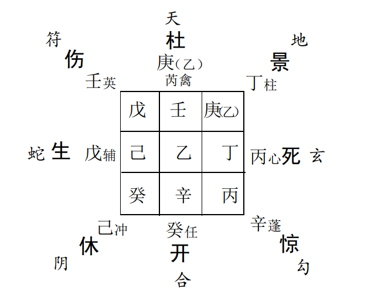

日干壬落巽四宫， 乘伤门， 巽主文化、 僧道， 伤门主忙碌、 工作、 变更、 改动， 可说明事关僧道、 文化、 艺术类工作或事情， 且为
之尽职尽责， 忙忙碌碌。 但是， 另一方面同时也意谓着此项工作在具体的实施过程当中恐有阻滞和变更。  

另外， 壬与丁合， 丁干落宫可代表我之愿望或所谋为之事，今丁干乘景门、 九地落坤二宫， 景门代表方针、 策略、 谋划、 筹为，
九地在此可引伸表示收集、 汇总、 集思广义等意思， 可以说与实情亦相符合。  

此案例之中的不利因素有三， 一是主要用神时干落宫空亡，因时干常主事， 故此象非吉。 二是开门落宫衰弱无力， 格局“ 网
盖天牢”亦是凶格， 因开门常代表所谋为事情的前途和具体工作的未来实施情况， 所以由此可概推知此项工作恐怕障碍重重， 至
少亦是办事拖落之象。 第三就是适逢五不遇时凶格， 时干克日干， 象征事情克人， 谋为不易成就  。

所以， 最后从以上总的分析来看， 筹建基金会一事恐怕最终亦只是一项计划或愿望。
以后的应验情况是， 事搁不久， 赶上了国务院、 中国人民银行彻底清理整顿各类基金会政策法规的出台与实施， 致使此基
金会虽已被市人民银行和省人民银行层层确认， 但至总行之最后关节却被搁浅至今， 悬而未决。  

### 例2： 一日， 和市政协委员、 市道教协会会长李文普道长一起品茶论道， 当谈及市道协与外商准备合资兴建湾里庙合作项目时， 随即起得一奇门局象， 预测其意向之前途和结果？ 亦适逢五不遇时格  

丁丑年丁未月乙亥日辛巳时， 阴遁四局用事， 甲戌旬， 天冲星值符落坎一宫， 伤门值使落坤二宫， 日干乙在巽， 时干辛在兑。  

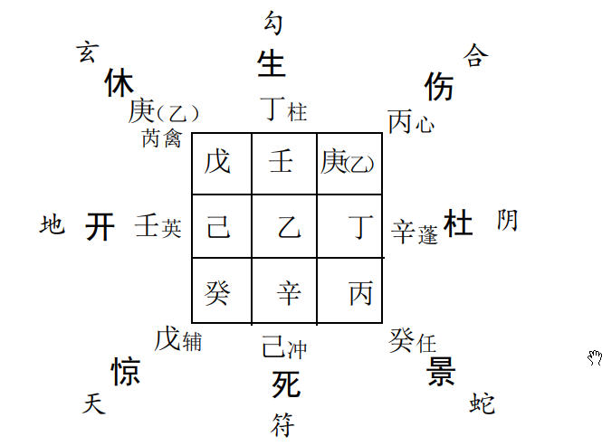

大象五不遇时格， 时干克日干， 为事克人， 谋为恐不易成就。日干乙乘休门、 玄武， 代表我方道教协会。 天禽星可象人
物， 正直无私， 广艺博才， 正可谓李道长为人之真实写照。 乙加 戊格局， 判语“ 利阴害”说明李道长很有可能会被人暗中利用， 玄
武可说明其想法或计划虚而不实， 恐不易成为现实。  

时干为合作伙伴， 在此代表外商投资者， 乘天蓬凶星， 格局辛加丁上， 判语说明“ 狱神得奇， 经商获倍利”， 可说明此投资者
商业气息十分浓厚， 往往见利而忘义， 实非真正道心之人。 乘杜门， 太阴又可说明其人在投资方面非常谨慎， 恐不会轻易投资。
所以， 由以上信息来看， 指望此外商为道教事业做点贡献恐非易事。 

最后， 我们再看一下值符落宫情况， 其在此可象当地政府和有关主管部门， 落坎一宫， 虽生合日干落宫， 但乘死门， 可说明此
事对于他们来说似乎亦是可有可无之事。综合上述分析后， 得出结论， 此项目最终可能谈不成。 所以， 我们最好还是道法自然， 万事随缘.

### 例： 原双鸽集团销售公司总经理葛立恒先生， 准备受聘于某私人制药企业， 据说各方面条件均十分优厚， 年薪8万元。 当时， 我们一起正在鸿运轩吃饭， 随以其告诉我此事的时间， 手上快速起局， 对此事进行了预测分析， 也遇五不遇时凶格。  

戊寅年己未月甲申日庚午时， 阴遁一局用事， 甲子旬， 天蓬星值符落艮八宫， 休门值使落巽四宫， 日干甲与值符同宫， 时干
庚在震。  

日干甲（ 戊）为葛"， 落艮八宫衰休之地， 可一方面说明此事不一定能成， 另一方面也可表明其本人对这份工作的意思也不
大， 态度亦不是十分积极。 加临地盘庚上， 庚常象羁绊、 障碍、 停留不前， 动则受阻等事情或意义， 由此亦可推葛"短时间亦不会
或不可能有什么变动和变化。 格局戊加庚上， 值符飞宫格， 信息  提示“ 吉事不吉， 凶事不凶”， 亦不见吉象。  

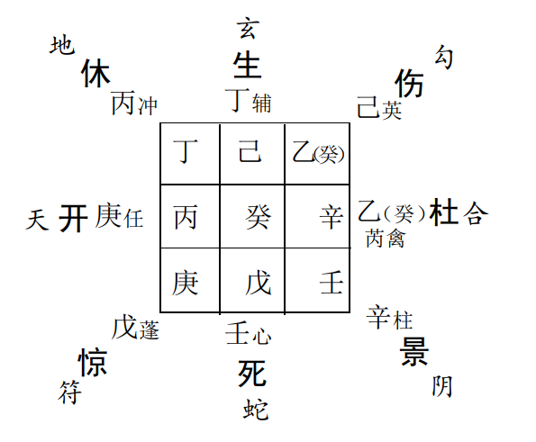

此外， 月干己落坤二旺地冲克日干落宫， 月干为朋友、 同事、同僚， 可象征说明一旦应聘就职， 势必会受到许多同僚的妒嫉和
排挤， 同事关系也因此而相当难处， 最终恐亦不能站稳脚根。 其它， 甲（ 戊）同宫， 戊又常表示钱财， 今落艮八宫， 亦与其所说8万
元薪金数目相应。  

再看开门落宫情况， 开门在此既可象此制药企业， 亦可象葛的这份工作情况。
居震三宫， 乘九天， 可说明此企业在石市之东， 九天可表明外地或非本市等意义， 震三宫亦可推知其具体距离当在30华里
左右。 查明情况， 果如所测。 原来此企业确在石市以东新建开发区内， 里程距离也基本相符。
以下我们再以开门象葛x之工作， 分析一下其与日干落宫的关系和意义。 开门落震三宫， 克日干所落之艮八宫， 可象征说
明工作克人， 此份工作怕也不是十分容易开展。 最后一点就是  逢五不遇时凶格， 谋为不易成就。 所以， 此事儿的最终结论应该
是机缘未到， 速则不达。  应验情况是此制药企业虽几经催促葛!前去就职上任， 但由于种种原因， 一直拖延而未去成， 直到99年3月， 葛x才算正式应聘受职  

## 四、 时干入墓格  

凡用事时辰天干恰逢其地盘墓地即为时干入墓格。 如六丙时， 丙干落乾宫戌亥之地， 则丙入戌墓即为时干入墓格。 余干入
墓者， 依此类推。凡时干入墓格， 常主谋事不易成功， 拖延时日或近期难有结果， 预测行人则常主隐匿难觅。  

### 例： 某日饭后， 大师去拿热水瓶烧水， 一不小心， 瓶胆爆裂， 响声很大， 怀疑可能是发生什么事情的前兆， 急起局预测， 适逢时干入墓格。  

丁丑年己酉月庚申日丙戌时， 阴遁六局用事， 甲申旬， 天辅星值符落艮八宫， 值使杜门落坤二宫， 日干庚与值符同宫， 时干
丙在乾。
占怪异灾非看时干， 今丙时干落乾宫墓地， 为时干入墓格，故首先由此大象可概推此事恐非某事即将发生之前兆。 再看格
局丙加戊上， 甚吉， 虽乘死门， 但与我日干落宫相互生合， 所以，由此亦可推应无甚灾非发生。 其它， 因奇门预测此类事情时， 也
常以朱雀（ 玄武）为用， 即传递某种信息的意义取象。 故而， 又进一步查析了朱雀（ 玄武）落宫情况， 落离九宫空亡之地， 格局奇仪
相佐， 亦为玄机未兆， 事端未现之象。  

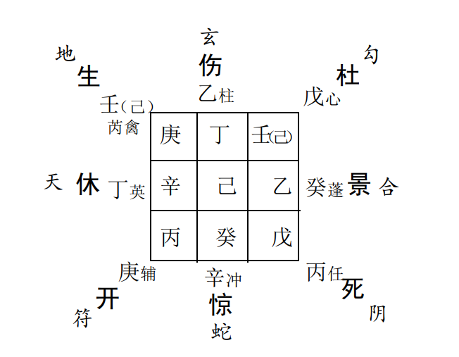

此外， 妻子在旁亦信手拈得一卦， 得《**口** 》之《 兑》卦， 见子孙爻旺相持世， 兄动爻中， 为破小财但平安之象， 于是随放宽心怀
不提。  

## 五、 年、 月、 日、 时格  

天盘六庚加临地盘年、 月、 日、 时四干之上， 奇门遁甲中分别称之为年格、 月格、 日格、 时格。 因为在奇门遁甲模型中， 庚常代
表阻力、 障碍、 灾害、 问题等不利信息或因素， 而年、 月、 日、 时四干却常为奇门模型之主要信息要素和用神， 常代表上级、 长者、贵人、 领导； 兄弟、 朋友、 同僚、 同事； 己身、 事情主体； 妻妾、 下属、事件、 事物等。 今庚加临其上， 那么， 就表明以上人物或要素出现了问题， 是以， 古人将这种局象列为奇门凶格。 因此， 我们在实际应用中遇到这种情况时， 亦需格外引起注意。  

### 例： 某小学女教师付!预测婚姻和身体状况， 适遇此格。  

星值符落乾六宫， 值使杜门落兑七宫， 日干壬与值符同宫， 时干庚在巽。  

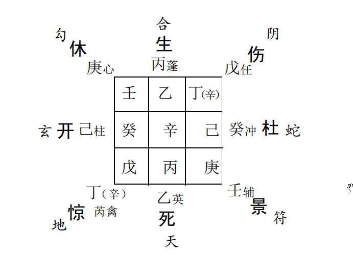

庚落巽四宫， 加临地盘日干壬上， 为日干逢格， 说明求测者本人看来确实遇到了一定的麻烦。 那么， 其问题出现在哪些方
面呢？ 结合其人的实际情况， 当时， 大师做了以下两点具体推测。一、 在预测婚姻家庭状况时， 庚常代表男人、 丈夫， 今庚加临
日干之上， 形成“ 小格”局象， 其判语“ 远走迷失道路， 男女音信嗟呀”， 由此可概推其夫妻感情可能不很合美。
此外， 当进一步注意到格局反吟， 日干与庚干落宫冲克。 日干乘景门， 格局壬加庚上，“ 太白擒蛇”， 判语提示“ 讼狱公平， 立
判邪正”等信息时， 于是便愈加认识到其夫妻感情问题， 恐怕比想象的还要严重。 情况问明后， 果然是夫妻关系已经破裂， 其女
正准备诉诸法院， 解散婚姻。  

二、 在预测身体状况时， 庚亦常可表示毛病、 病灶、 病症等信息。 今天盘庚落巽四宫， 巽在身体象肩背， 地盘庚居乾， 乾在身  

体象筋骨、 脊椎， 故而， 由此推测付!在身体方面可能患有以上一些方面的病症， 经调查询问， 知其本人果然患有严重之椎肩盘
突出病。
以上此例， 从中可以了解日格的某些常见信息特征。  

### 例： 邻居顾延理之亲戚张x承租他人汽车跑出租， 行车不到一年的时间， 入不负出， 欠车主"千余元， 寻死觅活， 愁苦万分。于是， 顾!找我帮助预测一下张x之未来运势。 另外， 顾x本人自复员转业以来， 工作单位也一直没有得到安置， 工作问题至今悬而未决， 所以， 同时再看看其工作问题何时会有着落？ 适遇月格、 时格和用神逢格问题 

丙子年己亥月庚申日丙戌时， 阴遁三局用事， 甲申旬， 天蓬星值符落坤二宫， 值使休门落艮八宫， 日干庚在坤与值符同宫，
时干丙、 月干己俱在震。天盘庚落坤二宫， 加临地盘奇仪己丙之上， 而己为月干， 丙为时干， 故这里恰好形成了月格和时格。 因为月干常可代表亲戚、 朋友， 时干常代表事情， 那么， 我们据“ 逢格”之说便可推两格之所主， 那就应该是“ 其亲戚或朋友当遇到了一些麻烦事儿”， 可以说正与其所要预测的实际情况基本一致。
此外， 本案例之中还有一个“ 用神逢格问题， 即坎一宫“ 开加庚上”。 因为顾!的第二个问题是预测自己的工作， 大家知道奇
门预测中常以开门代表工作， 即以开门为用， 而今开门用下逢庚， 是以， 通常我们把这种情况又称之为用神逢格， 其意义表示
用神本身存有问题或麻烦。 所以， 由此我们便亦可推知顾x的工作也存在着一定的麻烦   

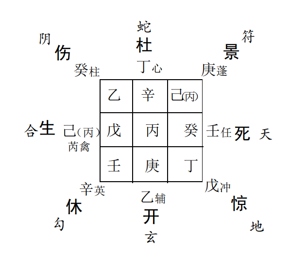

另外， 对于“ 逢庚”“ 庚格”这个问题， 大家很可能会提出这样一个疑问， 那就是庚落天盘加临年、 月、 日、 时干用神之上与庚居
地盘而上乘年、 月、 日、 时干、 用神， 两者所表示的意义有何区别？
这里我们就顺便亦解释一下这个问题。 一般来说， 庚居天盘其意义较侧重于正在或将要遭遇的一些障碍和麻烦， 而地盘逢庚
则通常倾向于过去的、 以往的、 先天性既成事实的问题和麻烦。

### 以下， 我们进一步具体分析一下顾!亲戚以及其工作上所存在的麻烦和问题。  

首先看天盘月、 时干落宫情况。 二者均落震三宫， 上乘生门、 六合， 下临甲子戊。 大家知道， 震宫， 伤门可象车辆， 戊、 生门
代表钱财， 六合表示合伙、 同谋， 所以， 由此我们不难推知， 其亲戚之麻烦应出在钱财、 合伙、 纠纷方面， 且该与车辆有关， 具体数目亦该应震木3、8之数。  

其次， 再来分析一下开门落宫情况。 落坎一宫， 上乘八神玄武， 因玄武常可表示一种非正式和不实之象， 故由此可推知顾!
工作目前当为临时聘用。 再者， 我们还可以继续注意一下空亡落宫的信息， 因为古人认为“ 神”常常兆先机于此处。 继察丁落
空亡之地。 因丁奇常与文书、 合同、 手续等方面的事情相关， 所以， 由此我们便可概推其工作方面的麻烦应不外乎手续、 合同方
面。 实际情况也确实如此。  

此外， 在预测行人或追捕贼盗时， 这种局象尚可引伸为“ 逢格则行人受阻而返， 贼盗受阻必获”等一些意义和象征， 且常有
年格， 年返、 年获； 月格， 月返， 月获； 日格， 日返， 日获； 时格， 时返， 时获之说。   

# 第七节 来意占断和应期确定  

## 一、 来意占断  

来意占断可以说是诸多易学预测方法中的难点， 在这个问题的具体处理上， 笔者以为尚没有任何一种方法可以言称对此
问题能够大包大揽。 比较而言， 奇门预测因为信息含量大， 内容丰富具体， 所以说在来意占测这个问题上， 应该是占有很大的优
势。 大家也许不会陌生“ 学会奇门遁， 来者不用问”这句民间谚语， 从中我们或可对奇门预测来意的某些独到之处窥见一斑。
奇门预测来意， 一般首先根据来人意向划分成几种情况， 然后， 再针对不同问题， 具体区别对待， 一般说来， 有以下一些方法
和内容。  

### （ 一）来人意在综合预测其全面情况。  

这种情况可以说是比较简单的， 大家只需运用后面章节所讲的奇门综合预测方法， 对其进行全方位模拟预测就行了。 比
如， 以开门为用考察其事业、 官运情况； 以生门为用分析预测其财运、 收入状况； 以死门为用预测其灾非、 失意、 刑伤等情况等
等。 然后， 再分别以其九宫旺衰程度， 格局善恶情况以及其各自与日干、 用神之间的生、 克、 制、 化关系， 酌情把握推论。 必要时
再纳入流年12宫， 进一步具体推测一下其流年运势， 如此以来，则来人近几年来的大概情况， 便基本上可以了然胸中了。 有关
这方面预测的具体案例， 请参阅奇门综合预测一章的部分内容

## (二）来人意在专项事件或事物的预测   

1.看日、 时干落宫情况。
一般来说日干为人， 时干为事。 乘开门为工作、 事业、 起行、升迁、 官运、 前程类事， 乘生门为财运、 经商、 利益、 生产、 生长类
事， 乘死门为刑丧、 破败、 死亡、 埋丧类恶事等等， 总之， 须先以所乘八门的属性和吉凶情况大体为事件定性定位， 后再以八神、 格
局、 奇仪等情况细究中间原尾。
2.以来人落座方位或电话打来的方位等九宫信息情况， 结合上述方法推论。  

3.以日、 时干加临地盘奇仪的情况， 进一步具体模拟预测。如加庚则常为男人、 疾病、 武斗、 阻碍类事， 加丁为少女， 第
三者女性、 文书、 票据、 合同、 印信、 电话、 手机、bp机类事。 加戊为长者、 官贵、 财物类事， 加乙为妻子、 女人、 中介类事， 加辛为失礼、 犯刑、 罪犯、 狱卒类事。 总之， 各以奇仪类象主应， 酌情推论。  

### 以下是古人总结的部分奇仪类象主应， 其中难免传讹摘录错误， 以及不符现代时宜之处

#### ①《奇门遁甲秘笈大全》十干克应捷法

这里所说的“ 克应”， 实际上是一种动态主应。 因为古人创立奇门遁甲的主要目的和用途是占兵制敌与军事应用， 所以， 它
自然也就偏向于动态出行方面的预测。 而对于这种动态出行类人事的预测主应， 奇门遁甲中称之为奇门克应。 严格地说， 奇门
克应该属于奇门运筹学内容， 但古人在此未做细致地划分， 其中亦包括有许多奇门预测学的重要内容。

六甲， 号天德， 遇之， 阳日青衣男子， 阴日青衣妇女， 得天禄为应。
六乙， 号天贤， 遇之， 阳日阳星贵客高贤， 阴日阴星僧道九流主应。 八日或八十日光辉喜事至。
六丙， 号天威， 遇之， 阳日贵客青衣白马， 阴日贵人、 青衣、 赤马为应。 七日或七十日进财宝文契。
六丁， 号玉女， 遇之， 女人， 美妇主应。 七日或七十日进古器。
六戊， 号天武， 遇之， 阳日锣鼓、 旗枪， 阴日亲友、 歌乐、 宴会主应， 年内进武人财。
六己， 号明堂， 遇之， 阳日黄衣男人， 阴日白衣女人或一男一女并行为应。 五十日有远亲至或得贵人财宝。
六庚， 号天狱， 遇之， 阳日阳星为兵吏， 阴日阴星孝服人应。四十九日得文字官事  

六辛， 号天庭， 遇之， 阳日阳星白衣人应， 阴日阴星鸦鹊飞鸟鸣叫应。 年内口舌， 财宝。
六壬， 号天牢， 遇之， 雷霆雨雪， 阳日阳星皂衣人， 阴日阴星白衣人应， 年内进人口。
六癸， 号天网， 遇之， 阳日阳星渔猎人， 阴日阴星为孕妇。 六十日内得铜镜物财喜  
