# 奇门静态类预测和分类应用  

**奇门静态预测方法的要略：**   首重日干、 时干和用神落宫的旺衰生克关系， 及其所乘八门吉凶和格局的善恶信息， 次察值符、
值使、 年干、 月干等相关信息的落宫旺衰和生克情况。 在奇门静态类预测中， 天地二盘奇仪九星间之生克关系， 以及方位空间等
信息因素， 非关键性之决定因素， 只可作为辅助信息参考， 有时甚至可以不予考虑  

## 第一节 贸易觅利预测  

### 一、 财物交易类预测  

财物交易类预测一般以日干为我， 为求测者， 时干为事、 为物， 月干为同类、 朋友、 竞争者， 年干为贵人、 长者、 公吏； 甲子戊
代表资本， 生门代表利润， 各以其与日干落宫的旺衰生克关系及所乘八门的吉凶和格局善恶情况综合推论。 一般说来， 日干或
用神旺相， 且得吉门、 吉星、 甲子戊、 生门等生合相助， 则求财易得， 否则， 求谋难成， 强为者招灾惹祸， 损失破财。  

**1.货物购进类利润预测**
日干落宫为求财者， 购货者， 时干落宫为商品、 货物。 时干落宫乘旺相气， 再得奇门吉格者， 则商品质量可靠， 市场紧俏， 乘 休囚气且不得奇门吉格者， 则所购进货物易出现质量问题， 市场前景也不会太好。
时干落宫， 甲子戊落宫， 生门落宫俱生合日干落宫者， 则货物购进有利可图， 销售后即能得财利。 旺相者利多， 休囚者利
少。 反之， 俱克日干落宫， 或落墓绝空亡之宫者， 则货物购进后，易发生销售不畅， 库存积压， 成本难收等问题， 各以其与日干落
宫之生克关系酌情具体推断。   

如甲子戊克日干落宫， 则为本金方面的问题， 或资金难筹，或本金难收。
如生门落宫克日干落宫， 而甲子戊却生日干之落宫， 则为本金可收， 但利润却无， 或继续增加投入后方可得利之象。  

**2.货物销售类利润预测**
日干落宫为求测者， 为货主， 时干落宫为货物， 甲子戊为资本， 生门为利息， 六合为中介或经济代理人， 各以其落宫的旺衰生克关系综合推论。  

**例：** 石家庄市食品工业协会罗勇忠预测， 在河北市场代理销售冠云牌平遥牛肉， 效益利润情况如何？  

丙子年辛丑月丁巳日庚戌时， 阳遁八局用事， 甲辰旬， 天冲星值符落坎一宫， 伤门值使落离九宫， 日干丁落巽宫， 时干庚落
兑七宫。日干丁和月干辛同宫， 日干为我， 月干则代表朋友， 在此可象征罗某与平遥牛肉厂家共同经营此项业务。 乘生门， 八神为
六合， 但巽宫此时为衰， 格局丁加癸朱雀投江， 亦不算佳， 故推论其利润状况一般， 可得小利。  

时干庚落兑七宫， 为事， 应西方， 今克日月干之巽四宫， 说明此事不会很顺利， 或为费力而不得什么好处之象。
甲子戊代表资金， 落乾六宫， 与巽宫冲克， 说明双方在资金方面均比较困难。 实际情况是食品协会没有多少资金， 此项业
务基本上为代销。 而山西厂家在流动资金方面也确实不很充裕， 此项业务如单纯于厂家而言， 本金恐难以全部回收。
最后结果基本应验。 协会得销售小利， 中途因销售不佳， 退还厂家一批货物。 因食品类商品均有一定的保质期， 商品过期
后， 则必然有一定的损失， 估计厂家会因此而损失部分成本。  

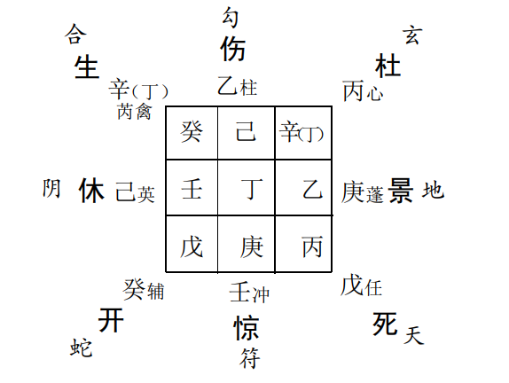

**例**： 邻居樊X， 在批发市场设有一摊位， 准备购进一批五金工具， 请预测一下其利润如何？
戊寅年丁巳月甲寅日癸酉时， 阳遁一局用事， 甲子旬， 天蓬星值符落乾宫， 值使休门仍居坎一宫， 八门伏吟格局， 日干甲
（ 戊）在乾， 时干癸在兑。 

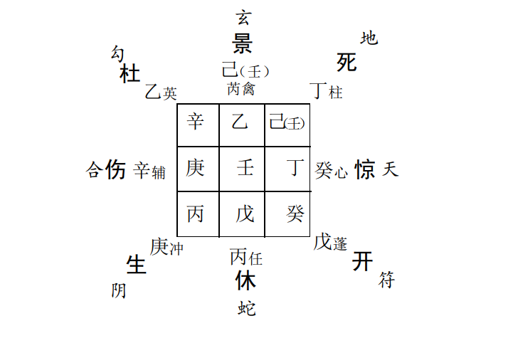 

日干甲（ 戊）乘开门， 说明因钱财之事， 为起行或开始做某件事情而预测。 时干为事， 落兑七宫； 八神乘九天， 九天主外地； 九
星为天心星， 五行属金。 可谓正应其外地采购五金工具一事。生门在艮八宫， 生助日、 时干所落之乾兑二宫， 应有一些利润。 但是， 奈何日、 时干落宫此刻衰弱无力， 受旺宫巽四宫之冲克。 且八门伏吟， 大象不佳。 又生门艮八宫之格局庚加丙太白入荧， 不甚吉利。 见于上述信息之提示， 于是告诉小樊可以小批量进货， 如大批量购进， 恐压货时间太长， 搞不好年底才能有所收益， 须防资本不足等问题发生。 后来， 樊X果然没有大批量进货， 亦不知什么原因， 三个多月以后摊位转让他人。  

**例**《： 青春岁月》杂志社美术编辑陈!， 想卖掉其旧面包车，看能行否？  

丙子年丙申月甲辰日壬申时， 阴遁七局用事， 甲子旬， 天柱星值符落震三宫， 呈九星全部反吟格局， 值使惊门落艮八宫， 日 干甲（ 戊）与值符同居震， 时干壬居兑   

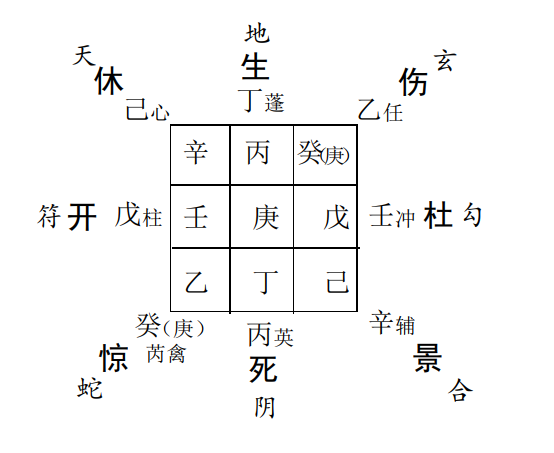

日干甲（ 戊） 同宫， 乘开门， 说明其所测之事关乎己身、 钱、财、 物方面。 落震三宫， 因震主动， 常为雷， 为车船等象， 是故， 几
项信息综合加临后， 正应其销售转让汽车一事。又日干与戊同宫， 戊代表资金、 本钱， 说明卖掉汽车后本钱可以收回。 利润方面则看生门落宫， 今生门落离九宫， 格局喜美， “ 星随月转”， 且与日干相互生合， 故由此可知尚有小利可图，数目亦该应离火之数三、 九。  

①时干壬为事， 乘天冲星、 杜门、 勾陈， 居旺宫冲克日干落宫。 天冲星在此可看作其车之表象信息， 杜门表示阻塞， 不顺利， 勾陈一方面表示事情迟滞， 另一方面还可说明 其车之破旧和毛病之多， 冲克日干， 则表示此事对自己来说尚有一定的难度  和阻力。

②六合代表交易、 中间人等信息， 今落空亡之宫， 表示此事目前尚没有交易之对象或中间介绍人， 亦可说明现在尚没有人
愿意买这辆破车。
③甲（ 戊）落震三宫， 六仪击刑， 说明在回收资金方面， 恐怕会出现一些问题。
结果应验情况是： 汽车没有能够卖成， 而是以货物顶帐形式推给了其贸易欠款单位， 顶帐数额!"#万元， 汽车买来时花费近
万元， 最后净挣小利3千元， 正应离卦之数。  

### 二、 企业店铺开业前景预测  

预测企业店铺开业， 以开门为用神， 代表其未来前景状况。如开门落宫乘旺相气， 带奇门吉格， 生合日干之落宫， 则开业大
吉， 企业前途不错； 如相互比和不冲不克为次吉， 则企业前景一般， 尚可维持一个时期； 最忌讳开门入墓空亡， 或反吟、 伏吟之格
局， 尤其是开门落宫乘凶神凶格冲克日干之落宫者， 终遭企业破产之厄， 遇此类情形， 敬请奉劝业主尽早收手， 以免铸成大错  。

**例**： 亚细亚火锅城老板张x， 准备投资200余万， 搞一个新型自行车装配厂， 请预测一下其前景如何？  

丙子年丁酉月己酉日庚午时， 阴遁九局用事， 甲子旬， 天英星值符落兑七宫， 景门值使落震三宫， 日干己乘死门落巽四宫，
时干庚落坎一宫。开门为用， 象征其投资建厂之事， 落坤二宫， 秋酉月为旺相气， 但格局为华盖悖格， 断语为“ 贵贱逢之皆不利”， 非全吉之象。  

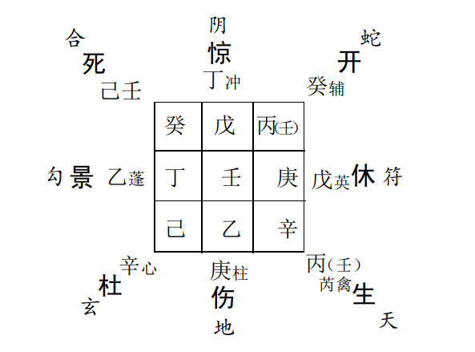

日干己乘死门， 落宫巽四宫衰弱无气， 说明其本身之能力、能量， 稍嫌不足或时机尚不成熟， 格局为地刑玄武， 断语亦非吉
利。 时干为事， 庚落坎一宫， 虽生助日干， 但衰弱无气， 断语亦劝诫“ 退吉进凶”。  

再者甲子戊落兑七宫表示资金方面的信息， 旺相冲克日干之落宫说明其资金方面存在严重问题。 实际情况是其自身并没
有这么多资金， 几乎完全要靠银行贷款投资， 而银行方面现在已是严格控制金融风险和贷款审批制度， 因此， 恐怕其资金难以到
位。  

最后， 再进一步假设其企业可以开业， 那么我们可以继续考察一下其利润状况。以生门为用。 今生门落乾六宫， 虽有气， 但冲克日干所落之巽四宫， 而且空亡， 于我实为不利。 格局丙加辛虽佳， 断语是“ 病人不凶， 谋事成就”， 但丙为年干， 象征长者、 官贵等他人， 随即推断此事如有一些级别较高的人士， 或领导参股， 那么， 可能会有  不少利润。 但是， 如此以来最终结果亦恐怕是“ 我栽树， 人乘
凉”。 张x马上证实了这一推断， 说确实有位领导对此项目很感兴趣， 但尚未议定。 鉴于此项推理， 那么， 这项合作也就到此为
止吧。后来结果基本如此， 此项目没有继续耗费精力， 张x又投资搞了一个装饰工程公司， 据说效益还蛮可以。  

**例：** 鹿泉市食品公司总经理付安预测投资创办一个小型炸药厂， 看此事能否办成？  

丁丑年癸卯月己酉日癸酉时， 阳遁一局用事， 甲子旬， 天蓬星值符落乾六宫， 休门值使伏吟本宫不动， 日干己乘景门落离
宫， 时干癸在兑。  

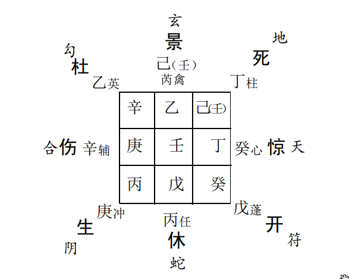

日干己落离九宫， 时值卯月， 可视为有气论， 格局己加乙为“ 墓神不旺”， 断语是“ 地户逢星， 宜遁迹隐形为利”， 不佳。 乘景
门落离九宫， 正应与离火有关之炸药厂事。 大象八门伏吟为办  事受阻， 拖 落之象。时干为事， 奇仪癸加丁上， 天盘丁又落坤二宫乘死门， 因丁奇在预测中常表示文件、 条文、 手续、 合同等信息， 故在此可引伸推论其创办炸药厂的一些手续恐难办理。 事实果然如此， 办这类企业需要几级政府和公安部门等审批， 所以， 最后之关键问题可能出在这个方面。  

此外， 开办企业类事又可以开门为用决之。 今开门伏吟本宫， 居空亡之地， 衰死之宫， 又是一个极端不利的信息。
所以， 最后综合推论， 事属计划落空， 求谋不遂之象。 结果全部应验。  

### 三、 合伙经营类前景预测  

预测合伙经营一般以日干落宫为我， 时干落宫为合伙者。合伙者为两人以上者， 可以合伙者之年命、 年干为其代表信息，
如1964年生人， 年干支是甲辰， 则即以甲（ 戊）落宫为用。一般来说， 时干落宫， 或用神落宫乘奇门吉格生合日干之落
宫者， 则合伙与我有益。 日干乘奇门吉格而生时干落宫者， 合伙有益于他。 二者落宫比合者， 那么， 合伙公平， 各无猜忌。 若时
干乘凶门凶格克日干之落宫者， 则与我不利。 具体损益情况则再参以甲子戊和生门落宫及其与日、 时干落宫的旺衰生克关系，
并把握相生则益， 相克则损的原则酌情推断。  

**例：** 北京大学博士， 姓名学专家金美含， 预测与佛协合作开办姓名学研讨班， 结果怎样？  

丁丑年癸卯月乙亥日辛巳时， 阳遁六局用事， 甲戌旬， 天柱星值符落离九宫， 惊门值使落坤二宫， 日干乙在巽， 时干辛在震。  

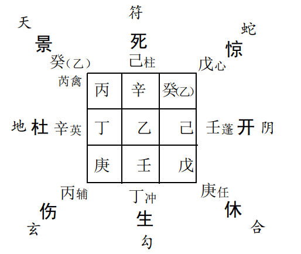

日干为求测者， 乘景门、 九天， 正应其所测之事， 即办研讨学习班， 且主要招收对象为外地学员。 格局乙加丙， “ 奇仪顺遂”亦
吉。 时干辛代表合伙者， 落震三宫， 格局狱神得奇， 断语是“ 经商获倍利”， 为坐收渔利之象。 两宫比合， 说明此班如能开办， 则双
方均能得到部分效益， 且合作过程中亦不会闹出什么不愉快的事情  .

但是， 因为其所预测的主要是办学之未来前途类事宜， 所以， 开门仍是此局象之中的主要用神。 今开门落宫衰死、 空亡，
并且克日、 时干之落宫， 因此， 此事之最终结果仍然是半途而废，不了了之。 后， 果应验如所测。  

### 四、 企业经营综合预测  

预测企业的经营情况， 一般以日干代表求测者， 值符为企业  法人或主要负责人， 年干代表上级领导或主管部门， 月干代表同
僚， 同行业竞争者， 或同一企业集团内部不同分公司或部门之经理、 主管， 时干代表企业员工， 甲子戊为企业资产、 资金情况， 生
门代表直接经济利润， 开门为预测者职位、 官运或企业经营、 运转情况。 各以其落宫间之旺衰生克关系， 和奇仪格局善恶等， 综
合具体推断。  

**例：**1995年12月9日下午4时， 全国人大代表著名企业家、 石家庄某化工有限公司董事长张&， 要求预测一下其企业之
经营情况和未来状况？  

乙亥年戊子月甲戌日壬申时， 阴遁一局用事， 甲子旬， 天蓬星值符落乾六宫， 休门值使落坤二宫， 日干甲与值符同居乾六
宫， 时干壬落兑七宫。

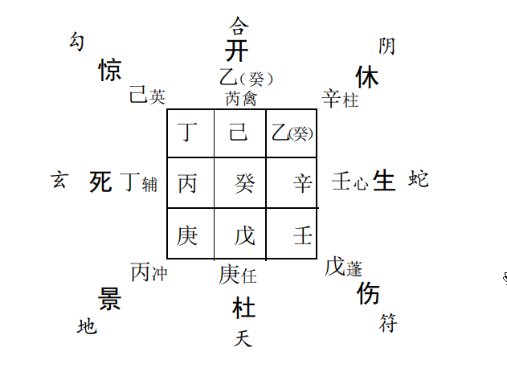  

首先， 通过局象分析一下其企业内部的经营情况。
甲（ 戊）地盘在坎一宫， 天盘落乾六宫， 均属旺宫、 旺地， 说明  其企业确有一定的实力。 但是， 地盘甲（ 戊）上乘庚和杜门， 象征
其资金周转及回收方面情况不佳， 八神乘九天， 又可推断其问题可能发生外地， 其中， 尤以北方为主。 天盘甲（ 戊）落空亡之地，
格局是“ 青龙入天牢”， 断语是“ 阴阳皆不利”， 更可进一步证明上述推论。 生门和时干落兑七宫， 与日干和甲（ 戊）所落之乾六宫
比和， 目前， 尚可以说有些余气， 由此可得知其企业尚有盈利。但是， 企业在内部管理方面恐怕存有一些问题， 尤其是虚报指
标、 假帐目、 蒙混领导过关等情况。 因其所乘奇门格局为壬加辛 “ 腾蛇相缠”， 断语是“ 纵得奇门亦不能安， 若有谋望被人欺瞒”。
是故， 我们便可以得出上述引伸推论。   此外， 从局象之中还可以进一步推论其与部属和各级主管领导之间的关系， 及其本人的事业情况。日干、 月干同居乾宫， 时干在兑亦为比和关系， 由此可知其企业凝聚力不错， 企业中下层都比较支持张!。 但是， 开门、 年干乙居离九宫， 克制日干之乾六宫， 说明张!本身不善于搞上层关系； 其于上级主管领导层之中， 常遇掣肘现象。 事业运在88年至90年间曾一度辉煌， 因是开门旺地， 看来， 其当时多次受到国家级领导人之接见亦属必然。  

## 第二节 事业前途预测  

### 一、 升学考试预测  

预测考试成绩优劣， 般以日干落宫为求测者， 为考生， 值符为主考部门或单位， 月干为副主考， 值使为执行考试具体工作的
个人或部门， 景门为成绩， 丁奇为试卷。 日干落宫得值符宫生助， 得景门、 丁奇落宫旺相吉格相生， 那么， 一般来说考试遂愿，
成绩理想。 如果景门、 丁奇落宫旺相， 但却冲克月干、 值符之落宫， 则往往是文卷虽佳， 主考不喜； 乘凶格或空亡入墓者， 则文不
对题或扣题不紧， 成绩欠佳； 乘玄武者， 卷面了草， 错误较多。  还须察看开门与日干落宫的生克关系， 因为开门常代表录取官方或录取学校， 要生合日干方吉， 否则开门落宫冲克日干落宫， 或开门落宫衰死、 空亡或入墓， 那么， 有时即使是景门、 丁奇旺相吉格， 也会经常发生成绩虽佳， 却榜上无名等种种不被官方录取的意外情况。  

**例**： 某部队领导测其子考试升学情况？  

丙子年， 丙申月辛卯日壬辰时， 阴遁八局用事， 甲申旬， 天心星值符落巽四宫， 开门值使落兑七宫， 日干辛落艮八宫， 时干壬
居乾。
首看景门落宫巽四宫之情况， 秋月按无气论， 格局庚加壬“ 小格”凶象， 而且克日干辛所落之艮八宫， 由此可推知其子之考试成绩欠佳。  

再看丁奇之落宫， 艮宫入墓， 并且受值符景门之落宫克制，说明所答题目扣题不紧， 判卷人不喜欢， 当然成绩自然也就不会太好。  

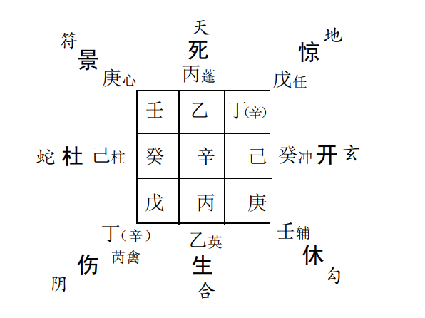  

日干落宫之奇仪格局为“ 困龙被伤”格局九星反吟， 大象亦为凶象。
综上信息定论， 考试成绩肯定不会理想。 结果成绩公布之后， 确实没有通过录取分数线。  

在预测升学考试类事情时， 除了参考景门、 丁奇落宫之表示成绩试卷情况的首要信息之外， 还必须结合开门落宫情况综合
判断。 此局就是一个比较特殊的案例。 景门丁奇落宫情况虽然不佳， 也就是说成绩虽不很理想， 但是， 开门却旺相有力， 为升学
录取必然之象。 经进一步询问方才得知， 其实来者已为其子找好退路。 假如说不能通过高考录取分数线的话， 那么， 军队内部
有两所学校可以照顾。 另外， 就是可以出国去俄罗斯自费留学，此又正应开门乘玄武象（ 非国家正式承认学历）  

**最后**， 此领导又问到， 如果是这种情况， 那么， 该选择哪一所  学校呢？ 大师又问了一些基本情况， 并根据此同一局象灵机选取
用神， 回答了其所提出的问题。 其第一所学校是某司令员联系的， 在石市之南方， 第二所学校是自己联系的， 基本方位在石市
北方， 第三所就是俄罗斯自费留学。
第一所学校， 当时以离宫年干、 九天之落宫为用， 今乘死门， 所以， 可推论此年干贵人即某司令员所推荐之学校去不成；
第二所学校因为是自己联系的， 又基本位于石市之东北方，以日干辛之落宫为依据， 因天盘八门乘伤门， 为变动、更改之象， 所以说最后之结果也未必应验于此  。

比较起来还是去俄罗斯留学的希望较大， 有两个理由， 其一是开门乘玄武为耗财之象， 而去俄罗斯为耗资最多。 其二是日
干落艮八宫， 而开门落兑七宫， 因为日干与用神如同居一、 八、三、 四宫或九、 二、 七、 六宫则距离较近， 反之， 则远， 而今日干和用神分居两组， 那么， 就是说我与最后录取学校的距离应该说是比较远的。 所以， 便得出了上述论断。
最后结果应验。  

### 二、 参军入伍预测  

日干为应征青年， 月干为同批应征者， 开门为部队首长或本人之前途事业， 值符为征兵工作之主管部门。 如果日干落宫乘
旺相气， 得奇门吉格， 且得开门旺相气或吉格生合， 那么， 必能应征入伍， 并且， 入伍后必得领导之信任提拔； 不得奇仪相助， 只乘
旺相气且与日干相生者， 入伍虽能， 后必业绩平平， 不得重用。
如日干被开门所克， 那么， 报名后恐不被录用； 日干落宫乘凶门凶格， 衰死无气者， 恐身体衰弱， 体检不合格； 受值符、 值使落宫
冲克者， 则必是当地征兵主管部门不愿推荐， 或暗使机巧， 李代 桃僵。

**例**： 康!准备让其子报名参军。 恐年龄稍小为碍， 故预测一下能否入伍？    

乙亥年丁亥月辛未日丙申时， 阴遁七局用事， 甲午旬， 天辅星值符落离九宫， 杜门值使落坤二宫， 日干辛与值符同宫， 时干
丙与值使同宫。  

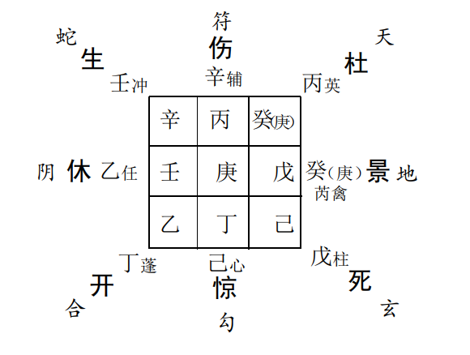

值符与日干同宫， 可说明能得征兵部门及其领导的赏识。
年干乙奇落震三宫， 亦与日干辛之落宫相生， 也为得贵人相助之象。 最后， 再看开门落宫进气得奇， 且与日干落宫相互生合， 故
可推断， 入伍肯定没有什么问题， 果应验如所测  。

### 三、 职务升迁  

谋职升迁类与工作事业有关之事俱以开门为用神。 日干为求测者， 月干为同僚、 同事， 年干为上级领导、 贵人、 长者， 值符为 主管领导或人事组织部门领导。一般来说， 日干得年干生助， 则上级领导提拔， 得值符生助，主管组织领导推荐， 得月干生助， 朋友同僚帮忙， 再得开门旺相吉格、 得奇， 不空亡入墓， 且与日干落宫相互生合者， 那么， 得职较快， 求谋易就。 如果是只得门而未得奇， 虽亦升迁， 但往往不得要职。 如果是只得奇而未得门， 则常常是只得加衔晋级， 但不能获得实际权力。
开门所乘之八神可说明未来工作的部门或特点， 值符为行政部门或指挥管理部门， 腾蛇可是宣传、 信访或商业贸易部门，太阴是参谋、 秘书、 司法、 律师或保密部门， 六合可为具合和、 交易、 联络等工作性质的部门， 勾陈可为公安、 道路、 军队、 刑侦、 医院等部门玄武常应税务、 水利、 营运等部门， 九地可是农林系统或宗教、 民政等部门， 九天常应驻外单位或通信、 交通等部门。   

**例**： 天津某大学学生处处长马!预测提升院长助理， 看希望如何？  

戊寅年癸亥月癸亥日癸亥时， 阴遁九局用事， 甲寅旬， 天辅星值符， 杜门值使， 八门九星俱伏吟本宫不动。 日、 时干俱在巽。
八门九星伏吟、 大象不佳， 不利谒贵求名， 积极进取， 只适合静以待变， 等候时机。
日干落宫衰弱无力， 乘杜门为阻塞之意， 格局“ 天网四张”亦为欲动不能之象。开门虽居旺宫， 但冲克日干落宫， 说明此次晋升之希望不是很大， 格局辛加辛“ 伏吟天庭”公废私就， 亦不为吉象。日干癸与离宫之年干戊相合， 虽应其说已和市委某领导接触联系， 但局象显示离宫目前衰弱无力， 此事恐难以相助。  问事时间比劫重重， 亦象征其竞争十分激烈。
最后， 综合以上信息得出结论： 马某之愿望最终恐难以实现。 结果应验。  

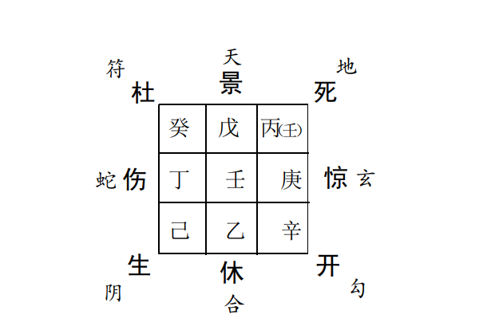

**例**： 某市委书记预测事业官运？  

乙亥年丙戌月乙酉日丙戌时， 随机诹取一局， 为阴遁八局用事， 仍按原时间起用。 甲申旬， 天心星值符落坎一宫， 值使开门
落巽四宫， 日干乙在坤， 时干丙在艮。日干、 年干乙奇同居坤二， 说明其人确实有一定地位和身份。
预测官运以开门为用， 今开门落巽四宫， 说明其事业运该应于巳酉丑之年月。 实际情况基本相符。 此人正是!"年中央党校毕业后， 官运始见亨通。日干、 乙落坤宫， 那么， 须防丑寅年艮宫死门冲克， 恐有让位放权之虞。
果然， 此人1998年调至人大， 免去其原来职务。  

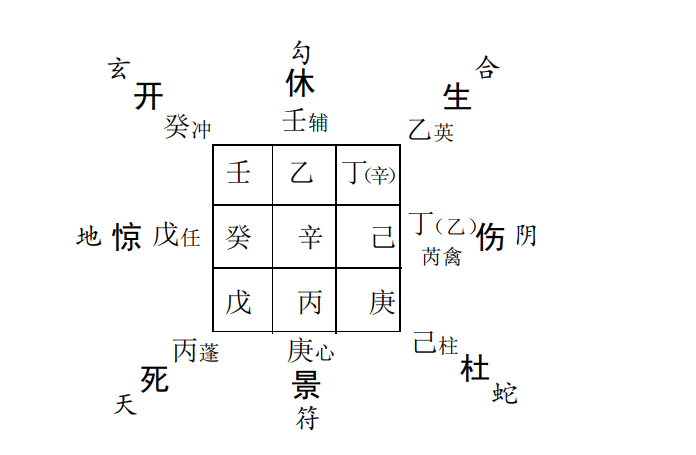

### 四、 职务贬谪预测  

降职调任般以开门或杜门为用神。 开门受克， 文官调任， 杜门受克， 武职谨防。 反吟主调任， 空亡必革职， 入墓不但降罚， 还防招惹罪戾。 太岁来克， 最上层领导不喜， 值符冲克直接上司参塞， 月干克为部臣同僚参劾。 如见玄武为盗案， 白虎为命案， 朱雀为文书口舌， 腾蛇工作失误， 太阴罢职， 六合勾陈贪酷。 若开杜二门乘旺相相生之宫， 或得三奇吉格， 虽参不妨。 可参阅《奇门遁甲秘笈大全》官禄公事占   

**例**： 某军官预测工作？  

乙亥年戊子月戊戌日丁巳时， 阳遁二局用事， 甲寅旬， 天柱星值符落艮八宫， 惊门值使落坎一宫， 日干戊与值使同宫， 时干 丁在离。  

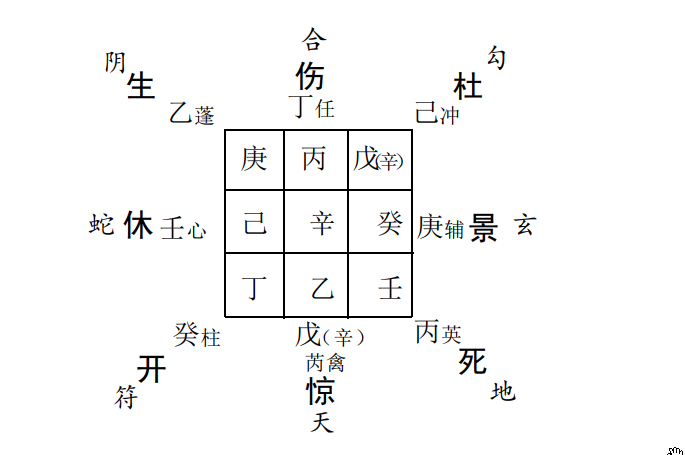 

日干戊与值使落空亡之地， 惊门可代表官司是非类事， 也代表其本人惊疑之情状。 辛干与日干同宫， 常有犯法、 犯罪、 做错
事等信息提示。 奇仪格局戊加乙“ 青龙合灵门”凶事更凶， 不为吉象； 同宫之辛加乙“ 白虎猖狂”， 更为凶象。 乘九天， 说明事情
可能出自外地。
开门为工作事业， 又与值符同宫， 今冲克日干落座之坎一宫， 说明领导对他很不满意， 须防免官革职之忧。 时间大概应于
立春以后， 用神开门填实之期。
结果到立春以后， 即丙子年寅月底， 上级下达了文件， 免去该军官主任职务， 同时被免职的还有几人。  

### 五、 身命占  

奇门预测终身般以出生时间的奇门格局综合推断。 年干代  表父母， 月干为兄弟， 日干为本人， 时干为儿女、 妻妾。 旺相得
奇， 富贵荣华， 休囚、 墓绝， 贫贱苦寒。  参考《奇门遁甲秘笈大全》  

#### 1、八门旺相得奇与否， 定事业成败之大局。

生辰局象之中， 开门有奇， 应是文职； 伤门得令， 定系虎臣；生门得奇， 石崇富足； 景门合局丹天文明； 惊门入式， 好辩之人；
死门得奇司刑之职， 宗教领袖； 杜门得地， 捕捉巡警， 工商检察；休门得奇， 无忧无虑， 名艺远播。

#### 2、年命日干落宫情况。

年命日干落宫旺相得奇， 那么， 一生谋为顺利， 若逢刑害格墓， 则必终生蹇滞。 乘休门财名自足， 宜遇贵谒见； 乘生门， 利经
商谋利， 教育儿女， 鸣则惊人； 乘伤门， 利动中谋为； 乘杜门， 可安分待机， 宜工商税务、 检察等行业， 寻求发展， 或潜形匿迹， 修身悟道； 乘景门， 宜文秘参谋， 侍候大人， 近官近贵； 乘死门可收积财货， 田地富足， 宜在农业、 刑侦、 宗教、 民政部门等寻机拓展； 乘惊门宜司法、 诉讼； 乘开门则为人深谋远虑， 可图谋大业， 统管全局。  

#### 3、九星推论人物性格和职业特性。

年命日干乘天蓬星， 其人粗眉大眼， 处事冷静； 乘天任星， 则性诚实， 个矮背驼； 乘天冲星身材高大， 性易冲动； 乘辅星清秀文
雅， 谦虚和顺； 乘禽星， 端庄稳重， 体格厚壮； 乘芮星， 黑矮肥壮，办事固执； 乘天英星， 鬓发脱落， 性格暴躁； 乘天柱星面瘦色清，阴险善辩； 乘心星方面圆白， 性格果断， 计谋深远。
天蓬乘时， 边疆之将， 失时失地， 军座贼艺； 天任得地， 司农 之职， 田土富足， 失地受克， 农辅辛苦之人； 天冲有气武贵， 背时
车船江湖之流； 天辅左枢， 得气者文雅仕宦， 失时休囚者， 僧道画工； 天英乘权， 必主文谋， 背时者， 贪暴昏庸； 天芮乘权， 性恶霸盗， 失时失地， 役隶庸工； 天柱乘权， 舌辩当世， 被冲克， 优伎乐工； 天心乘权， 华国玉柱， 失令九流相寻   

#### 4、其他有关格局论述

格局分轻重， 命运验得失， 未布局先看孤虚旺相， 即开口必辩天地乘时。 太白入乾坤， 父母早丧， 若临兄弟宫位， 手足竟是仇敌。 日奇被刑， 庄生嗟叹； 时干逢之， 邓通无儿。 生门产业， 要得门奇。 成败分于内外， 生克决其得失。 生门太白逢冲克， 背祖离乡客售尽祖父田园。 生在外而身在内， 必迁居而发富； 身在外而生在内， 纵有祖业亦难容。 身生二宫俱在内， 安享仆马之福； 身生俱在外宫， 远方创业之人。 日值孤时值虚， 少年无依； 时落孤， 日落虚， 老后鳏独。 命被冲克， 乞食道路， 日临墓绝， 难释愁眉。 财官生旺， 盖因飞鸟跌穴。 鳌头独立， 必得青龙返首。 青龙得光， 邑长县令。 丁加戊富家之名。 白虎猖狂， 凶顽之辈。 青龙逃走， 懦弱之人， 更主因妻成败， 而且弯背驼身。 朱雀投江， 刀笔书吏。腾蛇夭矫， 毒心小人， 失时者目盲耳聩， 乘气者火焚伤身。 太白入萤惑者， 进主先贫后富； 荧入太白者， 退主家业萧条。天乙太白， 太白天乙， 多成多败。 太白同宫， 兄弟雷攻， 太白蓬星， 妻室常病。 蓬星太白， 惟薄丑声， 大格者， 萍迹四海， 小格者，暂时清贫。 年月日时格， 即六亲而推去， 看是何宫应验， 而为悖戾无礼相从， 推及父母兄弟妻子贤否， 可以详明。 辛为天狱， 壬为地牢， 主低下之品， 更主抑郁难伸。 癸为天网， 须看高低， 高者化为华盖， 可推贵格， 低者天网缠身， 寂寂孤贫。 且忌玉女守门， 妻随人行。 乙丁妻妾， 看是谁亲谁疏。 乙奇入墓， 妻不生子。 丁乙同宫， 另续相亲。 乙奇在上， 妻妾协和， 丁加乙上， 幸幸夫心。诸格忌落空亡， 吉者减昌而苦者更苦。 若临墓绝之地， 无告穷民。 八门推来最怕反吟， 伏吟亦是凶神。 五行配合斯里， 取用在乎一心。     

#### 5、八神辅助信息。

值符， 发轫之初， 气概雄伟， 羊盾虎皮； 腾蛇， 口实虚惊， 奸佞心毒， 委曲婉转； 太阴， 小人暗算， 沉滞猥亵(xie)， 深谋远虑； 六合， 亲朋招抚， 和蔼慈详， 易惑易动； 勾陈（ 白虎）， 事多折磨， 果敢执拗，道路惊恐， 凶勇成权； 朱雀（ 玄武） 词讼是非， 巧辩能文， 宜防欺伪， 奸险阻邪； 九地， 宜防险阻， 深机大度， 阴险莫测； 九天， 轩昂大方， 虚张声势。
**例：** 清· 沈孝瞻著《 子平真诠》载梁启超之生辰八字， 如用奇门格局推之， 再参以命理大运， 流年， 则许多子平命理所不能尽
显之问题， 皆可了然无疑。
癸酉年甲寅月丙午日癸巳时生人， 雨水下元， 阳遁三局用事， 甲申旬， 天禽星值符落艮八宫， 死门值使伏吟本宫不动， 日干
丙在离， 时干癸在坤。  

日干丙落离宫旺地， 格局丙加丁上为“ 朱雀贵人”甚佳， 正可谓“ 景门合局， 丹天文明”， 是以其能够成为近代著名的大学者。
1894-1895年， 甲午、 乙未两年， 随康有为发起“ 公 车 上书”， 创办强学会， 编辑《 万国公报》， 声名日盛， 是为少年行离宫
身旺运， 景门旺相得奇故也。
1898年岁在戊戌， 流年乾宫开门主事， 所以有其组织领导保国会， 参与百日维新之事业， 怎奈命局反吟， 常主反复、 变动、  

无常之象， 亦可说明其年少气盛、 行事不稳， 再加激引坎宫水运，壬子大运冲克日干丙之落宫， 因此昙花一现， 几罹不测。 所幸者
坎宫遇丁奇， 乘休门、 九天， 是故， 唯其能够得贵人相助外出避难。
1913年癸丑， 艮八宫土运主事， 乘生门值符， 遇乙奇， 地盘又逢癸年干贵人， 因此本年度出任熊希龄内阁司法总长。
1917年丁巳， 大运戌运主事， 又日干落宫进气， 是以此年又出任段其瑞内阁财政总长。
1929年岁在己巳， 病故。 究其因或在戌亥乾宫开门吉运已过， 且流年逢己巳， 犯命理所谓行运“ 老怕身旺， 少怕衰”之忌也。  

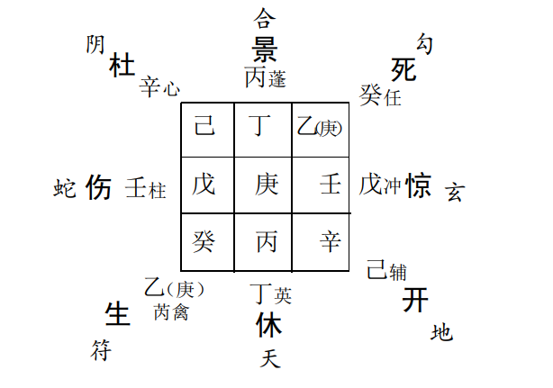

**例：** 《子平真诠》载胡适之命例。
辛卯年庚子月丁丑日丁未时生人， 属大雪下元， 阴遁一局用事， 甲辰旬， 天心星值符落巽四宫， 开门值使落震三宫， 日干、 时
干丁俱在乾 .

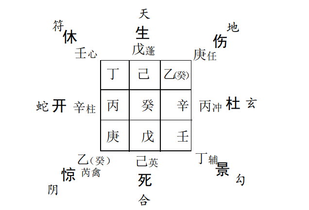 

日干丁奇乘天辅星、 景门落乾六宫， 应其文化名人学者之象， 且亦可同时说明其一生事业利文途。
1909年岁在己酉， 七宫杜门主事， 与开门冲克， 不利事业，是以此年胡适肄(yì)业于上海中国公学。 次年运转乾宫， 景门主事，
有利学业， 故留学美国康奈尔大学。
1918年岁在戊午， 离宫生门主事， 任职北京大学。
1927—1928年， 丁卯、 戊辰， 开门旺相， 大利事业发展， 故其年出任中国公学校长。
1938年任国民党政府驻美国大使， 时亦为开门进气， 戊寅、己卯之交。
1946年岁在丙戌， 任北京大学校长， 为日干落宫旺地。  

还有一个问题， 需要和大家做一下说明， 就是判定应  期的误差问题。 如此例之中的几个情况， 总是和局象信息前后
要错位相差一段时间， 那么， 这究竟是什么原因造成的呢？ 以及如何能够更加准确的确定应期呢？ 对此， 命理学典籍《 滴天髓》
之中， 亦曾有过这样的解释“ 阳支动且强， 速达显灾祥； 阴支静且专， 否泰每经年”， 也就是说天地之气的运行本身就经常有一些
误差， 因此， 有时我们单凭命局本身的固定信息， 是很难测定某些具体事件的应验日期的。 为了更好地处理这个问题， 尚须进一步多结合几种预测方式， 如六爻预测， 梅花易数预测等， 尤其是梅花易数预测方法， 它本身即具有“ 短、 平、 快”的一些优点， 如果确能够将之灵活地结合运用到奇门预测之中， 那么， 常常就会收到许多意想不到的“ 奇效”  

## 第三节 官司诉讼预测  

预测官司诉讼一般以值符为原告， 为讼者， 乙奇为被告， 为对者， 开门为问官、 法院， 惊门为讼神， 可代表律师， 六合为间证，
亦可代表证词、 证物， 景门为词状。
词讼胜负则专以原告和被告的旺衰生克关系及其得否开门生助为判， 旺者胜， 衰者败， 得开门生合者胜， 我克者胜， 否则讼
败。 开门入墓， 问官糊涂， 法院敷衍塞责， 落空亡者， 不预审理，反吟常应更换法官后再审。 景门旺相， 状词恳切， 惊门得奇， 律
师优良， 六合证人证据， 凭其与原、 被告之生克关系论断与我之利弊。  

预测罪责轻重和牢狱之灾， 以日干或甲午辛为罪人， 壬为地牢， 癸为天网， 辛为天狱。 要看日干或甲午辛落宫之地盘临干，
如遇壬、 癸、 辛者， 常为入牢遭囚禁之象。 如地盘日干或甲午辛上乘天盘奇仪壬、 癸、 辛者， 则常为已被囚禁拘留之象。 罪责轻
重， 以旺衰确定， 所犯罪责， 可以八神参断。  

例： 杨x等四人从银行贷款"万元， 拖欠至今未能偿还， 银行状告于法院， 杨x接起诉书后， 请预测一下其诉讼结果？  

戊寅年壬戌月辛丑日癸巳时， 阴遁九局用事， 甲申旬， 天柱星值符落巽四宫， 惊门值使伏吟本宫， 大象为八门伏吟格局， 日
干辛在离， 时干癸在坎。值符为原告， 落巽四宫， 失时失地， 乘杜门， 格局庚加癸为大格， 断语是“ 官司破败”凶象。
日干辛落离九宫， 乙奇落坤二宫， 皆为空亡之地， 说明被告确系无力偿还债务或人员下落不明， 或找人不见之象。 辛上乘 九天， 乙奇上乘九地， 亦辅助说明其借口外出或隐匿之信息。开门为问官、 法院， 落乾六宫， 被日干辛所克， 开门又克值符所落之巽四宫， 说明法院对此事也是束手无策， 以至搪塞原告，等待时机。格局伏吟， 办事毫无结果之象。
综上预测最后得出结论： 此官司打不起来， 亦很不容易出结果。 最好的办法还是和银行协调一下， 商量一个具体的还款计划， 慢慢再说吧。   

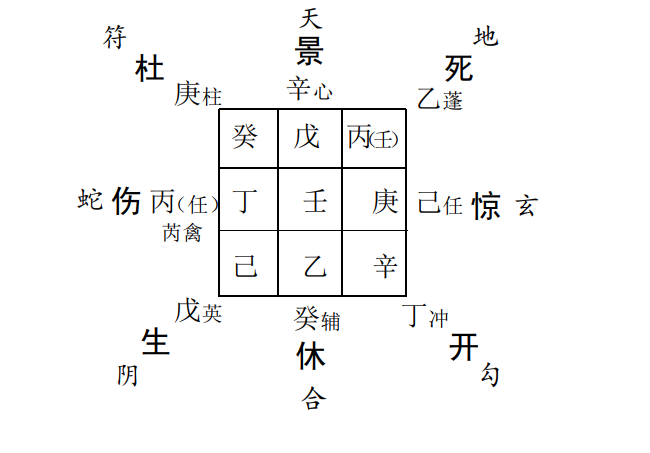

## 第四节 婚姻家庭预测  

### 一、 婚姻结合  

常以乙奇代表女方， 庚代表男方， 概取之于乙庚相合之意。六合为媒约、 证婚人， 丁奇可代表结婚证书。 首先， 看乙庚两干
落宫的生克情况， 两相生合， 则婚姻易成， 两相刑克， 则良缘难就。 其次， 看日、 时两干之落宫情况， 乘吉门、 吉格， 不空亡、 入墓者， 可成， 且成后夫妻生活美满， 白头偕老。 乘凶门， 凶格， 空亡入墓者， 难成， 既成亦难免改弦易辙， 感情不和。 最后， 辅助参看其他有关信息， 如六合生庚， 则媒约偏男， 生乙， 则媒约袒女方。乙奇落宫击刑或乘其他凶格， 则女性凶恶。 带德合， 吉格， 则女性贤淑， 男方之情况如何， 以庚宫同断。  

八神、 九星可为辅助信息， 由此可进一步推知婚媒的其他一些相关信息以及男女双方身体、 职业、 性格等方面的情况。 要视
具体情况， 灵活取用， 不可千篇一律， 板板六十四。

#### 八神临用

腾蛇： 表示犹疑未决， 有人唆使， 媒约作乱等信息；
白虎： 表示阻挠、 刑克、 病伤等信息， 亦可说明其职业身份可能是公安战士、 医生等方面信息；
九地： 婚姻迟滞， 身处农村， 或有宗教信仰等倾向；
九天： 外地旅行结婚， 婚期较近， 身份为驻外业务人员或交通、 通讯等部门工作的人员；
玄武： 则常主口舌、 奸诈， 心术不正， 非正式登记， 欺瞒说合等信息；  

值符： 代表为人正派， 婚姻圆满；
太阴： 为意往情深， 私订终身；
六合： 可代表脾气温和， 婚姻幸福， 感情合和等信息。

#### 九星临用

天蓬星： 脸黑、 个矮、 较肥， 具五行水的某些特征， 如冷静、 淫佚， 富于心计等；
天冲星： 个子较高， 喜动性慈， 具有五行震木的某些属性；
天辅星： 才貌较好， 性温具五行巽木的某些属性；
天英星： 体形较尖， 面微红， 性较急， 具五行火的某些属性；
天柱星： 形清瘦， 面白、 声突、 俏丽， 具五行兑金的某些属性；
天心星： 美貌、 清秀， 多才艺， 具五行乾金的某些属性；
天任星： 面色稍黄， 较丑， 形厚重；
天芮星： 腰粗背厚， 性较缓， 丑陋；
天禽星： 端庄、 貌美、 性稳重。 以上三星均属土， 故都具有五行土的某些特性  

### 二、 婚姻离异  

丁奇为插足之第三者女性， 丙奇为插足之第三者男性； 如乙庚双方各自生合丁、 丙， 那么， 是为夫妇双方移情别恋之象； 如再
互相冲克， 或日干、 时干乘凶格、 凶门或大象反吟等， 则十有九离； 伏吟为感情虽不和， 但可维系， 是离异不成之象  。

**例：** 范!（ 女）测婚姻离散？  

丁丑年丁未月辛酉日戊戌时， 阴遁五局用事， 甲午旬， 天芮星值符居坤二不动， 九星伏吟格局， 值使死门落兑七宫， 日干辛
时干戊俱在坤宫。  

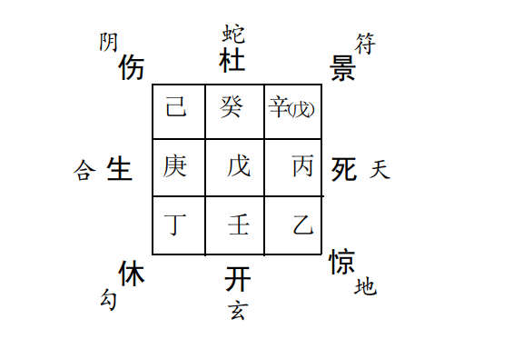

日、 时两干乘景门， 应是非、 争斗之事。 格局辛加辛“ 伏吟天庭”， 断语是“ 公废私就， 讼狱自罗罪名”， 戊加戊的断语是“ 凡事
闭塞， 静守为吉”， 实劝谕遇事须忍让三分， 不可针锋相对。克我者震三宫， 奇仪乘庚， 又应其丈夫之年命（ 庚戌年生人）， 显是婚姻感情方面发生了问题。 实际情况是男方不让女方回家， 想离婚。
所幸者庚宫衰弱无气， 而日干落宫坤二宫正当旺时， 又乙之落宫乾六能克制庚宫， 说明以前平时其女就比较厉害， 能制服其
夫。 此外， 丁庚落宫相克， 可说明男方尚没有钟情之女友。 再者， 九星大象伏吟， 估计其家庭不会出现什么变化  。

综合以上信息， 最后结论应该是： 风波渐息， 亥月以后自然恩爱如初。 结果应验。  

**例：** 河北省保险公司姚!（ 女）预测婚姻。  

丙子年辛卯月己未日壬申时， 阳遁六局用事， 甲子旬， 天心星值符落坎一宫， 开门值使落坤二宫， 日干在乾， 时干在艮。  

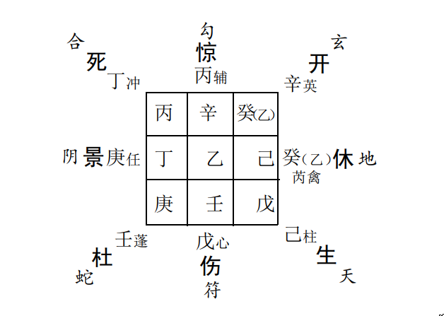

乙奇在兑， 庚在震， 互相冲克， 说明夫妻感情破裂。 格局乙加己为“ 日奇入墓”， 被土暗昧， 凶象已露； 庚加丁为“ 亭亭自奸”
因私匿而起官司， 又丁象征第三者女性， 今庚丁同宫， 说明男方已有所钟情。
日干己为测者落乾六宫， 受丁奇落宫巽四宫乘死门冲克， 亦现插足争斗之象。
时干壬为事， 落艮八宫， 格局“ 太白擒蛇” 讼狱之象亦显。
最后综合分析结果是： 前缘已尽， 须防近两月恐就是离散之期。 后果然电话告知壬辰月办理完离婚手续。  

**例：** 柏林寺《禅刊》杂志编辑， 武汉大学研究生胡!交了一位大学生女友， 预测婚姻成否？  

丙子年丙申月丁酉日己酉时， 阴遁一局用事， 甲辰旬， 天心星值符落离九宫， 开门值使落坎一宫， 日干丁与之同宫， 时干己
在艮。  

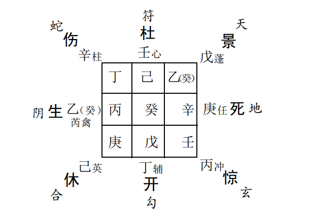

庚在兑， 乙在震， 二宫相克， 故当时即照本宣科式地得出结论， 此对姻缘难就， 可是结果却是截然相反， 事后仔细揣摸， 终悟
出了其中的一些道理。庚为男， 乘死门、 九地， 或可一方面说明此人在宗教界拓展事业， 同时或亦在说明其前世之姻缘不佳或婚姻状况本来不是很好。 但是， 通过其一个时期的修行， 使本来不是很好的姻缘状况发生了一些变化， 故此例之中似乎更应注重日干落宫信息以
及其与乙奇落宫的生克关系。 

日干丁乘开门， 格局“ 青龙转光”， 吉象。 再者丁亦为女象，说明胡!确有异性朋友运。 开门吉利， 说明其谋为易就， 前途不
错。
乙奇落宫与日干落宫相互生合， 且其格局， 门、 神俱佳， 生门象征未来、 希望， 太阴可说明女方一往情深， 格局奇仪顺遂亦吉
象。 今虽落空亡之地， 但出空之年月必应。 果然冬月传来其结婚的喜讯 。

## 第五节 失物、 怪异预测  

### 一、 预测失物  

以日干落宫为失主， 时干落宫为失物。 时干落宫乘旺相气生合日干落宫者， 则可失而复得， 格局反吟者亦可得。 时干落
墓、 绝、 空亡之宫者为不可得。 如果要测知所失为何物， 则可以时干落宫之八卦类象推论， 旺相有气常为鲜活之物， 带奇者为贵
重之物， 反此， 休囚死气者， 必为废旧死物。    

**例：** 邻居顾大伟家丢失一枚戒指， 预测能否找到？  

丙子年甲午月壬子日己酉时， 阴遁八局用事， 甲辰旬， 天辅星值符落兑七宫， 杜门值使与时干同落艮八宫， 日干壬与值符同宫。  

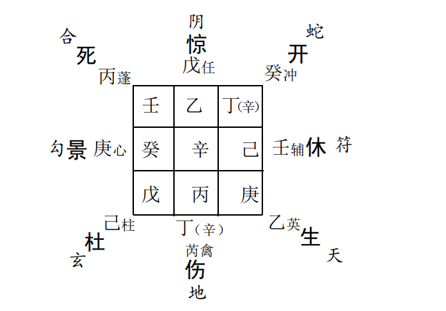

日干为失主， 乘休门， 格局虽不佳， 但仍不算是凶象。 时干己为物， 下临天柱星， 可谓正象戒指之应， 落艮八宫， 虽入墓， 但
土土比合， 时值午月， 亦不作衰论。 此外， 最关键之处在于时干 落宫生日干之落宫， 为失而复得之主象。
时干己与地盘甲（ 戊）相合， 乘杜门， 八神为玄武， 为艮方潮湿阴暗之地， 或者是艮卦类物品之旁， 如床底下， 茶几底下， 鞋子
中可以找到。 时间该应于未、 申之年、 月、 日、 时， 因奇仪相合， 必待逢冲之时， 方可摆脱羁绊。 再者坤宫上乘开门， 亦可说明物品找到之时间应在未申月。   为了进一步证实上述推断， 于是， 又起得一六爻卦，《 旅》之
《遁》， 子孙持世自丢失， 亦为平安复得之象， 五爻子孙未土动化申财生助， 正与奇门测试结果完全吻合。
但是， 他家人认为， 即然是在家中丢失， 家里又没有多大的地方， 于是乎便翻箱倒柜地折腾了个遍， 结果仍是没有找到。 最
终还是丙申月庚寅日， 其子偶然拿床底下的鞋子穿， 果然才在里面发现找到。 由此看来， 一些时候， 有些事情似乎确有定数啊。  

### 二、 怪异征兆预测  

古人所谓的怪异， 实际上就是易学预测中常说的外应、 征兆等， 它往往是我们事情或灾难发生降临时的提前或异地同步信
息的反映和馈示。 我们据此常可以提前预防和避免某些恶性事件的发生。
古先贤在这方面曾留下许多经验， 比如他们说“ 天垂象， 见吉凶”， “ 象其物宜”， 又说“ 自天祐之， 吉无不利”，“ 天道无常， 惟
有德者居之”等等。  

奇门预测怪异、 狗嚎、 釜怪鸣、 雀躁、 牛匕鸡司晨， 火灾、 水灾等各类征兆之事， 常以时干落宫为用， 八神类神参看，（ 所谓类神，  比如与火、 光、 热量、 电能等有关的信息以 腾蛇为类神， 雀躁、 鸦鸣、 躁声者等以朱雀为类神）其乘临吉门吉格者， 得三奇者， 且与日干相互生合， 则常为吉兆， 反此者为凶兆。 

**例：** 因孩子上学的事儿， 耽误了报名时间， 老师说“ 这事必须亲自去找校长谈谈”， 于是， 便准备好了几瓶酒和几本书， 这天正
准备送过去， 却突然不知什么原因， 酒瓶被碰倒在地， 摔了个粉碎， 我心里感到一惊， 想到这应该是一种征兆。 那么， 到底这事
儿是吉还是凶呢？ 于是， 立刻以当时时间起局， 进行预测。  

丁丑年丙午月丙午日壬辰时， 阴遁六局用事， 甲申旬， 天辅星值符落坤二宫， 杜门值使亦居坤二宫， 日干丙落巽四宫， 时干
壬落乾六宫。   

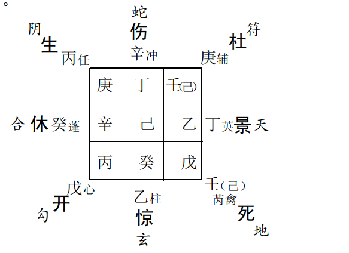

因为是预测上学的问题， 故首先看开门落宫情况。 今开门落艮八宫， 门宫相生， 格局戊加丙为“ 青龙返首”， 大吉之象， 于是
乎心里顿时松了口气， 乘勾陈虽为迟滞之象， 倒也无妨。
再看时干壬之落宫， 落乾六宫， 乘死门冲克巽四宫日干丙之落宫， 说明此送礼之事倒不利于我。 其原因何在呢， 以下是更进  

一步的分析。值符在此可看作是校长， 乘庚临天辅星正应学校教师之象。居坤二宫， 乘杜门和庚加壬“ 小格”， 可象征说明此校长严把不够入学条件的“ 说情关”， 而且不会轻易收受他人礼物。  此外， 我又查看了酒之类神落宫情况， 可以玄武为用。 又因此事为不正之物象类， 也应当以玄武参断。 今玄武落坎一宫， 格局乙加癸为“ 华盖逢星”， 断语亦告诫隐迹藏形为宜， 受值符庚之坤二宫所克， 象征即使把酒送过去， 校长也不会接受。  

那么， 他拒绝收受礼品的原因是什么呢？ 局中信息提示， 玄武礼品之坎一宫， 直接克制离九宫， 离九宫上乘伤门， 在此可代表影响， 群众反映等等， 此项信息可说明， 校长此人很注意群众影响和自身形象， 不会轻易接受他人礼品而有损自己的威信。事过之后， 逐渐和校长也混熟了， 最后才知道， 校长此人确实刚直不阿， 因群众威信很高， 工作作风优良， 除在此学校任职外， 还担任着市人大代表， 本区人大副主任等职。  

那么， 我们再分析一下几本书籍送去以后的结果会如何呢？以丁奇为类神， 落兑七宫， 受值符坤二宫所生， 说明校长对此以及对从事文化事业研究的人员可能会很感兴趣。 结果不出所料， 书送去之后， 我又说出了自己的事业和兴趣， 校长对我极为
热情， 我们就中国的传统文化和释道文化等题目， 谈论了整整一个上午。  

**例：**大师 妻子早晨一起床， 突然感觉到心里一阵难受， 不知所为何事， 于是起局预测。  

戊寅年乙卯月辛未日壬辰时， 阳遁九局用事， 甲申旬， 天芮星值符落巽四宫， 死门值使落坎一宫， 日干辛与值使同居坎一  宫， 时干壬在艮。  

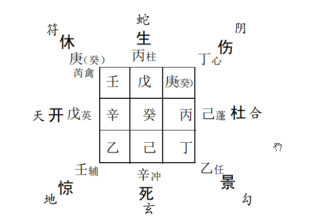

日干辛落坎一宫， 乘死门， 格局辛加己“ 入狱自刑， 奴仆背主， 讼狱难伸”， 说明此兆确实不是什么好事。
再看克我日干宫者， 一是艮八宫时干壬之落宫， 再就是坤二宫丁奇之落宫。 艮八宫壬之落宫乘惊门， 说明很可能是一些口舌、 官司、 惊疑类事， 又察壬加临乙奇之上， 乙为月干， 说明此事很可能出自兄弟或同事身上。 坤二宫丁奇为消息、 音信、 电话等， 另外亦可说明征兆应验的大致方位或时间。当日午后， 此事果然应验。 正是内弟因做生意亏了本， 于是， 从西南方向邯郸打来电话请求借款支援 

