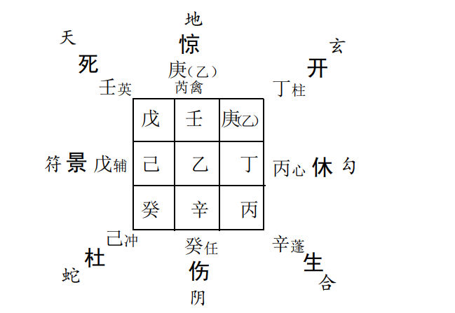
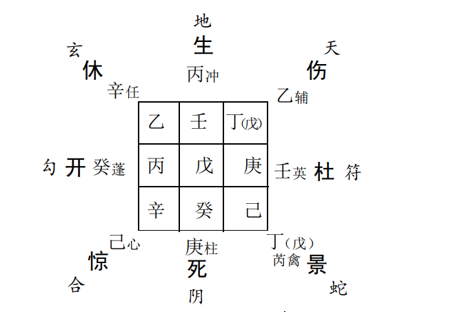
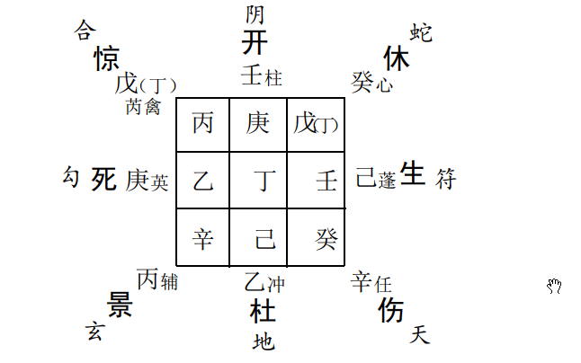
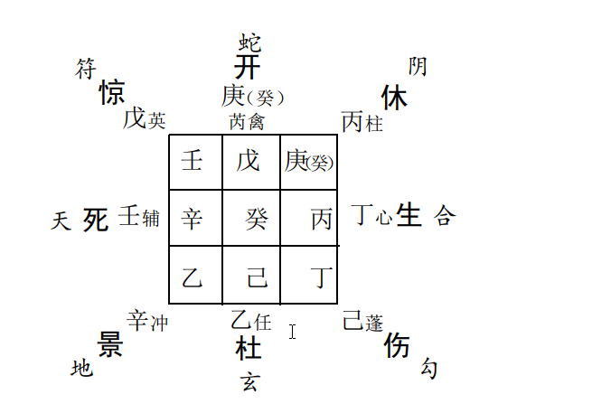
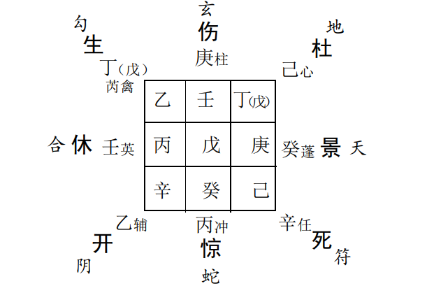

# 奇门动态类预测和分类应用  

## 奇门动态类预测的要略： 

注重用事方位的吉凶状况， 和天盘、 地盘星仪的主客生克关系， 以及所形成奇仪格局的善恶。
日、 时干等信息要素非动态类预测的关键因素， 可作为辅助信息参看。  它一般是即刻行动， 即刻起局预测  

## 第一节 寻亲访友、 来人善恶预测  

### 一、 寻亲访友预测  

以所往之方地盘星仪为主， 代表所要寻访之亲友， 天盘星仪， 为我。 若天地二盘比和， 则寻之必见。 如再得奇、 得吉格、 得
天地二盘奇仪相合， 则寻访愉快， 办事顺利， 亦或有酒食之喜。反之， 天地二盘相克， 格局亦凶， 则双方猜忌不见， 见亦不喜。 地
盘星干入墓者， 其人在家避而不见， 如空亡则其人确不在家。  

**例：** 一日， 准备去艮方某朋友之私人公司办点事， 即刻按时间起局， 看顺利与否？  

丙子年丁酉月甲戌日己巳时， 阴遁四局用事， 甲子旬， 天辅星值符落震三宫， 日干甲与值符同宫， 杜门值使落艮八宫， 时干己与之同宫。  

  

主要以艮宫星仪等信息推断。 天冲星为客为我， 地盘天任星为主为朋友， 今相互克制天冲星属木克天任星土星， 为不顺之
象其一。 格局己加癸为“ 地刑玄武”断语是“ 男女疾病垂危， 词讼有囚狱之灾”亦不为佳。 （ 其实， 正应朋友公司已停业关门之
象。 ）此又我出师办事不利的原因之二。最后， 看八门、 乘杜门， 也是阻隔不通之象， 日干己又入艮宫之墓， 说明“ 哪里也不要去， 还是老老实实在家呆着吧”。  

看了上述预测结果后， 当时我还是不太死心， 可是无论如何就是打不通电话， 和朋友联系不上， 等到第二天才打通了朋友家
里的电话， 并得知他已关门不干了。
又前面征兆类预测我去为孩子上学事找校长例， 当时也是出行东北艮方， 其实在这一格局中亦可以运用动态类预测方法
进行预测。 其时艮宫天盘星天心星为客、 为我， 地盘星天任星为主、 为校长， 天盘星得地盘星之生， 又格局“ 青龙返首”， 动作大  

利， 局象甚佳。 再者， 人盘又得开门生助， 故此， 必然出师无阻，谋事顺利。 这种将奇门静态预测和动态类预测溶合在一起， 穿
插运用的预测方法即为奇门综合预测， 其详细应用见后面章节内容， 在此不做深述  

### 二、 来人善恶预测  

以来时时间起局， 所来之方天盘星为来人为客， 地盘星为我， 为主。 天盘星得奇门生助地盘星者为贵客， 有益于我， 可见；
如天盘星克地盘星， 再加凶门凶格相乘者， 则必有损于我， 不必相见  。

**例：** 建设银行某分行行长殷某， 打电话说找我有点事情， 需帮助预测谋划一下， 随即以当时时间起得局象， 察看来人来意及
善恶等情况。 

 

戊寅年丙辰月丁酉日庚戌时， 阳遁五局用事， 甲辰旬， 天英星值符落兑七宫， 景门值使在乾六宫， 日干丁在乾， 时干庚在坎。  

行人时在艮宫， 故以艮宫星仪的信息提示， 分析来人的某些情况。天盘天心星为来人， 地盘天任星为我， 今地盘天任星生天心
星， 相互生合， 虽然是我生合客方， 但见天心星之为人清雅近贵，终非邪恶之辈， 故知尚可以做普通朋友交往。来人天心星属金， 概知其旺运必在巳酉丑年月， 近几年水木运恐声名狼籍。 天盘八门可说明其来意的有关情况， 今乘惊门，很可能是官司词讼、 惊恐忧疑之事。

实际情况是来人为女， 为此银行之前任行长，93年至95年在职， 现离任。 因在位期间， 经营管理不善， 致使此银行亿元信
贷资金流失拖欠， 其来意正是预测与某外地某工商银行的信贷官司一案  

## 第二节 迁移、 避难、 捕盗等预测  

### 一、 迁移吉凶  

以迁移时刻起得局象， 如迁移方得三奇、 三吉门， 并得天禽星、 天辅星、 天心星三吉星为值符生助， 俗称“ 吉星高照”， 则吉。
以时间而论， 天禽星值符， 四季皆吉， 天辅星值符， 春夏大利， 天心星值符， 秋冬大吉。 余星皆不利  

**例：** 石市某肉制品加工企业总经理崔!预测厂房搬迁事宜？  

乙亥年癸未月庚子日壬午时， 阴遁二局用事， 甲戌旬， 天蓬星值符落兑七宫， 值使休门落坤二宫， 日干庚在震， 时干壬在离。  

预测迁移得天蓬星值符不算吉利， 主盗耗、 遗失类恶事， 又主申子辰年月及北方市场稍有盈利。 新建厂房位原厂房之正
东， 奇门格局中， 正东方震三宫为死门天英星， 八神乘勾陈， 又皆主不利。 故此， 企业至今仍是惨淡经营， 不见红火气象。  

### 二、 避难何方

专以杜门决之， 看其落于何方， 即以其方避之。 再看所乘之干， 如逢戊和三奇， 则必遇贵人帮助潜避， 去无阻隔。 见庚小心
行事， 可以免凶， 见辛为天狱， 壬为地牢、 皆主不能逃脱， 见癸为天网之格， 临震、 巽、 乾、 兑不能逃， 余宫可脱。 案例从略  

### 三、 揖捕贼盗  

以案发时间起局， 视天蓬星或玄武之落宫急追捕之。 杀人取财者为贼寇， 以天蓬星为用。 只劫人财物者， 为小盗， 以玄武
为用。 能否捕获， 看局象之中是否逢年、 月、 日、 格， 逢格或杜门有格者定能捕获。  

**例**： 刘广赋《奇门预测学》例。1987年2月14日下午3点，王巧云家被盗， 罪犯持枪威胁失主后， 逃之夭夭， 预测其案件侦
破情况。 

行窃不伤人者以玄武为用， 但此处刘广斌以地盘玄武为用，我们认为这个问题值得商榷。 笔者以为这里的用神应该是天盘
玄武或辛干落宫， 而以辛干落宫又似乎更加贴切， 且恰与原案例实情相附。
那么， 为什么要以天盘辛干落宫为用呢， 大家可仔细分析一下原局象， 其暗藏的“ 天机”不难窥破。 日干甲（ 戊）可说明是钱
财、 贵人等方面的信息或事情， 加临地盘壬干之上， 壬为地牢， 可解作这是“ 捉捕、 追剿某种东西人或财物”的一种信息馈示。 那   

么， 所要捕捉的具体物象又是什么呢？ 可再看天盘壬干之地盘加临， 今天盘壬干加临地盘辛上， 辛常表示罪行、 凶犯等信息； 那
么， 这里的“ 天机”也就无疑是在告诉我们捕捉盗贼凶犯了。 所以说此案例之中， 我们以辛干落宫代表罪犯信息， 应该说似乎更加确切。
原案例其它几项推理， 凶犯逃往东北， 辛乙同宫， 凶犯有前科， 面色青黄， 身材瘦高， 地盘日干戊上乘庚干为日干逢格， 甲寅
月日可获等。  

### 四、 落座方位预测多人近期情况  

首先以九宫方位确定每个人的落坐宫位， 再分别以其落座宫位的八门吉凶， 格局善恶， 八神特性， 九星旺衰等信息， 结合实
际综合推断。  

**例**： 一日， 几位朋友闲坐， 都想预测一下近期运势， 于是起局以方位分别进行预测。  

丙子年癸巳月辛亥日己亥时， 阳遁五局用事， 甲午旬， 天任星值符与日干辛同落乾六宫， 生门值使落巽四宫， 时干己在坤。  

陈x， 某协会会长， 落坐巽四宫旺相之地， 乘生门， 格局丁加乙、 戊加乙甚佳， 说明其人近期事业及财运都不错， 天盘丁干应
其准备创办刊物一事， 加临地盘乙奇之上， 又恰应陈x正是主要找天盘乙奇所落之艮八宫郭x， 商讨创刊事宜。
郭x， 女， 某杂志社编辑， 落坐艮八宫， 首应天辅星文曲之象， 乘开门、 太阴， 说明其正在积极密谋筹划某项事业。 实际情
况是受陈x之委托， 筹划出版协会的刊物杂志。 格局乙加辛，“ 青龙逃走”， 可说明其具体工作过程中会出现许多不尽人意的问题。 实际情况是当时刊物刊号尚未通过审批， 印刷厂家也没有最后确定落实。 若问其运势， 因巳月艮宫可视为有气， 故其总的运势还算不错， 但难免在家庭生活或某些具体工作过程中易出现一些问题。  

崔x， 某贸易公司总经理， 落坐离九宫， 天柱星正象其人之  相貌性格， 干练、 开朗、 稍活泼、 能言、 声响。 巳月离宫亦乘旺相
气， 可说明此人之活动能量等综合情况不错， 在这些朋友之中仅次于巽宫之陈x， 乘伤门可说明其工作、 事业忙碌异常， 格局庚
加壬不佳， 象征其在某些具体方面忙无头绪， 杂乱无章， 且没什么实际效果。  

李x， 女， 某报社记者， 落坐兑七宫， 巳酉相合， 亦不做衰死论， 乘九天、 景门， 代表活动性、 文化性， 又可说明其近期很有可
能外出。 格局不佳， 运势一般。
陈x， 某刊物美术编辑， 落坐乾六宫， 巳月本宫衰死无气， 乘死门， 格局亦不佳， 说明这些人当中其近期运势最差。  

